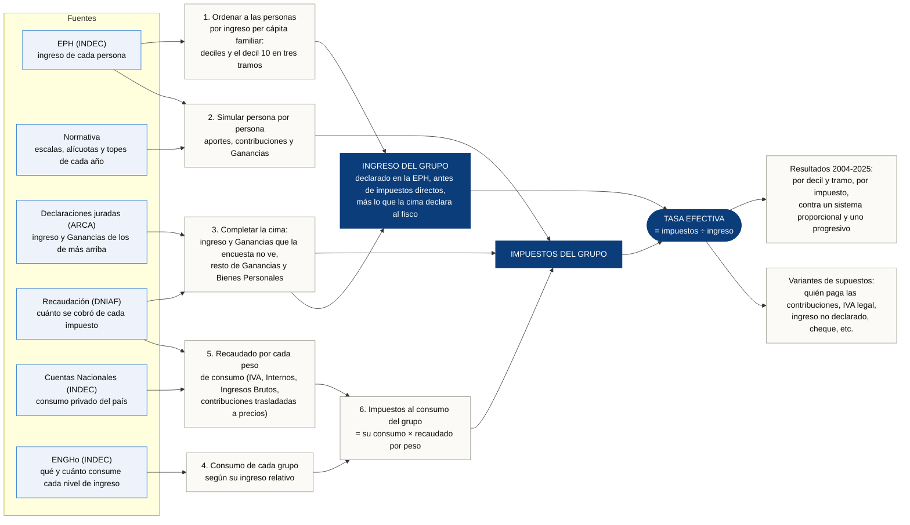
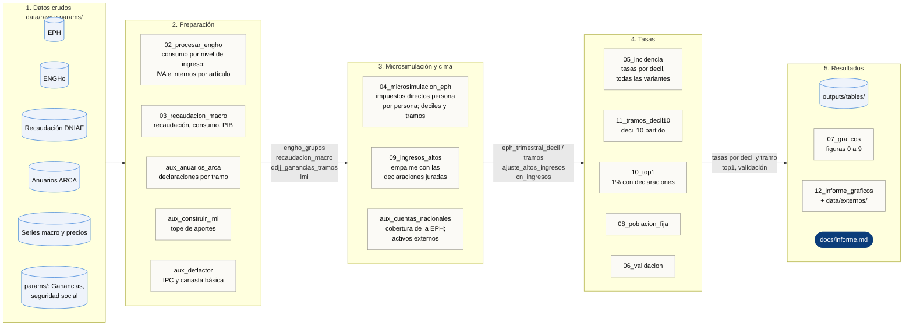

# Diagramas del proyecto

Dos diagramas: el primero explica **qué se calcula** (para cualquier lector); el segundo, **cómo
fluyen los datos** por los scripts del repositorio (para quien quiera reproducirlo o
modificarlo). GitHub los dibuja directamente. Qué es cada fuente: [glosario de fuentes](fuentes.md); el
método completo: [metodología](metodologia.md); los resultados: [informe](informe.md).

## 1. Cómo se calcula la tasa efectiva

La tasa efectiva de un grupo es **sus impuestos divididos por su ingreso**. Cada parte sale de
fuentes distintas:

**Cómo leerlo.**

- **Impuestos directos (paso 2):** a cada asalariado registrado y jubilado de la encuesta se le
  calculan los aportes, las contribuciones patronales y la Ganancias que le corresponden según la
  ley de ese año. Paso a paso, con ejemplos: [microsimulación](microsimulacion.md).
- **La cima (paso 3):** la encuesta casi no ve a los de más ingresos. Con las declaraciones
  juradas se les suma el ingreso que declaran al fisco y la Ganancias que pagan por él, y se
  reparte lo que falta de Ganancias y Bienes Personales.
- **Impuestos al consumo (pasos 4 a 6):** no se aplica la alícuota de la ley sino lo que
  efectivamente se recaudó por cada peso consumido, multiplicado por lo que consume cada grupo.
  Así se descuenta la evasión.

## 2. Flujo de datos en el repositorio

Cada caja es un script; las flechas entre etapas llevan los archivos principales.
`scripts/correr_todo.py` los corre en este orden.

**Qué usa cada script** (además de lo de la etapa anterior):

| Script | Lee | Escribe |
|---|---|---|
| `04_microsimulacion_eph` | EPH, `params/`, RIPTE, haber mínimo, SMVM | deciles y tramos con impuestos directos |
| `09_ingresos_altos` | salida de `04`, declaraciones por tramo, recaudación | `ajuste_altos_ingresos.csv` |
| `aux_cuentas_nacionales` | salida de `04`, recaudación, CGI, PII, dólar | `cn_ingresos.csv` |
| `05_incidencia` | `04`, `02`, `03`, `09`, `aux_cuentas_nacionales` | tasas por decil, todas las variantes |
| `11_tramos_decil10` | lo mismo, con los tramos | tasas del decil 10 partido |
| `10_top1` | declaraciones por tramo, `02`, `03`, `04`, `aux_cuentas_nacionales` | `top1.csv` |
| `08_poblacion_fija` | EPH de 2004 y 2017, `params/`, `02`, `03`, `09` | `serie_poblacion_fija.csv` |
| `06_validacion` | `04`, `02`, `03`, `09` | tablas de validación |
| `07_graficos` | tablas, `aux_deflactor` | `outputs/figures/` |
| `12_informe_graficos` | tablas, `data/externos/` | `outputs/figures/informe/` |

**Archivos intermedios** (`data/processed/`, no se versionan):

| Archivo | Lo escribe | Qué tiene |
|---|---|---|
| `eph_trimestral_decil.csv` | `04` | Por año, trimestre y decil: ingreso, personas e impuestos directos simulados |
| `eph_trimestral_tramos.csv` | `04` | Lo mismo con el decil 10 partido en P90-95, P95-99 y 1% |
| `eph_cola_alta.csv.gz` | `04` | Las personas de más ingreso, para el empalme con las declaraciones juradas |
| `engho_grupos.csv` | `02` | Consumo y canasta por veintil de ingreso relativo, por edición |
| `recaudacion_macro.csv` | `03` | Recaudación por impuesto, consumo privado, PIB y población, por año |
| `ddjj_ganancias_tramos.csv` | `aux_anuarios_arca` | Declaraciones juradas por tramo: casos, ingreso, impuesto, patrimonio |
| `ajuste_altos_ingresos.csv` | `09` | Ganancias e ingreso faltantes y cómo se reparten entre grupos |
| `cn_ingresos.csv` | `aux_cuentas_nacionales` | Cobertura de salarios e ingreso mixto; activos externos |
| `deflactor.csv` | `aux_deflactor` | IPC empalmado y canasta básica |

Las tablas finales (`outputs/tables/`) se describen al principio de cada script que las escribe.
