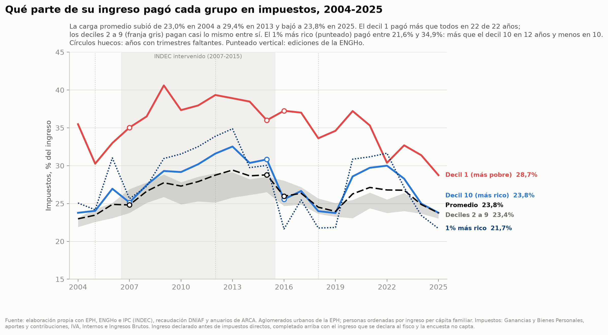
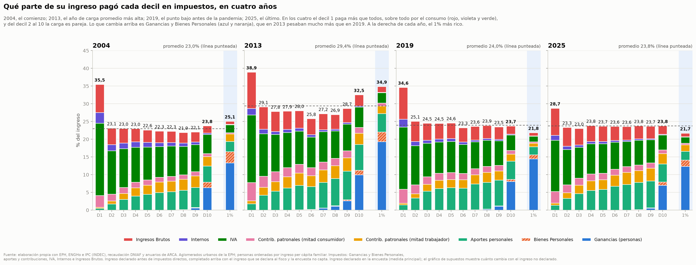
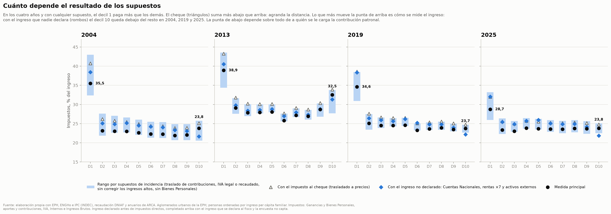
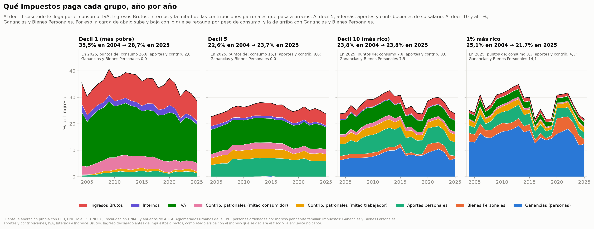
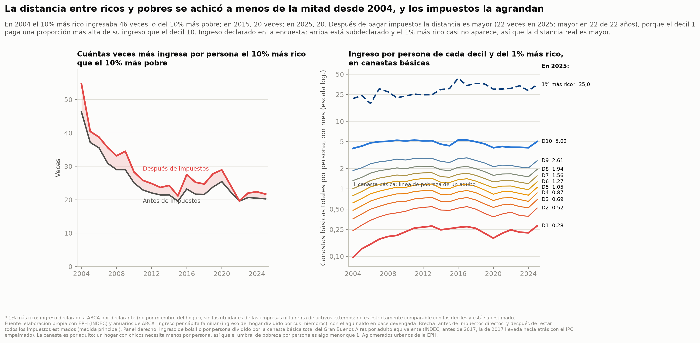
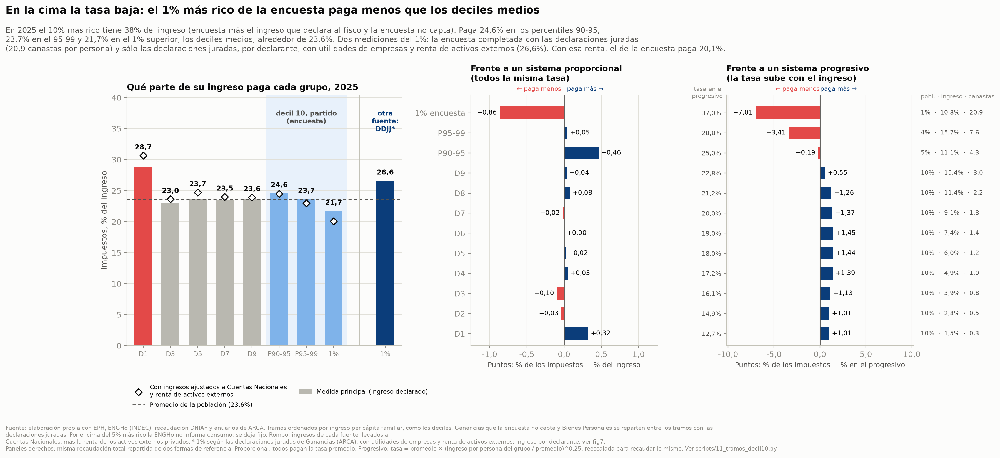
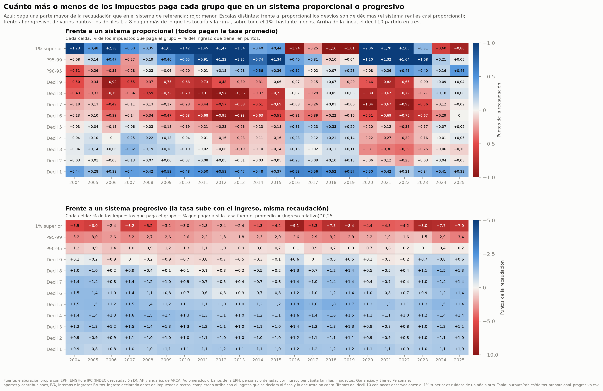
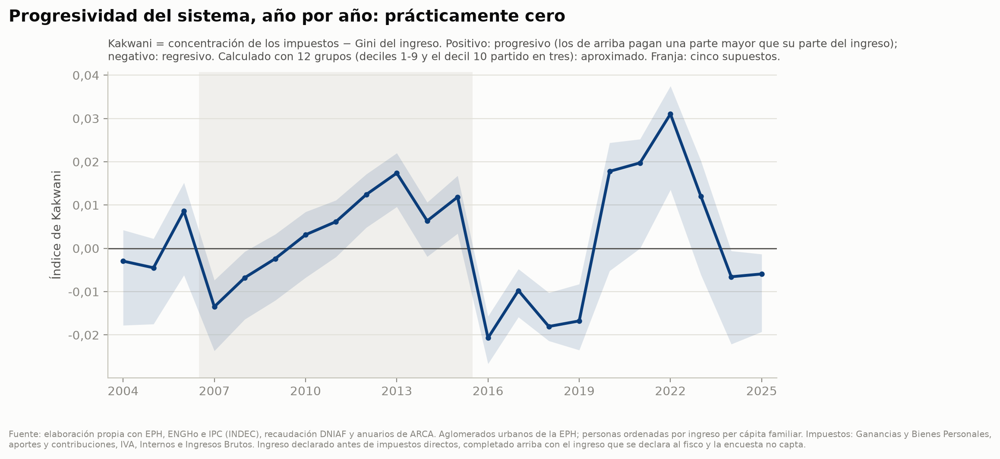
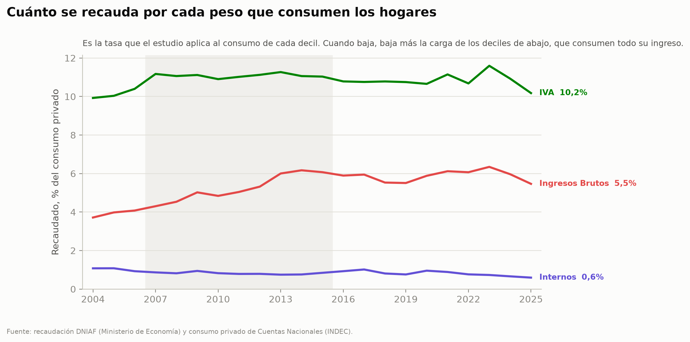
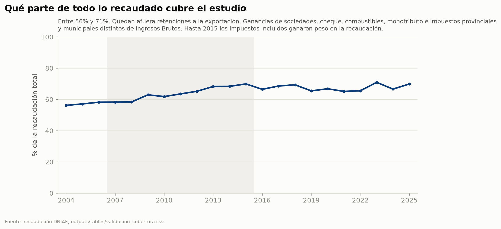

# Quién paga impuestos en Argentina, 2004-2025

**Informe de resultados.** Qué parte de su ingreso pagó en impuestos cada grupo de la población,
año por año, y cómo fue cambiando. Los gráficos se generan con `scripts/12_informe_graficos.py`
y están en `outputs/figures/informe/`. El método completo está en `docs/metodologia.md`.

## Resumen

- **El 10% más pobre paga la mayor proporción de su ingreso, todos los años.** Pasa en los 22 años
  y con todos los supuestos que miden lo mismo. En 2025 pagó 28,7% de su ingreso, contra 23,8% en
  promedio.
- **Esa distancia se achicó.** El decil 1 pagaba 12,5 puntos más que el promedio en 2004 y 5,0
  en 2025. Sobre todo bajó lo que paga por IVA (de 20,4 a 14,5 puntos).
- **Del decil 2 al 10 la carga es pareja.** En 2025, entre 23,0% y 23,8%. El sistema es casi
  proporcional: no cobra más, en proporción, a quien gana más.
- **El 1% más rico paga a veces más y a veces menos que el resto.** Entre 21,6% y 34,9% de su
  ingreso según el año: más que el decil 10 en 12 años y menos en 10. En 2025, 21,7%, por debajo de
  todos los deciles. Lo que lo mueve es Ganancias y Bienes Personales.
- **Ricos y pobres: los impuestos agrandan la distancia.** En 2004 el 10% más rico ingresaba 46
  veces lo del 10% más pobre; en 2025, 20 veces. Después de impuestos la distancia es mayor todos
  los años (22 veces en 2025), porque el más pobre paga una proporción más alta.
- **La carga promedio subió de 23,0% (2004) a 29,4% (2013) y volvió a 23,8% (2025).**

## 1. Qué se mide

**Tasa efectiva** = impuestos que paga un grupo ÷ su ingreso.

- **Grupos:** personas de los aglomerados urbanos de la EPH (65% de la población en 2025),
  ordenadas por ingreso per cápita familiar y agrupadas en deciles. El decil 10 además se parte en
  percentiles 90-95, 95-99 y el 1% superior.
- **Ingreso:** el que se declara en la EPH, antes de impuestos directos. Arriba se completa con el
  ingreso que se declara a ARCA y la encuesta no capta, junto con la Ganancias que paga.
- **Impuestos:** Ganancias y Bienes Personales, aportes personales, contribuciones patronales, IVA,
  Internos e Ingresos Brutos. Son entre 56% y 71% de todo lo recaudado (anexo, gráfico A3). El
  impuesto al cheque se suma como variante (sección 3). Quedan afuera retenciones a la exportación,
  Ganancias de sociedades, combustibles, monotributo e impuestos provinciales y municipales
  distintos de Ingresos Brutos (ver "Pendientes").
- **Anclado a lo recaudado:** los impuestos al consumo se reparten según lo que efectivamente se
  cobró por cada peso de consumo (anexo, gráfico A2), no según la alícuota legal.
- **Un año por vez, con el mismo método:** las reglas de Ganancias, aportes y contribuciones de
  cada año; la encuesta de gastos (ENGHo) de 2004/05, 2012/13 y 2017/18, interpolada entre
  ediciones.

## 2. Cuánto se paga y cómo cambió

La carga promedio sube de 23,0% en 2004 a 29,4% en 2013, baja a 24,0% en 2019, sube a 27,1% en
2021 y vuelve a 23,8% en 2025. El decil 1 está arriba de todos los grupos en los 22 años. Los
deciles 2 a 9 (franja gris) pagan casi lo mismo entre sí: en 2025 los separa menos de un punto.
El decil 10 va pegado al promedio, salvo en 2009-2015 y 2020-2023, cuando pagó entre 1,5 y 3,2
puntos más.

**El 1% más rico** (punteado) es el grupo que más se mueve: 25,1% en 2004, 34,9% en 2013, 21,8%
en 2019, 31,6% en 2022 y 21,7% en 2025. Sube cuando pesan Ganancias y Bienes Personales y baja
cuando pesan menos (sección 4). En 2009-2013 y 2020-2021 pagó más que cualquier decil salvo el 1,
y en 2022 más que todos; en 2016, 2018, 2019, 2024 y 2025, menos que todos. Es un grupo chico en la encuesta: los saltos de un solo
año (2006, 2016) son en parte ruido.

El período 2007-2015 (sombreado) es el de la intervención del INDEC: la EPH y los precios de esos
años son menos confiables. En 2007, 2015 y 2016 faltan trimestres de la EPH (círculos huecos).

**Cuatro años, impuesto por impuesto.** 2004 es el comienzo; 2013, el año de carga promedio más
alta; 2019, el punto bajo antes de la pandemia; 2025, el último. En los cuatro, el decil 1 paga más
que todos, casi todo por el consumo, y del decil 2 al 10 la carga es pareja. Lo que cambia entre
años es el tamaño de cada color: en 2013 los aportes y Ganancias pesaban más en toda la mitad de
arriba, y en 2025 el IVA pesa menos abajo que en 2004.

Las barras miden contra el ingreso que se declara en la encuesta (la medida principal de todo el
informe). Si además se suma el ingreso que nadie declara (rentas y activos en el exterior,
concentrados arriba), el decil 10 baja unos 2 puntos y queda debajo de todos los deciles; eso se
ve en el gráfico de supuestos de la sección 3 (rombos). Se eligió la medida declarada porque es
la que se puede calcular igual en los 22 años; la otra depende de multiplicadores que no se
observan.

## 3. Quién paga más, y qué tan firme es

Para ver si cambió la forma y no sólo el nivel, cada grupo se mide contra el promedio de su año.
El decil 1 pagaba 12,5 puntos más que el promedio en 2004, alrededor de 10 entre 2007 y 2020, y
entre 3,6 y 6,5 desde 2022 (5,0 en 2025). La caída de 2004 a 2025 aparece con todos los supuestos.
El decil 10 oscila entre 3,2 puntos arriba (2022) y medio punto abajo (2018) del promedio.

**Cuidado con 2009.** El pico del decil 1 (12,9 puntos, 40,6% de su ingreso) depende de cómo se
combinan las ediciones de la ENGHo: con la de 2004/05 hasta 2011 en vez de interpolarla, da 4,9
puntos. Lo firme es la tendencia, no el valor de un año.

El mapa muestra los 22 años y los 12 grupos. Azul es pagar más que el promedio de ese año; rojo,
menos (los mismos colores que la matriz de la sección 5). El decil 1 es azul todos los años. Los deciles 6 a 8 son los que más seguido pagan menos que
el promedio (hasta 3 puntos en 2012-2013 y 2020-2023). La cima del decil 10 alterna.

**Cuánto depende de los supuestos.** En los mismos cuatro años, cada decil con su rango entre
supuestos de incidencia (franja), la medida principal (punto), el cheque (triángulo) y el ingreso no
declarado (rombo).

- El decil 1 paga más que los deciles 2 a 9 con cualquier supuesto, en los 22 años.
- Su nivel es lo más incierto: la franja (entre 26% y 33% en 2025) depende sobre todo de a quién
  se le carga la contribución patronal.
- Arriba, lo que más pesa es cómo se mide el ingreso: con el ingreso que nadie declara, el decil 10
  pasa a 21,8% en 2025, debajo de todos los demás.

**El impuesto al cheque.** La medida principal no lo incluye; la variante lo suma suponiendo que se
traslada entero a precios y repartiéndolo según el consumo, como Ingresos Brutos (lo recaudado es
entre 2,3% y 2,6% del consumo privado).

| Puntos que agrega | Prom. | D1 | D2 | D3 | D5 | D8 | D10 |
|---|---|---|---|---|---|---|---|
| 2004 | +1,8 | +5,2 | +3,1 | +2,7 | +2,3 | +2,0 | +1,4 |
| 2012 | +1,8 | +4,6 | +2,8 | +2,5 | +2,1 | +1,8 | +1,4 |
| 2018 | +1,4 | +3,4 | +2,3 | +1,9 | +1,8 | +1,5 | +1,0 |
| 2025 | +1,5 | +3,3 | +2,3 | +2,0 | +1,8 | +1,6 | +1,0 |

Es regresivo: al decil 1 le suma tres veces más que al decil 10, porque consume todo su ingreso y
el 10 ahorra. Agranda la distancia entre ellos en unos 2 puntos, pero no cambia la forma ni la
tendencia. Es la lectura más regresiva posible: parte del cheque la pagan empresas y quienes más
usan el sistema bancario, que están más arriba.

## 4. Qué impuestos paga cada grupo, y por qué cambió

Cada grupo paga impuestos distintos, y por eso cada uno se mueve por razones distintas.

| Puntos de su ingreso | Ganancias | Bienes Pers. | Aportes | Contrib. (trabajador) | Contrib. (precios) | IVA | Internos | Ingresos Brutos | **Total** |
|---|---|---|---|---|---|---|---|---|---|
| Decil 1, 2004 | 0,0 | 0,0 | 0,5 | 0,3 | 3,3 | 20,4 | 3,1 | 7,9 | **35,5** |
| Decil 1, 2025 | 0,0 | 0,0 | 1,4 | 0,6 | 3,2 | 14,5 | 1,4 | 7,6 | **28,7** |
| Decil 5, 2004 | 0,0 | 0,0 | 4,5 | 2,6 | 1,5 | 9,3 | 1,3 | 3,5 | **22,6** |
| Decil 5, 2025 | 0,0 | 0,0 | 5,9 | 2,7 | 1,8 | 8,3 | 0,6 | 4,3 | **23,7** |
| Decil 10, 2004 | 6,3 | 1,6 | 4,5 | 2,7 | 0,9 | 5,4 | 0,4 | 2,0 | **23,8** |
| Decil 10, 2025 | 7,0 | 1,0 | 5,1 | 2,9 | 1,0 | 4,2 | 0,2 | 2,4 | **23,8** |
| 1% más rico, 2004 | 13,3 | 3,2 | 2,9 | 2,1 | 0,4 | 2,2 | 0,1 | 0,9 | **25,1** |
| 1% más rico, 2013 | 19,3 | 2,7 | 5,2 | 2,1 | 0,8 | 2,9 | 0,1 | 1,6 | **34,9** |
| 1% más rico, 2025 | 12,4 | 1,8 | 2,5 | 1,8 | 0,4 | 1,8 | 0,1 | 1,0 | **21,7** |

- **Decil 1: consumo.** IVA, Ingresos Brutos, Internos y la parte de las contribuciones que pasa
  a precios son 26,8 de sus 28,7 puntos en 2025. Su baja desde 2004 es casi toda IVA (−5,9 puntos)
  e Internos (−1,7). Dos razones: el IVA cobrado por cada peso de consumo bajó de 11,6% en 2023 a
  10,2% en 2025 (anexo, A2), y el decil 1 gasta hoy menos en relación con lo que declara ganar:
  2,2 veces su ingreso en 2004, 1,4 en 2025.
- **Decil 5: consumo y salario.** Paga casi lo mismo por consumo que por aportes y contribuciones
  de su salario registrado. Subió en 2008 cuando terminaron las AFJP (los aportes pasan a contar
  como impuesto) y su total cambió poco en el período.
- **Decil 10: un poco de todo.** En 2025, 7,8 puntos de consumo, 8,0 de aportes y contribuciones y
  7,9 de Ganancias y Bienes Personales. Tiene la misma tasa que el decil 5 con impuestos distintos.
  Subió en 2009-2015 y 2020-2022 por Ganancias y aportes; coincide con años en que el piso de
  Ganancias quedó atrás de los salarios.
- **1% más rico: Ganancias y Bienes Personales.** Son 14,1 de sus 21,7 puntos en 2025 y 22,0 de
  34,9 en 2013. Por eso su tasa sigue a las leyes de esos dos impuestos (hitos, al final): baja en
  2016-2019 (baja de alícuotas de Bienes Personales y blanqueo), sube en 2020-2022 (suben las
  alícuotas) y vuelve a bajar en 2024-2025.

## 5. Ricos y pobres

**La distancia de ingresos se achicó y los impuestos la agrandan.** En 2004 el 10% más rico
ingresaba por persona 46 veces lo del 10% más pobre; en 2015, 20 veces; en 2025, 20. Después de
pagar impuestos la distancia es mayor en los 22 años (22 veces en 2025), porque el decil 1 paga una
proporción más alta de su ingreso que el decil 10. El sistema tributario, sin contar el gasto
público, no achica la desigualdad: la agranda un poco.

A la derecha, el ingreso por persona en canastas básicas (la línea de pobreza de un adulto). En
2025 el decil 1 tiene 0,28 canastas por persona por mes; el decil 5, 1,05; el decil 10, 5,0; el 1%
más rico según las declaraciones juradas, 35. Es ingreso declarado: arriba está subdeclarado, así
que la distancia real es mayor.

**Adentro del 10% más rico.** El decil 10 mezcla a asalariados de clase media alta con los ricos.
Partido en tres, en 2025 los percentiles 90-95 pagan 24,6%, los 95-99, 23,7% y el 1% superior,
21,7%: en la cima la tasa baja.

Los dos paneles de la derecha muestran lo mismo de otra forma. Se toma lo recaudado y se pregunta
cómo se repartiría si el sistema fuera:

- **Proporcional** (todos pagan la tasa promedio): las barras son la parte de los impuestos que paga
  cada grupo menos su parte del ingreso. Están todas cerca de cero: el sistema real es casi
  proporcional. El que más se aleja es el 1% superior, que paga 0,9 puntos menos de lo que le
  tocaría.
- **Progresivo** (la tasa sube con el ingreso, de 12,7% en el decil 1 a 37,0% en el 1%): con la
  misma recaudación, el decil 1 al 9 pagarían menos y la cima bastante más. El 1% superior paga 7
  puntos de la recaudación menos que en ese sistema; los deciles 1 a 9, entre 0,6 y 1,5 puntos más
  cada uno.

**Los mismos dos deltas, año por año.** Cada celda es la parte de la recaudación que paga el grupo
menos la que pagaría en el sistema de referencia, en puntos (azul: paga más; rojo: paga menos).
Tabla: `outputs/tables/deltas_proporcional_progresivo.csv`.

- **Frente al proporcional** los desvíos son de décimas: el sistema real reparte casi igual que uno
  donde todos pagan la misma tasa. El decil 1 paga más que su parte del ingreso los 22 años (entre
  0,2 y 0,6 puntos). Los deciles 6 a 9 pagan menos casi siempre. El 1% superior paga más en 16 años
  (hasta 2,4 puntos) y menos en 2016-2019, 2024 y 2025.
- **Frente al progresivo** los desvíos son de varios puntos: los deciles 1 a 7 pagan más de lo que
  les tocaría todos los años (hasta 1,8 puntos), y el 1% superior paga entre 2,4 y 9,1 puntos
  menos, también todos los años. Lo que falta arriba es lo que sobra abajo y en el medio.

Para llegar acá la encuesta se completa con las declaraciones juradas de Ganancias: a las personas
de arriba se les suma el ingreso que declaran a ARCA y la encuesta no ve (con sus rentas exentas) y
la Ganancias que pagan. Con eso, la Ganancias del 1% de la encuesta coincide con la del 1% de las
declaraciones (2024: 12,0% contra 11,7% de su ingreso).

**Dos medidas del 1%.** La de este gráfico (barras celestes) es el 1% de la encuesta, completado.
La barra azul oscuro estima el 1% sólo con declaraciones juradas, por declarante, y le suma la mitad
de las utilidades de las empresas y del impuesto de sociedades: da 26,6% en 2025. No son el mismo
grupo ni la misma cuenta. El mismo gráfico para cada año está en `outputs/figures/por_anio/`.

## 6. Comparación y limitaciones

**Contra Argendata (Pessino, Rasteletti, Artana y Lustig, BID 2023), ~2018:**

| Decil | 1 | 2 | 3 | 5 | 9 | 10 |
|---|---|---|---|---|---|---|
| Argendata | 35,8 | 30,8 | 27,8 | 25,6 | 24,2 | 24,9 |
| Este estudio, 2018 | 33,6 | 25,3 | 25,0 | 25,7 | 24,5 | 24,0 |
| Este estudio, 2018, con cheque | 37,1 | 27,6 | 27,0 | 27,5 | 25,9 | 25,0 |

La forma coincide: el decil 1 paga mucho más y del 3 al 10 la carga es pareja. Con el cheque, que
ellos incluyen, los deciles 1 y 10 quedan casi iguales a los suyos. Las diferencias que quedan
vienen de otros impuestos (ellos suman otros impuestos en cascada y derechos de importación, que
pesan más abajo) y de la definición de ingreso (ellos incluyen el alquiler imputado de la vivienda
propia). Lo que agrega este estudio es la serie de 22 años y el interior del decil 10.

**Limitaciones:**

- Sólo aglomerados urbanos de la EPH; el resto del país es en promedio más pobre.
- 2007-2015: datos del INDEC intervenido.
- 2025 usa las declaraciones juradas de 2024 actualizadas (las de 2025 todavía no se publicaron).
- El 1% superior de la encuesta tiene pocas observaciones: sus saltos de un año (2006, 2016) son en
  parte ruido.
- No se tiene en cuenta que en los comercios informales se paga menos IVA, lo que haría menos
  pesada la carga de abajo.
- No se reparten Ganancias de sociedades ni retenciones a la exportación entre los deciles (ver
  "Pendientes").

### Pendientes

**Ganancias de sociedades (2,4% del PIB en 2025; entre 2,4% y 3,1% en la serie).** No se suma a la
medida principal por tres razones:

1. **No se sabe bien quién lo paga.** Lo paga la empresa, pero el costo puede recaer en los dueños
   (menos ganancia), en los trabajadores (menos salario) o en los consumidores (más precio). La
   literatura usa escenarios (100% a los dueños del capital, o 50% capital y 50% trabajo) y el
   resultado de la cima depende de cuál se elija.
2. **Sumarlo bien exige sumar también las utilidades al ingreso de los dueños.** Si se suma sólo el
   impuesto, la tasa de la cima se infla (es el mismo error que se corrigió con la Ganancias de
   personas: impuesto sin el ingreso que lo genera). Con las utilidades, esa parte paga cerca del
   30% y el efecto es mucho menor: en el 1% de las declaraciones juradas (figura 7) sumar la mitad
   del impuesto y de las utilidades casi no cambia su tasa (30,2% sin sociedades, 30,1% con).
3. **No hay datos de quién es dueño de qué.** Ni la EPH ni las declaraciones juradas publicadas dicen
   cuántas acciones o participaciones tiene cada persona.

**Cómo se agregaría.** Como variantes, con una sola perilla: quién paga cada peso del impuesto. A
quien lo paga se le suman a la vez el impuesto y el ingreso que tendría sin el impuesto, como en la
corrección de la Ganancias de personas. Cuatro escenarios:

| Escenario | Capital | Trabajo | Consumidores |
|---|---|---|---|
| Todo al capital | 100% | | |
| Mitad capital, mitad trabajo | 50% | 50% | |
| Todo al trabajo | | 100% | |
| Todo a precios | | | 100% |

- **Parte del capital (los dueños).** Impuesto: su parte de la recaudación, menos la que corresponde
  a dueños del exterior (aproximada con la inversión extranjera directa de la Posición de inversión
  internacional del INDEC). Ingreso: las utilidades antes del impuesto (impuesto ÷ alícuota), que
  son ingreso de los dueños aunque la empresa no las reparta. La alícuota va año por año en
  `params/`: 35% hasta 2017, 30% en 2018-2020, escala de 25/30/35% desde 2021 (Ley 27.630). A quién:
  primero con las proporciones del empalme con las declaraciones juradas (como la Ganancias que la
  encuesta no capta); mejor, con las rentas de negocios por tramo de los anuarios de ARCA, si vienen
  separadas; las ganancias de negocios de la EPH pueden dar la forma en los deciles medios.
- **Parte del trabajo (salarios más bajos).** Se trata como un impuesto al salario: tasa = su parte
  de la recaudación ÷ la masa salarial privada registrada del país; a cada decil, esa tasa × su masa
  salarial privada registrada, como impuesto y también como ingreso (es salario que habría cobrado).
  No alcanza a informales, empleados públicos ni jubilados.
- **Parte de los consumidores (precios más altos).** Como la mitad de las contribuciones patronales
  que pasa a precios: recaudación por peso de consumo privado × el consumo de cada decil.

**Qué se espera.** El nivel sube unos 3 puntos en cualquier escenario (2,4% a 3,1% del PIB).

- Todo al capital: sube la cima; el 1% de la encuesta (21,7% en 2025) se acerca al 30%, porque esa
  parte paga más que su promedio, y su parte del ingreso crece mucho (las utilidades son del orden
  de 8% del PIB). Los deciles 1 a 8 casi no cambian.
- Todo al trabajo: recae en los deciles con empleo privado registrado (4 a 10) y sube varios puntos
  a los del medio; el decil 1 casi no cambia. El perfil queda con una joroba en el medio.
- Todo a precios: regresivo, como el IVA.
- Mitad y mitad: entre los dos primeros.

**Dónde se toca el código.** `params/` (alícuota por año); `src/incidencia/incidencia.py` (un campo
de `Variante` con el reparto entre capital, trabajo y precios; un impuesto `sociedades`; el cálculo
de cada parte); `scripts/09_ingresos_altos.py` (el reparto de la parte del capital si se usan las
rentas de negocios); `scripts/05_incidencia.py` y `scripts/11_tramos_decil10.py` (las cuatro
variantes); el informe (una subsección como la del cheque). No hace falta volver a correr la
microsimulación de la EPH.

**Otros impuestos que quedan afuera:**

- **Combustibles (0,6% del PIB en 2025)** está como variante: se reparte según el consumo total de
  cada decil. Le llega a los hogares por dos vías: directa (la nafta del auto propio, que crece con
  el ingreso) e indirecta (el gasoil del transporte de carga y de pasajeros, de la producción
  agropecuaria y de la industria, que encarece casi todo lo que se compra). Repartirlo según el
  consumo total representa bien la vía indirecta y exagera algo lo regresivo de la directa. Le suma
  1,1 puntos al decil 1 y 0,3 al decil 10 en 2025 (3,7 y 0,9 en 2004, cuando el impuesto pesaba el
  doble). Para separar las dos vías haría falta el gasto en combustible de la ENGHo y una matriz
  insumo-producto.
- **Impuestos provinciales distintos de Ingresos Brutos** (inmobiliario, automotor, sellos; 1,0% a
  1,4% del PIB): habría que conseguir la recaudación separada por impuesto y repartir el inmobiliario
  según la propiedad de la vivienda, el automotor según la tenencia de autos y sellos a precios.
  Sumaría entre 1 y 2 puntos, bastante parejo.
- **Tasas municipales:** no hay una serie nacional de recaudación.
- **Retenciones a la exportación:** no está claro si las pagan los productores o los consumidores
  internos, con precios de alimentos más bajos.
- **Monotributo (0,04% a 0,15% del PIB):** suma menos de medio punto en el decil 1 y una décima en el
  resto.

## Anexo

**A1. Progresividad.** El índice de Kakwani compara cómo se reparten los impuestos con cómo se
reparte el ingreso. Va entre −0,021 (2016) y +0,031 (2022): prácticamente cero, con cambios de
signo. El sistema no redistribuye ingreso: cobra a cada grupo más o menos lo que le toca según su
parte del ingreso. Tabla: `outputs/tables/progresividad_anual.csv`.

**A2. Recaudado por peso de consumo.** Es la tasa que el estudio aplica al consumo de cada grupo.
El IVA pasó de 9,9% del consumo privado en 2004 a 11,6% en 2023 y 10,2% en 2025; Ingresos Brutos,
de 3,7% a 6,2% en 2014 y 5,5% en 2025.

**A3. Cobertura.** Qué parte de todo lo recaudado entra en el estudio: entre 56% (2004) y 71%.

### Hitos de política tributaria

Coincidencias en el tiempo, no causas demostradas:

| Año | Hecho | Dónde se ve |
|---|---|---|
| 2008 | Fin de las AFJP: los aportes pasan al Estado | Aportes del decil 5 (sección 4) |
| 2013 | Dto. 1242/2013: piso de Ganancias para asalariados | Ganancias del decil 10 |
| 2016 | Ley 27.260: baja de alícuotas de Bienes Personales y blanqueo | Bienes Personales y el 1% (sección 4) |
| 2019-2020 | Ley 27.541: suben las alícuotas de Bienes Personales | Bienes Personales y el 1% (sección 4) |
| 2021 | Ley 27.617: suben los mínimos de Ganancias | Ganancias del decil 10 |
| 10/2023-06/2024 | Régimen cedular: casi todos los asalariados dejan de pagar Ganancias | Ganancias del decil 10 |
| 2024 | Ley 27.743: vuelve Ganancias a asalariados y bajan las alícuotas de Bienes Personales | Ganancias y Bienes Personales |
