# Quién paga impuestos en Argentina, 2004-2025

*Los gráficos se generan con `scripts/14_informe_graficos.py` y están en
`outputs/figures/informe/`.*

Este informe estima qué parte de su ingreso paga en impuestos cada grupo de la población argentina,
año por año entre 2004 y 2025. La medida es la **tasa efectiva**: lo que un grupo paga en
impuestos dividido por su ingreso. No es la alícuota que fija la ley, sino lo que efectivamente
pagan sus miembros sumando todos los impuestos que alcanzan.

El recorrido es el siguiente. Primero se compara el resultado con los dos estudios más citados
sobre el tema (sección 1). Después se presenta la tasa de cada decil con los datos más firmes del
proyecto (sección 2). La sección 3 muestra por qué los deciles no alcanzan para ver a quienes más
ganan, y la 4 parte el decil 10 y explica cómo se completa el ingreso que las encuestas no captan.
Con ese grupo separado, la sección 5 vuelve a mirar la evolución en el tiempo, la 6 compara el
sistema con uno proporcional y uno progresivo, y la 7 resume la distancia entre los de arriba y
los de abajo. La sección 8 prueba cada resultado con otros supuestos, la 9 resume las limitaciones
y la 10 presenta las conclusiones. El anexo tiene la figura de cada año y el control del 1% con las
declaraciones juradas.

## 1. Lo que muestran otros estudios

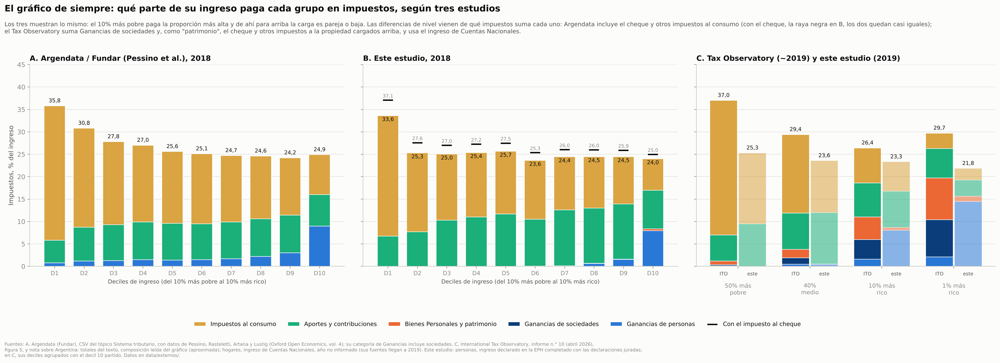

**Figura 1.** El gráfico de siempre: tres estudios, el mismo perfil por deciles.

La forma habitual de mostrar quién paga impuestos es una barra por decil con la parte de su
ingreso que se va en impuestos. La figura 1 pone lado a lado los dos estudios más citados para
Argentina y este:

- **A. Argendata (Fundar)**, con datos de Pessino, Rasteletti, Artana y Lustig, para 2018: el decil 1
  paga 35,8% y el decil 10, 24,9%.
- **B. Este estudio**, mismo año: el decil 1 paga 33,6% y el decil 10, 24,0%.
- **C. International Tax Observatory (ITO)**, informe de abril de 2026. No usa deciles sino cuatro
  grupos: el 50% más pobre paga 37%, el 40% del medio 29%, el 10% más rico 25% y el 1% más rico
  alrededor de 30%. Al lado, este estudio con los mismos cuatro grupos en 2019: 25,3%, 23,6%, 23,3% y
  21,8%.

Los tres estudios coinciden en la forma de la parte de abajo: el 10% más pobre paga la proporción
más alta de su ingreso. Los niveles difieren porque cada estudio suma impuestos distintos y mide el
ingreso de otra forma:

| | Argendata | ITO | Este estudio |
|---|---|---|---|
| Año | 2018 | no lo dice (sus fuentes llegan a 2019) | 2004 a 2025, cada año |
| Unidad | personas | hogares | personas |
| Ingreso | encuesta | Cuentas Nacionales (más alto que la encuesta) | encuesta, completada arriba con las declaraciones juradas |
| Impuesto al cheque | sí (como impuesto "en cascada") | sí, dentro de "patrimonio", cargado arriba | como variante, cargado a precios (raya negra en B) |
| Ganancias de sociedades | sí | sí | no |
| Impuestos al patrimonio | no | sí | Bienes Personales |

Con el impuesto al cheque, este estudio queda casi igual a Argendata en las dos puntas (2018: decil
1, 37,1% contra 35,8%; decil 10, 25,0% contra 24,9%). En el IVA las dos estimaciones coinciden casi
decil por decil (decil 1: 16,7 contra 16,5 puntos; decil 5: 8,8 contra 8,8). Las diferencias que
quedan vienen de "otros impuestos indirectos" que Argendata suma (probablemente derechos de
importación y combustibles, entre otros) y de que reparte Ganancias de sociedades entre todos los
deciles.

Con el ITO, la diferencia está en las puntas. Abajo, el ITO le carga al 50% más pobre unos 30
puntos de impuestos al consumo, contra unos 18 de este estudio; no pudimos verificar de dónde sale
esa diferencia. Arriba, el 1% del ITO llega a 30% porque suma Ganancias de sociedades (unos 8
puntos) y bastante patrimonio (unos 9); este estudio no reparte el impuesto de sociedades.

El "patrimonio" del ITO no es sólo Bienes Personales. Sigue la clasificación internacional de la
OCDE, en la que "impuestos a la propiedad" incluye el impuesto al cheque. En 2019 esa categoría sumó
2,6% del PIB: cheque 1,6, sellos 0,4, inmobiliario 0,4 y Bienes Personales 0,14. El ITO la reparte
pesando más arriba; este estudio carga el cheque a los precios, donde pesa más abajo. Es la
diferencia de supuestos más importante en la cima y no está resuelta: parte del cheque la pagan
quienes consumen y parte quienes más mueven dinero en los bancos (`docs/metodologia.md`, sección 15).

## 2. Qué parte de su ingreso paga cada decil

### Qué se mide

**La población.** Las personas que viven en los aglomerados urbanos que releva la Encuesta
Permanente de Hogares (EPH) del INDEC: 65% de la población del país en 2025. La EPH es una encuesta
trimestral que pregunta a cada miembro del hogar cuánto ganó y de qué fuentes. El dato de cada año
es el promedio de sus trimestres.

**Cómo se ordena.** Cada persona tiene el ingreso per cápita familiar de su hogar: el ingreso de
todos sus miembros dividido por la cantidad de miembros. Se ordena a la población de menor a mayor
según ese ingreso y se la divide en diez grupos del mismo tamaño, los **deciles**. El decil 1 es el
10% de menores ingresos; el decil 10, el 10% de mayores ingresos.

**El ingreso (el denominador).** El que declara cada persona en la encuesta, llevado a antes de
impuestos directos: al ingreso de bolsillo se le suman los aportes personales, la Ganancias
retenida y la parte de las contribuciones patronales que recae sobre el trabajador. En la cima,
este ingreso se completa con el que se declara a ARCA y la encuesta no capta; cómo se hace se
explica en la sección 4.

**Los impuestos (el numerador).** Se incluyen siete, que suman entre 56% y 71% de todo lo que
recaudó el país según el año (70% en 2025). Para cada uno hay que decidir quién lo paga, y la
decisión no siempre es quien lo deposita:

- **Aportes personales** (jubilación y PAMI). Se calculan persona por persona para cada asalariado
  registrado de la encuesta, con las alícuotas y topes de cada mes.
- **Contribuciones patronales.** Las deposita el empleador, pero su costo se reparte: la mitad recae
  en el trabajador, que cobra un salario menor, y la mitad en los consumidores, a través de los
  precios. La primera mitad se carga a cada asalariado registrado; la segunda, a cada decil según
  su consumo.
- **Ganancias de personas.** Se simula con la ley de cada año para asalariados registrados y
  jubilados. La encuesta no capta bien a quienes pagan Ganancias por otras rentas; la diferencia
  con lo recaudado se completa con las declaraciones juradas (sección 4).
- **Bienes Personales.** Se reparte según el patrimonio declarado en las declaraciones juradas, que
  se concentra en el decil 10.
- **IVA, Internos e Ingresos Brutos.** Se pagan al comprar, así que para saber cuánto paga cada
    decil hace falta saber cuánto consume. El cálculo tiene tres pasos.
    1. *Cuánto se cobra por cada peso que se consume.* Se toma lo que el Estado recaudó en el año con
    estos tres impuestos, según la Dirección Nacional de Investigaciones y Análisis Fiscal del
    Ministerio de Economía, y se lo divide por todo lo que consumieron los hogares del país, según
    las Cuentas Nacionales del INDEC. En 2025 se cobraron $16,2 por cada $100 de consumo ($10,2 de
    IVA, $5,5 de Ingresos Brutos y el resto de Internos).
    2. *Cuánto consume cada decil.* La EPH pregunta cuánto gana cada persona, pero no cuánto gasta.
    Ese dato sale de otra encuesta del INDEC, la Encuesta Nacional de Gastos de los Hogares (ENGHo,
    ediciones 2004/05, 2012/13 y 2017/18), que pregunta las dos cosas. De la ENGHo se toma cuánto
    consumen los hogares de cada nivel de ingreso, y eso se aplica al decil de la EPH que está en
    el mismo nivel.
    3. *Cuánto paga cada decil.* Su consumo multiplicado por lo que se cobra por peso. En el IVA se
    ajusta además según qué compra cada decil, porque unos productos pagan 21%, otros 10,5% y otros
    están exentos.

    Como el punto de partida es lo que efectivamente se recaudó y no la alícuota de la ley, no se
    cuenta como pagado el impuesto que se evade.

Quedan afuera Ganancias de sociedades, retenciones a la exportación, impuesto al cheque,
combustibles, monotributo, impuestos provinciales distintos de Ingresos Brutos y tasas municipales.
Ganancias de sociedades queda afuera porque no se sabe quién la paga (los dueños, los trabajadores
o los consumidores) ni hay datos de quién es dueño de qué empresa. El cheque, los combustibles y el
monotributo se calcularon como variantes y no cambian la forma de los resultados.

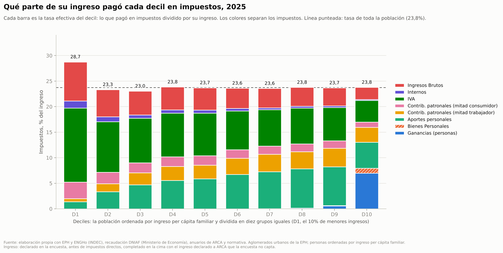

**Figura 2.** Qué parte de su ingreso pagó cada decil en impuestos, 2025.

La figura 2 muestra el resultado para 2025. Cada barra es un decil; su altura es la tasa efectiva y
los colores separan los impuestos. La línea punteada es la tasa de toda la población, 23,8%.

El decil 1 paga 28,7% de su ingreso, cinco puntos más que el promedio. Del decil 2 al 10 la tasa es
casi la misma: entre 23,0% y 23,8%. Lo que cambia entre deciles es con qué se paga. En el decil 1,
26,8 de los 28,7 puntos son impuestos al consumo: IVA, Ingresos Brutos, Internos y la mitad de las
contribuciones que pasa a precios. Ese peso se explica porque el consumo estimado del decil 1 es
1,4 veces el ingreso que declara en la EPH, y paga los impuestos al consumo sobre todo ese consumo
Hacia arriba el consumo pesa menos y los aportes y
contribuciones más. El decil 10 es el único con una parte importante de Ganancias y Bienes
Personales (7,9 puntos).

Ese resultado del decil 1 requiere una aclaración. En los deciles de menores ingresos, el consumo
que se estima con la ENGHo es mayor que el ingreso que los hogares declaran en la EPH. En 2025 ocurre
en los deciles 1 y 2: el consumo del decil 1 equivale a 1,43 veces su ingreso declarado y el del
decil 2, a 1,03 veces. En 2004 ocurría en los deciles 1 a 5. Es un rasgo conocido de las encuestas de
hogares en los sectores de menores ingresos, y responde a varias fuentes: la ayuda de familiares y de
la comunidad, el consumo financiado con deudas e ingresos que la encuesta no llega a registrar. Las
encuestas disponibles no permiten separar cuánto corresponde a cada una.

El estudio no trata esa diferencia como ingreso de los hogares. No hay forma de verificarla, y
atribuir a los hogares más vulnerables una capacidad económica que no declaran iría más allá de lo
que los datos sostienen. La tasa del decil 1 se expresa entonces sobre el ingreso que declara, y debe
leerse así: incluye los impuestos que se pagan al consumir bienes financiados con esos otros
recursos. Incluir esos recursos como ingreso podría alterar la lectura de la regresividad del
sistema en la base, porque la carga del decil 1 resultaría menor. Como no pueden medirse ni
verificarse por separado, el estudio no lo hace.

### Los años de cambio de gobierno

**Figura 3.** Qué parte de su ingreso pagó cada decil, en los años de cambio de gobierno.

La figura 3 repite el cálculo en siete años. Los mandatos presidenciales empiezan el 10 de
diciembre, así que el último año de un gobierno es también el punto de partida del siguiente: 2007
(fin del mandato de Néstor Kirchner), 2011 y 2015 (fin de los dos mandatos de Cristina Fernández de
Kirchner), 2019 (Mauricio Macri) y 2023 (Alberto Fernández). Se agregan 2004, el primer año de la
serie, y 2025, el último dato disponible, en el segundo año de Javier Milei.

Tres rasgos se repiten en los siete años. El decil 1 paga más que todos los demás. Entre los
deciles 2 a 9 la tasa difiere en menos de 3,5 puntos (0,8 en 2025). Y el decil 10 queda cerca de los deciles medios, por encima de ellos
en los años en que Ganancias y Bienes Personales pesan más (2011, 2015 y 2023) y a la par en los
demás. Lo que cambia es el nivel: la tasa promedio pasó de 23,0% en 2004 a 28,8% en 2015, bajó a
24,0% en 2019, subió a 26,8% en 2023 y volvió a 23,8% en 2025. La distancia del decil 1 al resto se
achicó: pagaba 12,5 puntos más que el promedio en 2004 y 4,9 en 2025.

### Con qué impuestos paga cada decil

**Figura 4.** Con qué impuestos paga cada decil, año por año.

La figura 4 sigue a cuatro deciles a lo largo de los 22 años: el 1, el 4, el 7 y el 10. Cada panel
apila, año por año, los puntos de ingreso que el decil paga en cada impuesto; la línea negra es el
total.

En el decil 1 casi todo es consumo. Su tasa bajó de 35,5% en 2004 a 28,7% en 2025, y la baja vino
sobre todo del IVA (de 20,4 a 14,5 puntos): en 2004 el decil gastaba 2,2 veces lo que declaraba
ganar y en 2025, 1,4 veces. En los deciles 4 y 7 se suman los aportes y contribuciones del salario
registrado, que crecen hacia arriba, y la tasa total se mantuvo entre 22% y 28% en toda la serie.
El decil 10 es el único en el que Ganancias y Bienes Personales tienen un peso propio, y su tasa sube
y baja con ellos: fue 23,8% en 2004 y en 2025, y llegó a 32,5% en 2013.

## 3. Por qué los deciles ocultan a quienes más ganan

Los deciles reparten a la población en diez grupos del mismo tamaño. Eso sirve para describir a la
mayoría, pero tiene una consecuencia: los grupos tienen la misma cantidad de personas, no el mismo
nivel de vida, y la distancia entre el primero y el último de cada grupo es muy distinta. Esta
sección mide esa distancia.

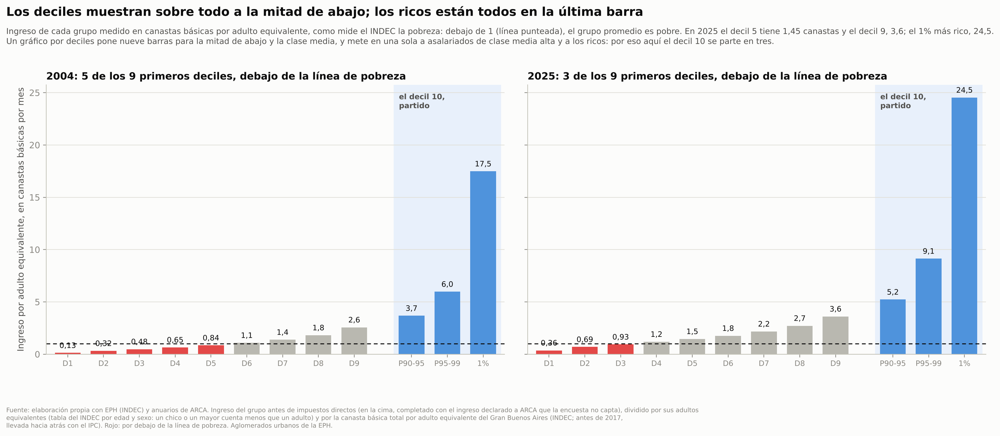

**Figura 5.** Ingreso de cada grupo en canastas básicas por adulto equivalente, 2004 y 2025.

La figura 5 mide el ingreso de cada grupo con la misma unidad con que el INDEC mide la pobreza. La
**canasta básica total** es el valor de los bienes y servicios que el INDEC considera necesarios para
que un adulto no sea pobre; se publica todos los meses para el Gran Buenos Aires (antes de 2017,
este estudio usa la de 2017 llevada hacia atrás con el índice de precios). Las necesidades de cada
persona se ponderan con la tabla de **adultos equivalentes** del INDEC, que asigna a cada persona un
peso según su edad y sexo. El ingreso del grupo dividido por sus adultos equivalentes y por la
canasta dice cuántas canastas por mes puede cubrir el grupo promedio: debajo de 1 (línea
punteada), es pobre. Medir en canastas, además, permite comparar años distintos sin que la
inflación distorsione.

En 2025, los deciles 1 a 3 están debajo de la línea de pobreza (0,36, 0,69 y 0,93 canastas); en
2004 eran cinco deciles. El decil 5 tiene 1,45 canastas y el decil 9, 3,6. En el decil 10, en
cambio, conviven situaciones muy distintas: el decil entero promedia 8,8 canastas, pero los
percentiles 90 a 95 tienen 5,2, los percentiles 95 a 99, 9,1, y el 1% más rico, 24,5. Dentro de la
última barra hay casi cinco veces de distancia entre el primer tramo y el último; entre el decil 1
y el decil 5 hay cuatro.

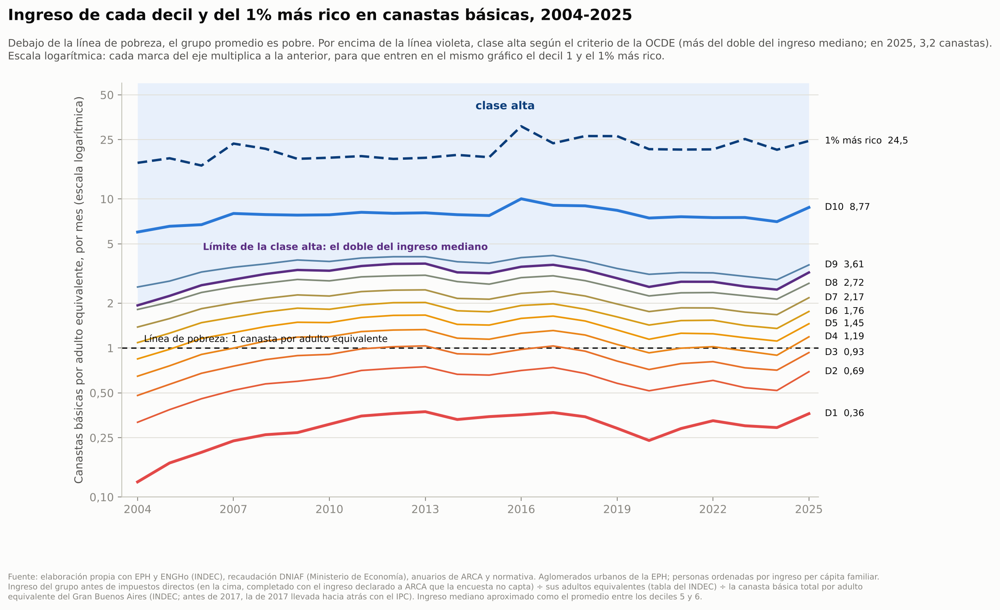

**Figura 6.** Ingreso de cada decil y del 1% más rico en canastas básicas, 2004-2025.

La figura 6 sigue el mismo indicador para cada decil y para el 1% más rico en todos los años. El
eje vertical es logarítmico: cada marca multiplica a la anterior, lo que permite ver en el mismo
gráfico al decil 1 (menos de media canasta) y al 1% más rico (más de veinte).

Para marcar dónde empieza la clase alta hace falta un criterio, y no hay uno oficial en Argentina.
Se usa el de la OCDE (*Under Pressure: The Squeezed Middle Class*, 2019): clase alta es quien tiene
más del doble del ingreso mediano, es decir, del ingreso de la persona que está justo en el medio
de la distribución. Como este estudio trabaja con promedios por grupo, la mediana se aproxima con el
promedio de los deciles 5 y 6. En 2025 el límite queda en 3,2 canastas por adulto equivalente (1,9
en 2004). Es un límite relativo: se mueve con el ingreso del medio.

Con ese criterio, la clase alta incluye al decil 10 entero y a buena parte del decil 9, cuyo
promedio (3,6 canastas en 2025) está apenas por encima del límite. El decil 8 queda debajo. La
línea del 1% más rico, en cambio, está entre 17 y 31 canastas en toda la serie, muy lejos del resto
del decil 10 (entre 6 y 10).

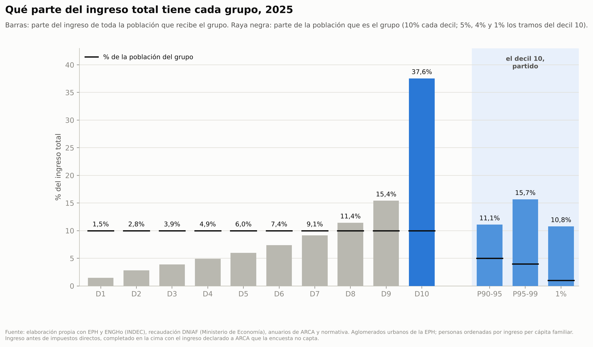

**Figura 7.** Qué parte del ingreso total tiene cada grupo, 2025.

La figura 7 muestra la misma desigualdad en términos de ingreso total. Cada barra es la parte del
ingreso de toda la población que recibe el grupo; la raya negra, la parte de la población que es el
grupo. Si el ingreso estuviera repartido en partes iguales, cada barra llegaría a su raya.

El decil 10 recibe 37,6% del ingreso total con el 10% de la población. Partido, los percentiles
90-95 (5% de la población) reciben 11,1%; los 95-99 (4%), 15,7%; y el 1% más rico, 10,8%, más que
los deciles 1, 2 y 3 juntos (8,2%).

Las tres figuras muestran lo mismo desde ángulos distintos. Un gráfico por deciles dedica nueve
barras a la mitad de abajo y a los sectores medios, y reúne en una sola al 10% de mayores ingresos,
que tiene más de un tercio del ingreso y adentro diferencias mayores que las que hay entre los
primeros cinco deciles. Para saber qué pagan quienes más ganan, hay que partir esa barra.

## 4. El decil 10, partido

### Cómo se parte

Dentro del decil 10, las personas se ordenan con el mismo criterio que en los deciles, por ingreso
per cápita familiar, y se cortan en los percentiles 95 y 99. Quedan tres grupos: los percentiles
90-95 (5% de la población), los 95-99 (4%) y el 1% de mayores ingresos.

Partir el decil 10 tiene un problema que en los deciles de abajo es menor. Sabemos bastante bien
cuánto se paga, porque los impuestos se pueden reconstruir con la recaudación y con las
declaraciones juradas. Lo que no sabemos bien es cuánto ganan los de arriba, porque la encuesta lo
subestima. Quienes más ganan declaran menos de lo que ganan o no responden, y la parte de su
ingreso que más se pierde (rentas del capital, ganancias de empresas, activos en el exterior) es la
más difícil de captar con una encuesta. Por eso el decil 10 partido se presenta en dos versiones.
La **versión A** completa el ingreso de la cima sólo con datos administrativos. La **versión B**
agrega estimaciones de lo que ninguna fuente registra persona por persona.

### Versión A: con los mismos datos que los deciles

**Figura 8.** Versión A: el decil 10 partido en tres, con los mismos datos que los deciles, 2025.

La versión A usa exactamente la misma información que la figura 2. La diferencia es sólo que el
decil 10 se muestra también separado en sus tres tramos (fondo celeste).

El ingreso y la Ganancias de la cima se completan con las **declaraciones juradas de Ganancias**.
ARCA publica cada año, en sus anuarios de estadísticas tributarias, cuántos contribuyentes declaran
en cada tramo de ingresos, cuánto ingreso declaran y cuánto impuesto pagan. El procedimiento es el
siguiente:

1. Se ordenan las declaraciones juradas de mayor a menor ingreso y se comparan con las personas de
   mayor ingreso de la encuesta, expandida a la población del país.
2. Se busca el punto en que el ingreso declarado al fisco empieza a superar al de la encuesta.
   De ahí para arriba, a cada persona de la encuesta se le suma el ingreso que declara a ARCA y la
   encuesta no registra (incluidas sus rentas exentas) y la Ganancias que paga por ese ingreso.
   Se suman a la vez el ingreso y el impuesto; sumar sólo el impuesto inflaría la tasa.
3. La parte de la Ganancias recaudada que no corresponde a esas personas se reparte entre los
   demás que presentan declaración jurada. Bienes Personales se reparte según la parte del
   patrimonio declarado que tiene cada grupo.

El resultado se puede verificar: con esta corrección, la Ganancias que paga el 1% de la encuesta,
como parte de su ingreso, coincide con la que surge de las declaraciones juradas del 1% de mayores
ingresos (12,0% contra 12,1% en 2024; sección 4). Para 2025 todavía no hay declaraciones publicadas y se usan
las de 2024, actualizadas con la variación del ingreso del decil 10 de la encuesta.

Partir el decil 10 cambia también un cálculo. En la figura 2 el consumo del decil 10 sale del
promedio de ese decil en la ENGHo. Partido, el consumo se estima tramo por tramo, y por encima del 5%
de mayores ingresos la ENGHo no tiene datos (ver la segunda limitación, más abajo). Con esa
estimación más detallada el decil 10 completo paga 23,4% en lugar de 23,8%, y el promedio de la
población, 23,6% en lugar de 23,8%. Desde aquí, todas las cifras usan este cálculo.

Con la versión A, en 2025 el decil 10 paga 23,4% y sus tramos 24,6% (percentiles 90-95), 23,7%
(95-99) y 21,7% (el 1%). La tasa baja hacia la cima: el 1% más rico paga menos que el promedio
(23,6%) y menos que cualquier decil. También cambia con qué paga cada tramo. Los percentiles 90-95
pagan sobre todo aportes, contribuciones y consumo, con poca Ganancias: su composición se parece a la
del decil 9. En el 1%, Ganancias y Bienes Personales son 14,2 de sus 21,7 puntos. Los aportes pesan
poco porque tienen tope, y el consumo pesa poco porque se supone que, por encima del 5% de mayores
ingresos, el consumo no sigue creciendo con el ingreso (ver la segunda limitación).

La versión A tiene tres limitaciones, todas en la cima:

- **El ingreso sigue incompleto.** Las declaraciones juradas sólo registran lo que se declara al
  fisco. Las Cuentas Nacionales del INDEC, que miden el ingreso total del país, muestran que en 2025
  la encuesta capta el 80% de los sueldos y el 66% del ingreso de los cuentapropistas y pequeños
  empleadores. Para las rentas del capital no hay un total oficial con qué comparar. Si el ingreso
  que falta está concentrado arriba, la tasa de la versión A sobreestima lo que paga la cima.
- **El consumo de arriba es un supuesto.** La ENGHo informa el consumo hasta el 5% de mayores
  ingresos, no más arriba. La versión A deja fijo el consumo en el nivel de ese 5%: quienes ganan
  más no consumen más. Con ese supuesto el 1% gasta 36% de su ingreso. Si en cambio se supone que
  gasta la misma proporción de su ingreso que ese 5% (58%), su tasa sube de 21,7% a 23,6%, la
  misma que los deciles medios.
- **Pocas observaciones.** El 1% de la encuesta son pocas personas por trimestre, y su tasa salta de
  un año a otro en parte por azar.

### Versión B: completando el ingreso que la encuesta no capta

**Figura 9.** Versión B: los mismos impuestos, con el ingreso que la encuesta no capta estimado,
2025.

La versión B responde a la primera limitación. Mantiene los impuestos de la versión A y agrega al
ingreso una estimación de lo que la encuesta no registra. Esa estimación tiene tres partes, y cada
una se apoya en una fuente distinta:

| Qué se suma | De dónde sale | Qué es dato y qué es supuesto |
|---|---|---|
| Sueldos e ingreso de cuentapropistas que faltan en la encuesta | Cuenta de generación del ingreso de las Cuentas Nacionales (INDEC), que mide el total del país | El faltante total es un dato. Repartirlo en proporción a lo que cada persona ya declara es un supuesto |
| Rentas del capital (alquileres, intereses, utilidades) | Las rentas declaradas en la encuesta se multiplican por 7. En las encuestas de América Latina el ingreso del capital es el que peor se capta: hay que multiplicarlo por 5 a 10 en la mayoría de los países para llegar a las Cuentas Nacionales (De Rosa, Flores y Morgan, 2024). Para Argentina no pueden medirlo y usan el promedio de la región | Supuesto: el INDEC no publica el total de rentas de los hogares |
| Renta de los activos financieros privados en el exterior | 4% anual sobre las acciones y bonos que el sector privado tiene afuera, según la Posición de inversión internacional del INDEC, atribuido al 1% más rico | Supuesto: que esa cartera es de la cima y que su renta no se declara |

La tercera parte necesita una justificación propia. De los US$378.000 millones que el sector privado
tiene afuera según el INDEC (2025), US$260.000 millones son moneda y depósitos, en su mayoría
dólares fuera del sistema que no generan renta y que están repartidos entre buena parte de la
población. Esos se dejan afuera. Las acciones y bonos (US$118.000 millones) sí generan renta, y es
plausible que pertenezcan a la cima: en Bienes Personales declaran tener bienes en el exterior unas
87.000 personas (ARCA, año fiscal 2023), alrededor del 0,2% de la población. El 4% combina
dividendos (alrededor de 2%) y cupones de bonos (3% a 4%); con 3% o 5% el resultado casi no cambia.

La carga total de la población se mantiene igual que en la versión A. Lo que cambia es quién la
soporta en proporción a su ingreso: los grupos cuyo ingreso crece más con la estimación pasan a
tener una tasa menor, y los demás una mayor.

Con la versión B, en 2025 el decil 10 baja de 23,4% a 22,0% y queda por debajo de todos los demás
deciles. Partido, los percentiles 90-95 pagan 24,0%, los 95-99, 23,4%, y el 1% más rico, 18,5% (20,0%
sin la renta de la cartera externa, rayas grises). El decil 1 sube de 28,7% a 31,5%: su ingreso
crece menos que el del resto con la estimación y, como la carga total es la misma, le toca una
parte mayor.

La versión B tiene sus propias limitaciones. El multiplicador de 7 sale de estudios sobre otros
países de la región. Lo que se declara en Bienes Personales como bienes en el exterior es alrededor
del 5% de lo que el INDEC estima que hay afuera, así que la atribución de la cartera al 1% no se
puede verificar persona por persona. Y la Posición de inversión internacional incluye también a
empresas, no sólo a hogares.

### La medida de control: el 1% con lo que declara a ARCA

Hay una tercera forma de medir la tasa del 1%, que no usa la encuesta: armar el grupo sólo con las
declaraciones juradas de Ganancias. Los anuarios de ARCA informan, por tramo de ingreso, el ingreso
y el impuesto declarados. También informan qué parte del ingreso es trabajo personal (4ta
categoría), cuántos contribuyentes descuentan aportes jubilatorios como empleados y cuánto aportan.
Con esos datos se arma la **medida de control (C)**. El grupo son las 459.000 declaraciones de mayor
ingreso, el 1% de la población.

| Componente | Cómo se obtiene | % del ingreso, 2025 |
|---|---|---|
| Ganancias | Impuesto determinado que declara el grupo | 12,1 |
| Bienes Personales | Recaudación, repartida según la parte del patrimonio declarado que tiene el grupo | 2,4 |
| Aportes personales | Aportes a jubilación, obra social, cajas profesionales y autónomos que el grupo descuenta en su declaración | 2,0 |
| Contribuciones patronales | La mitad del 20% sobre la parte del trabajo personal que corresponde a empleados. En 2024, el 43% de quienes declaran 4ta categoría en el grupo descuenta aportes como empleado; el resto son jubilados, directores e independientes | 1,4 |
| Impuestos al consumo | Consumo estimado (26,7% del ingreso, ver abajo) por los impuestos que se pagan por cada peso consumido | 5,0 |
| **Total** | | **22,8** |

Para que sea comparable con la versión A, la medida de control no incluye Ganancias de sociedades
ni la renta de activos en el exterior.

El consumo del 1% no lo mide ninguna fuente. Hay dos aproximaciones, y cada una falla en una
dirección:

- La versión A supone que el 1% gasta en pesos lo mismo que el 5% más rico de la ENGHo. Con eso
  gasta el 18,5% de su ingreso. Es probablemente bajo: quien gana más gasta más.
- ARCA calcula un "monto consumido" para cada contribuyente. No lo declara el contribuyente: el
  sistema de ARCA lo obtiene como saldo de lo que sí declara, es decir, lo que entra en el año menos
  lo que aumenta su patrimonio y los impuestos que paga. Para el 1% da el 35,0% de su ingreso. Es
  probablemente alto: incluye el gasto en el exterior, que no paga IVA ni Ingresos Brutos en el país,
  y crece cuando el patrimonio se declara por debajo de su valor.

La medida de control usa el punto medio entre las dos, calculado año por año: el 26,7% del ingreso
en 2025.

| Medida | 1% más rico, 2025 | Qué sale de datos | Qué se supone | Uso en el informe |
|---|---|---|---|---|
| A. Encuesta completada con declaraciones juradas | 21,7% | Ingreso de la encuesta, ingreso y Ganancias declarados a ARCA, recaudación | El consumo por encima del percentil 95 | Principal |
| B. A más el ingreso estimado | 18,5% | Lo mismo que A y el total de sueldos de las Cuentas Nacionales | Rentas ×7, reparto del faltante, renta de la cartera externa | Cota inferior |
| C. Declaraciones juradas | 22,8% (21,8%, 20,8% y 17,8% si no declara el 5%, el 10% o el 25% de su ingreso no salarial) | Ingreso, Ganancias, patrimonio, aportes y cantidad de empleados declarados a ARCA | El consumo, que no se mide; qué parte del trabajo personal es sueldo; el impuesto por peso consumido | Control para el 1% |

Las tres medidas coinciden en Ganancias, que es un dato (12,4% del ingreso en la versión A y 12,1%
en la medida de control), y en 2025 las tres dan al 1% una tasa menor que el promedio (23,6%). La
medida de control queda 1,1 puntos por encima de la versión A si el 1% declara todo su ingreso.

La medida de control sólo registra el ingreso que se declara al fisco, y hay evidencia de que la
cima declara menos de lo que gana. En el sinceramiento fiscal de 2016 (Ley 27.260) se exteriorizaron
US$116.800 millones en bienes que no estaban declarados, el 80% en el exterior. En Noruega, Suecia y
Dinamarca, con listas filtradas de bancos offshore, el 0,01% más rico evadía alrededor de un cuarto
de sus impuestos, contra un 3% del promedio de la población (Alstadsæter, Johannesen y Zucman, 2019).
No hay una estimación de cuánto ingreso no declara el 1% en Argentina.

Por eso la medida de control se informa siempre con tres escenarios: que el 1% no declare el 5%, el
10% o el 25% de su **ingreso no salarial**. Es el ingreso que se puede ocultar. Del sueldo de un
empleado informan otros: el empleador lo declara todos los meses y retiene Ganancias y aportes antes
de pagarlo, y para ocultarlo haría falta que el empleador también lo oculte. Los alquileres, los
intereses, los dividendos, las ganancias de un negocio o los honorarios dependen en gran parte de
lo que declara el propio contribuyente. Los dos primeros escenarios son moderados. El tercero está
en el orden de lo que Alstadsæter, Johannesen y Zucman encuentran para el 0,01% más rico, y funciona
como techo para el 1%.

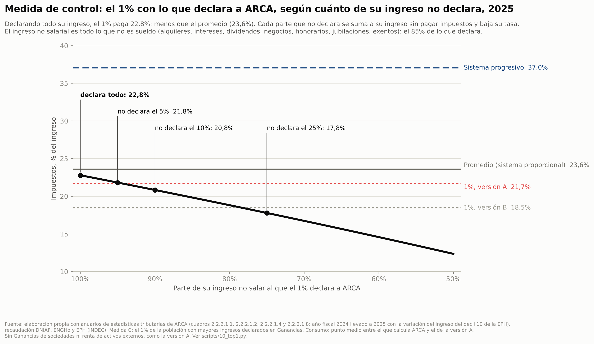

**Figura 10.** Medida de control: tasa del 1% más rico según qué parte de su ingreso no salarial
declara a ARCA, 2025.

La línea negra muestra la tasa del 1% si declarara a ARCA sólo una parte de su ingreso no salarial.
El ingreso no salarial es todo lo que no es sueldo: alquileres, intereses, dividendos, ganancias de
negocios, honorarios, jubilaciones e ingresos exentos. Es el 85% de lo que el 1% declara. La parte no
declarada se suma a su ingreso y no paga ningún impuesto. Las líneas horizontales son el promedio
de la población, que es la tasa de un sistema proporcional, las versiones A y B, y la tasa que le
correspondería al 1% en el sistema progresivo de referencia de la sección 6.

Las fuentes son los anuarios de ARCA (cuadros 2.2.2.1.1, 2.2.2.1.2, 2.2.2.1.4 y 2.2.2.1.8; para 2025
se usan las declaraciones de 2024, llevadas a 2025 con la variación del ingreso del decil 10 de la
encuesta), la recaudación de la Dirección Nacional de Investigaciones y Análisis Fiscal, la ENGHo y
la EPH.

Con todo su ingreso declarado, el 1% paga 22,8%, 0,8 puntos menos que el promedio (23,6%). Cada parte
que no declara baja todavía más su tasa: 21,8%, 20,8% y 17,8% si no declara el 5%, el 10% o el 25% de
su ingreso no salarial. En ningún caso se acerca al 37,0% que pagaría en el sistema progresivo de
referencia. La figura A.4 del anexo hace el mismo cálculo año por año, entre 2012 y 2025.

### Qué medida se usa en adelante

De aquí en adelante se usa la **versión A**. Frente a la versión B, por dos razones. La primera es que
todos sus componentes salvo el consumo de la cima salen de fuentes observadas, mientras que la
versión B depende de un multiplicador tomado de otros países y de la atribución de una cartera que
no se puede verificar. La segunda es que la versión A es la más prudente para las conclusiones que
siguen: si el ingreso que falta está arriba, la tasa real de la cima es menor que la de la versión
A, no mayor. Cuando la versión A muestra que la cima paga menos que el promedio o menos que un
sistema progresivo, la versión B refuerza ese resultado. La versión B queda como cota: indica cuánto
más baja podría ser la tasa de la cima.

La medida de control tiene menos supuestos para el 1%, pero no puede reemplazar a la versión A por
dos razones:

- **Sólo existe para el 1%.** Las declaraciones juradas de Ganancias cubren a unas 800.000 personas.
  Para el resto de la población no hay medida de control.
- **No se puede combinar con los demás grupos.** Las secciones que siguen comparan la parte del
  ingreso y la parte de los impuestos de cada grupo, y esas partes tienen que sumar el total del
  país. La versión A ordena a las personas por el ingreso per cápita de su hogar y la medida de
  control ordena declaraciones individuales: su 1% no son exactamente las mismas personas. Además,
  trae su propio ingreso y sus propios impuestos. Reemplazar sólo el 1% de la versión A por el de la
  medida de control haría que las partes dejaran de sumar el total.

La medida de control queda como control: en cada afirmación sobre el 1% se informa si la sostiene o
no.

## 5. El decil 10 partido a lo largo del tiempo

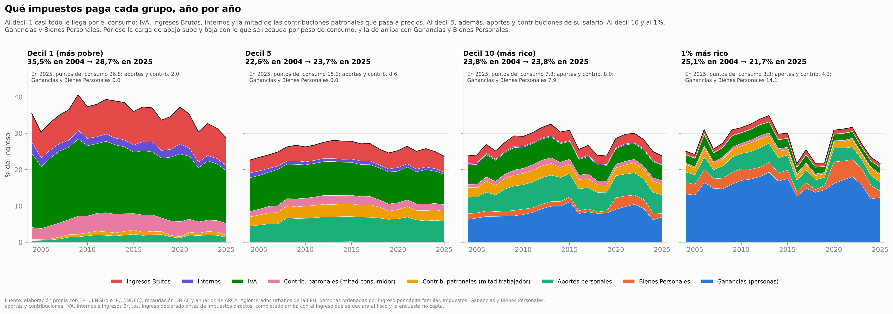

**Figura 11.** Qué impuestos paga cada grupo, año por año: deciles 1, 5 y 10 y el 1% más rico.

La figura 11 repite el gráfico de la figura 4 con el 1% más rico como cuarto panel. Los deciles 1,
5 y 10 son los mismos de antes; el 1% es un tramo del decil 10, separado con la versión A.

El 1% es el grupo cuya tasa más se mueve: entre 21,6% (2016) y 34,9% (2013). La razón está en su
composición. Ganancias y Bienes Personales son entre 61% y 75% de lo que paga, según el año, y esos dos impuestos
cambiaron mucho en el período: el piso de Ganancias quedó atrás de los salarios en 2009-2013, las
alícuotas de Bienes Personales bajaron en 2016 (Ley 27.260, con blanqueo), subieron en 2020 (Ley
27.541) y volvieron a bajar en 2024 (Ley 27.743). Son coincidencias en el tiempo, no causas
demostradas; el estudio no aísla el efecto de cada ley.

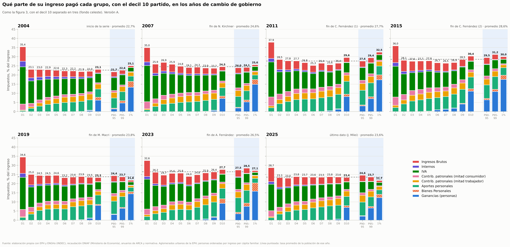

**Figura 12.** Qué parte de su ingreso pagó cada grupo, con el decil 10 partido, en los años de cambio
de gobierno.

La figura 12 vuelve a los siete años de la figura 3 con el decil 10 partido. Muestra que el decil 10
entero esconde movimientos de signo contrario adentro:

| Año | Decil 10 | P90-95 | P95-99 | 1% | Promedio |
|---|---|---|---|---|---|
| 2004 | 23,1% | 21,7% | 22,6% | 25,1% | 22,7% |
| 2007 | 24,5% | 24,0% | 24,1% | 25,6% | 24,6% |
| 2011 | 29,6% | 27,6% | 29,4% | 32,5% | 27,7% |
| 2015 | 30,4% | 29,5% | 31,2% | 30,0% | 28,6% |
| 2019 | 23,3% | 24,4% | 23,7% | 21,8% | 23,8% |
| 2023 | 27,7% | 27,5% | 28,5% | 27,1% | 26,5% |
| 2025 | 23,4% | 24,6% | 23,7% | 21,7% | 23,6% |

Entre 2004 y 2011 la tasa sube dentro del decil 10: el 1% paga más que los otros dos tramos. Desde
2015 la relación se invierte y el 1% paga menos que los percentiles 95-99, y en 2019 y 2025 menos que
todos. En 2004 el decil 10 y el promedio de la población estaban casi a la par (23,1% y 22,7%), con el
1% por encima de ambos; en 2025 también están a la par (23,4% y 23,6%), pero con el 1% dos puntos por
debajo.

Con la medida de control, la tasa del 1% sigue el mismo recorrido: sube hasta 2014-2015, cae en 2016
y vuelve a subir en 2020-2022, pero se mantiene más alta que con la versión A en casi todos los años
(figura A.4). La diferencia está en el consumo y en el ingreso, porque la medida de control usa sólo
lo que el 1% declara al fisco. Con ella, el 1% paga menos que los percentiles 90-95 en 2016 y 2025 si
declara todo su ingreso; también en 2024 si no declara el 5% o el 10% de su ingreso no salarial; y en
todos los años salvo 2017 y 2020-2022 si no declara el 25%. Que la tasa baje hacia la cima depende
entonces de la medida en la mayoría de los años; en 2016 y 2025 se sostiene con las dos.

## 6. ¿Proporcional o progresivo?

### Dos sistemas de referencia

Un sistema tributario es **proporcional** si todos pagan la misma tasa, **progresivo** si la tasa
sube con el ingreso y **regresivo** si baja. Para ubicar al sistema argentino se lo compara con dos
sistemas de referencia que recaudan exactamente lo mismo que el real cada año:

- **Proporcional:** todos pagan la tasa promedio. En ese sistema, cada grupo paga una parte de los
  impuestos igual a su parte del ingreso: si tiene el 10% del ingreso, paga el 10% de la
  recaudación.
- **Progresivo:** la tasa de cada grupo es la tasa promedio multiplicada por su ingreso relativo
  elevado a 0,25, y después se ajusta para que la recaudación total sea la misma. El ingreso
  relativo es el ingreso por persona del grupo dividido por el de toda la población. Con esta regla,
  en 2025 el decil 1 pagaría 12,7% y el 1% más rico, 37,0%.

La referencia progresiva no es un hallazgo sino una regla de medición. El exponente 0,25 es una
elección: un valor mayor daría un sistema más progresivo y uno menor, uno más parecido al
proporcional. Sirve para medir cuán lejos está el sistema real de un sistema progresivo concreto.
Al final de la sección se muestra cuánto cambian los resultados con otros exponentes.

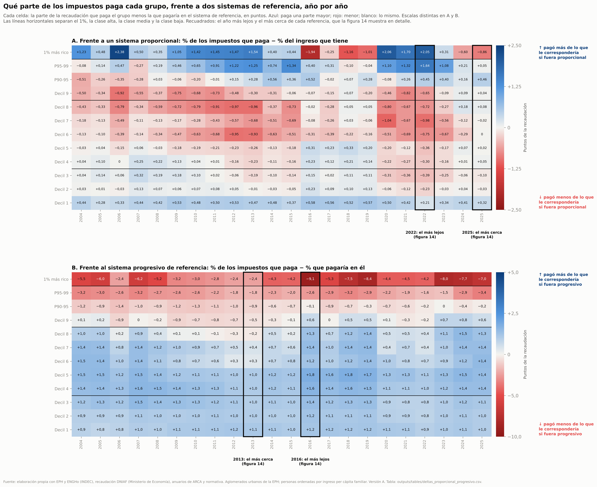

**Figura 13.** Qué parte de los impuestos paga cada grupo frente a dos sistemas de referencia, año por
año.

La figura 13 tiene dos tablas de colores. Cada fila es un grupo y cada columna, un año; las líneas
horizontales separan el 1%, la clase alta, la clase media y la clase baja. En la tabla A, cada celda
es la parte de todo lo que se paga en impuestos que pone el grupo, menos la parte del ingreso total
que recibe, en puntos de la recaudación. Si la diferencia es cero, el grupo paga en proporción a su
ingreso, como en un sistema proporcional. En la tabla B, cada celda es la parte de los impuestos que
pone el grupo menos la que pondría en el sistema progresivo de referencia. Azul significa que el
grupo paga una parte mayor que en la referencia; rojo, una parte menor; blanco, la misma. Las dos
tablas tienen escalas distintas. Las columnas recuadradas son los años más lejos y más cerca de cada
referencia, que la figura 14 muestra en detalle.

En la tabla de arriba, frente al sistema proporcional, casi todas las celdas están cerca de cero:
las diferencias son de décimas de punto. El decil 1 paga una parte mayor que su parte del ingreso
los 22 años (entre 0,2 y 0,6 puntos). El único grupo que se aleja más de un punto es el 1%, y lo hace
en las dos direcciones: paga una parte mayor que su parte del ingreso en 2004-2015 y 2020-2023 (hasta
2,4 puntos) y una menor en 2016-2019 y 2024-2025 (hasta 1,9 puntos).

En la tabla de abajo, frente al sistema progresivo, las diferencias son de varios puntos y tienen
siempre el mismo signo. Los deciles 1 a 7 pagan una parte mayor que la que les tocaría todos los
años (entre 0,3 y 1,8 puntos), y el 1% una parte menor todos los años (entre 2,4 y 9,1 puntos). Esto
es lo esperable en un sistema casi proporcional: cualquier referencia progresiva le asigna más a la
cima y menos a la base que un sistema donde todos pagan parecido.

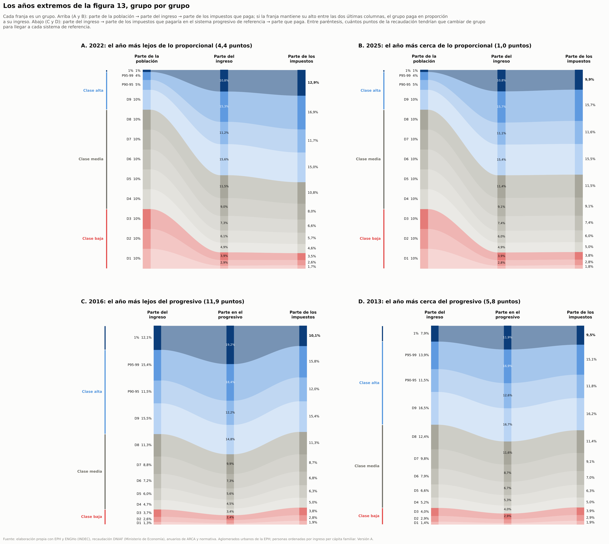

**Figura 14.** Los años extremos de la figura 13, grupo por grupo.

La figura 14 muestra en detalle los cuatro años recuadrados en la figura 13. Cada panel es un gráfico
de flujo: cada franja es un grupo, y su altura en cada columna es la parte que le corresponde de un
total. Para calcular la parte de los impuestos, se suman los pesos que paga el grupo en los siete
impuestos y se dividen por lo que pagan todos los grupos juntos. Las partes suman siempre 100%: si un
grupo pone una parte mayor, los demás ponen una parte menor, aunque paguen los mismos pesos.

Arriba están los años extremos frente al sistema proporcional, y las columnas son la parte de la
población, la parte del ingreso y la parte de los impuestos. Si una franja tiene la misma altura en
las dos últimas, el grupo paga en proporción a su ingreso; si se ensancha, una parte mayor; si se
angosta, una menor. La distancia de cada año a lo proporcional se mide con la parte de la
recaudación que tendría que cambiar de grupo para que todos pagaran la misma tasa. En 2022, el año
más lejos (4,4 puntos), el 1% tiene el 10,8% del ingreso y pone el 12,9% de los impuestos, mientras
la clase media pasa del 38,8% al 35,7%. En 2025, el más cerca (1,0 punto), las franjas casi no
cambian de altura y la única que se angosta es la del 1%, del 10,8% al 9,9%.

Abajo están los años extremos frente al sistema progresivo, y la columna del medio cambia: en lugar
de la población, a la izquierda está la parte del ingreso, y en el medio, la parte de los impuestos
que el grupo pagaría en ese sistema. En 2016, el año más lejos (11,9 puntos), el 1% tenía el 12,1% del
ingreso, en el sistema progresivo pagaría el 19,2% de los impuestos y pagó el 10,1%; la clase media
tenía el 38,0% del ingreso, pagaría el 30,7% y pagó el 38,1%. En 2013, el más cerca (5,8 puntos), el
1% pagó el 9,5% frente al 11,9% que le tocaría, y la clase media, el 38,8% frente al 36,3%. Incluso el
año más cercano al sistema progresivo está más lejos de él que el año más lejano al proporcional.

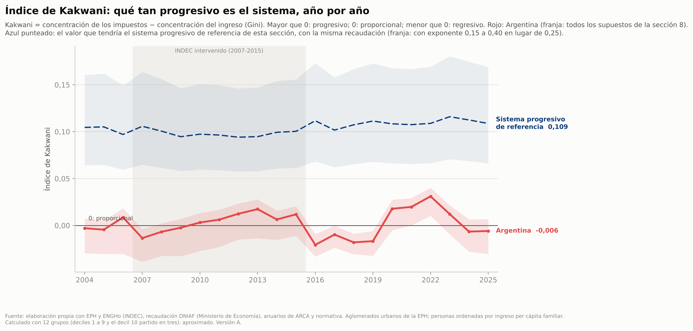

**Figura 15.** Índice de Kakwani: qué tan progresivo es el sistema, año por año.

La figura 15 resume cada año en un número, el **índice de Kakwani**. Compara dos repartos: cómo se
concentra la recaudación entre los grupos y cómo se concentra el ingreso. El segundo se mide con el
coeficiente de Gini, que vale 0 si todos tienen el mismo ingreso y 1 si una sola persona tiene todo;
el primero se calcula igual, con los impuestos en lugar del ingreso. El índice es la diferencia
entre los dos. Si los impuestos están más concentrados arriba que el ingreso, el índice es positivo
y el sistema es progresivo; si están igual de concentrados, es 0 y el sistema es proporcional; si
están menos concentrados, es negativo y el sistema es regresivo.

La línea roja es Argentina, con una franja que muestra cómo cambia el índice con todos los
supuestos que se prueban en la sección 8. Con la medida del informe va de −0,021 (2016) a +0,031
(2022), y con cualquier supuesto queda entre −0,039 y +0,040: prácticamente cero en todo el período, con cambios de
signo que siguen a los del 1% en la figura 13. La línea azul punteada es el índice que tendría el
sistema progresivo de referencia, con la misma recaudación: alrededor de 0,10 en todos los años
(0,109 en 2025). La franja azul muestra ese valor con exponentes entre 0,15 y 0,40: va de 0,06 a 0,18.
Incluso el más suave de esos sistemas progresivos queda lejos del sistema argentino.

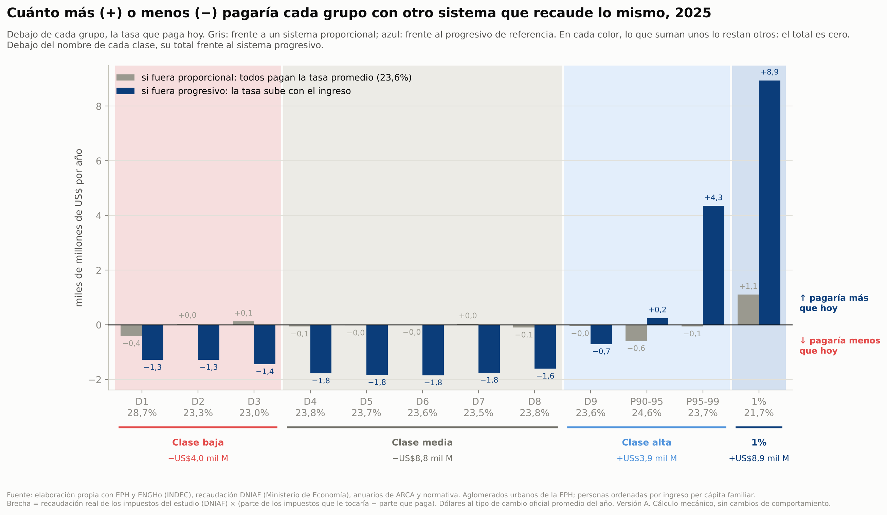

**Figura 16.** Cuánto más o menos pagaría cada grupo con otro sistema que recaude lo mismo, 2025.

Las diferencias de la figura 13 se pueden pasar a dinero. Para cada grupo, la diferencia entre la
parte de la recaudación que le tocaría y la que paga se multiplica por lo que efectivamente se
recaudó en el año con los siete impuestos del estudio (18,7% del PIB en 2025, según la Dirección
Nacional de Investigaciones y Análisis Fiscal). Se usa lo recaudado y no lo que reconstruye el
modelo porque la encuesta capta menos ingreso y consumo que las Cuentas Nacionales: el modelo
reproduce bien cómo se reparte la carga, no cuánto suma. Los montos se pasan a dólares con el tipo
de cambio oficial promedio del año.

En la figura 16, cada grupo tiene dos barras: gris, frente al sistema proporcional; azul, frente al
progresivo. Debajo de cada grupo está la tasa que paga hoy. En cada color, lo que suman unos grupos
lo restan otros, porque la recaudación total no cambia.

Con un sistema proporcional, en 2025 el 1% más rico pagaría US$1.100 millones más por año (0,16% del
PIB), unos US$2.400 por persona. Con el progresivo de referencia pagaría US$8.900 millones más (1,31%
del PIB), unos US$19.500 por persona, y los percentiles 95-99, US$4.300 millones más. Los deciles 1 a
9 pagarían en conjunto US$13.500 millones menos (2,0% del PIB): entre US$150 y US$400 por persona y
por año. Los montos por persona cuentan a todos los miembros del grupo, incluidos chicos, jubilados
y desocupados.

La figura marca también las clases sociales, con el criterio de la OCDE de la figura 6 aproximado
con deciles: clase baja, por debajo del 75% del ingreso mediano (deciles 1 a 3); clase media, entre
el 75% y el doble (deciles 4 a 8); clase alta, por encima del doble (decil 9 y percentiles 90 a 99). El
1% más rico se muestra aparte. Debajo de cada clase está su total frente al sistema progresivo. Entre
2016 y 2025, lo que la clase media pagó de más frente a ese sistema suma US$65.700 millones, y lo que
el 1% pagó de menos, US$73.100 millones.

Es una cuenta mecánica, que supone que nadie cambia su comportamiento. No estima lo que se podría
recaudar con una reforma: una suba de impuestos en la cima traería más elusión, más evasión y más
activos afuera. Mide la distancia entre cómo se reparte hoy la carga y cómo se repartiría con cada
referencia.

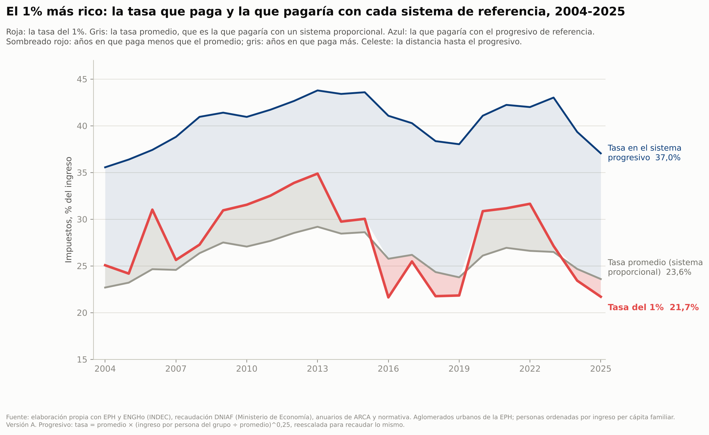

**Figura 17.** El 1% más rico: la tasa que paga y la que pagaría con cada sistema de referencia,
2004-2025.

La figura 17 sigue al 1% en el tiempo con tres tasas. La roja es la que paga. La gris es la tasa
promedio, que es la que pagaría con un sistema proporcional. La azul es la que pagaría con el
progresivo de referencia. El sombreado gris marca los años en que el 1% paga más que el promedio; el
rojo, los años en que paga menos; el celeste, la distancia hasta el progresivo.

Frente al sistema proporcional el resultado depende del período: el 1% pagó más que el promedio en
2004-2015 y 2020-2023 y menos en 2016-2019 y 2024-2025. Sumando 2016-2025, lo que pagó de menos y lo
que pagó de más se compensan casi exactamente. Frente al progresivo, pagó menos todos los años: la
distancia fue de entre 0,35% y 1,86% del PIB según el año, y sumó US$73.000 millones entre 2016 y
2025.

El monto frente al progresivo depende del exponente elegido. En 2025, con un exponente de 0,15 (un
sistema menos progresivo) el 1% pagaría US$5.500 millones más (0,81% del PIB); con 0,25, US$8.900
millones (1,31%); con 0,40, US$14.800 millones (2,17%). Cambia el monto, no la dirección.

La figura A.4 del anexo muestra, año por año, cuánto se aparta el 1% del promedio con la versión A y
con la medida de control. Frente al sistema progresivo, la medida de control da el mismo resultado
que la versión A: el 1% paga menos de lo que le correspondería todos los años, aunque la distancia
es menor (en 2025, 14,3 puntos con la medida de control y 15,4 con la versión A; con la medida de
control, entre 15,3 y 19,3 puntos si no declara el 5%, el 10% o el 25% de su ingreso no salarial).
Frente al proporcional, con la medida de control el 1% paga menos que el promedio en 2016 y 2025 si
declara todo su ingreso; también en 2024 si no declara el 5% o el 10% de su ingreso no salarial; y
además en 2012, 2013, 2018, 2019 y 2023 si no declara el 25%.

Las matrices (figura 13), el índice de Kakwani (figura 15) y los montos en dólares (figura 16) quedan
con la versión A, porque comparan las partes de todos los grupos y la medida de control sólo existe
para el 1%.

**Figura 18.** Qué parte de los impuestos paga cada grupo frente a lo que pagaría con cada
referencia, 2025.

La figura 18 es la columna de 2025 de la figura 13, dibujada en barras para leer los valores. A la
izquierda, frente al sistema proporcional; a la derecha, frente al progresivo, con la tasa que le
tocaría a cada grupo al lado de su nombre.

Los fondos de color marcan las mismas clases que la figura 16. Frente al proporcional, en 2025 el 1% paga 0,86 puntos menos de la recaudación que su parte del
ingreso, y el decil 1 y los percentiles 90-95 pagan algo más (0,32 y 0,46 puntos). Los demás grupos
quedan a menos de una décima. Frente al progresivo, todos los deciles 1 a 9 pagan una parte mayor
que la que les tocaría (entre 0,5 y 1,5 puntos cada uno), los percentiles 90-95 casi la misma, los
95-99, 3,4 puntos menos, y el 1%, 7,0 puntos menos.

## 7. Cuántas veces más ingresan y cuántas veces más pagan

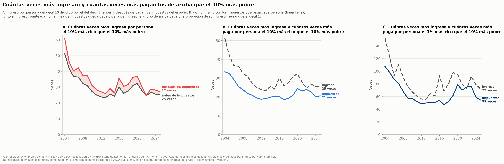

**Figura 19.** Cuántas veces más ingresan y cuántas veces más pagan los de arriba que el 10% más
pobre.

La figura 19 compara a los de arriba con el decil 1 dividiendo una cosa por otra. Todo está por
persona: el ingreso o los impuestos del grupo divididos por la cantidad de personas del grupo.

El panel A divide el ingreso por persona del decil 10 por el del decil 1, antes y después de pagar
los impuestos del estudio. En 2004 el decil 10 ingresaba 51 veces lo del decil 1; en 2025, 25 veces.
Después de impuestos la distancia es mayor todos los años (61 veces en 2004 y 27 en 2025), porque el
decil 1 paga una proporción más alta de su ingreso que el decil 10.

El panel B pone, junto a ese cociente de ingresos (línea punteada), el cociente de impuestos: cuántas
veces más paga por persona el decil 10 que el decil 1 (línea llena). Si los dos grupos pagaran la
misma tasa, las dos líneas coincidirían. En 2025 el decil 10 ingresa 25 veces más que el decil 1 y
paga 21 veces más; la línea de impuestos queda debajo de la de ingreso todos los años.

El panel C hace lo mismo con el 1% más rico. En 2025 ingresa 72 veces lo del decil 1 por persona y
paga 55 veces más en impuestos. La línea de impuestos queda debajo de la de ingreso todos los años
salvo 2022. La distancia entre las dos se achicó en los años en que el 1% pagó más (2009-2015 y
2020-2023) y se agrandó en 2016-2019 y desde 2024. Con la medida de control pasa lo mismo, salvo en 2021
y 2022, cuando el 1% paga una tasa mayor que el decil 1. Si no declara el 10% de su ingreso no
salarial, la excepción queda sólo en 2022; si no declara el 25%, no hay excepciones.

Los tres paneles comparan contra el decil 1 y usan su ingreso declarado, con la aclaración de la
sección 2: una parte de su consumo se financia con recursos que no son ese ingreso. En los paneles B
y C, que la línea de impuestos quede debajo de la de ingreso equivale a decir que el grupo de arriba
paga una tasa menor que el decil 1.

## 8. Qué tan firme es cada resultado

Cada resultado de las secciones anteriores depende de decisiones: a quién se le carga cada impuesto,
qué impuestos se incluyen, cómo se mide el ingreso. Esta sección repite el cálculo cambiando esas
decisiones una por una y revisa, para cada afirmación del informe, si se sostiene. El resultado de
cada prueba se resume con tres veredictos: **firme** (se sostiene con cualquier supuesto, todos los
años), **depende del año** o **depende de un supuesto**, en cuyo caso se dice cuál.

### Los supuestos que se prueban

Se agrupan en cuatro familias. Cada una reemplaza una decisión de la medida del informe por otra
que también es defendible:

1. **Quién paga.** Las contribuciones patronales cargadas enteras al trabajador o enteras a los
   consumidores, en lugar de mitad y mitad. Y el IVA cobrado con la alícuota legal, como si nadie lo
   evadiera, en lugar de lo que efectivamente se recaudó por peso de consumo.
2. **Qué impuestos entran.** Sumando el impuesto al cheque, cargado a los precios; el cheque y los
   impuestos a los combustibles; el monotributo. O sacando Bienes Personales.
3. **Cómo se mide el ingreso de la cima.** Sin completar la cima con las declaraciones juradas (sólo
   la encuesta), o con la versión B de la sección 4.
4. **Cuánto consume la cima.** Por encima del 5% de mayores ingresos, el consumo proporcional al
   ingreso en lugar de fijo.

Se agrega una prueba más, sobre la forma de combinar las tres ediciones de la ENGHo: por tramos de
años en lugar de interpolarlas. Con la medida del informe son 12 versiones del cálculo.

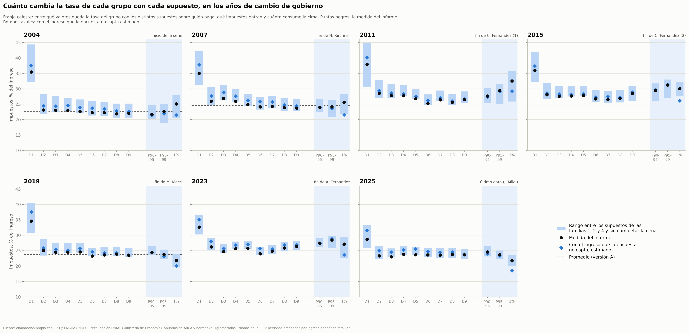

**Figura 20.** Cuánto cambia la tasa de cada grupo con cada supuesto, en los años de cambio de
gobierno.

La figura 20 muestra, para los mismos siete años de las figuras 3 y 12, entre qué valores queda la
tasa de cada grupo con los supuestos de las familias 1, 2 y 4, sin completar la cima y con la otra
forma de combinar la ENGHo (franja celeste). El punto negro es la medida del informe y el rombo
azul, el cálculo con el ingreso que la encuesta no capta estimado (la versión B de la sección 4). La línea punteada es el promedio de la población.

La franja del decil 1 es la más larga, porque el decil 1 paga sobre todo impuestos al consumo y las
contribuciones, y esos son los supuestos que más cambian: en 2025 su tasa va de 26% a 33%. Las
franjas mezclan supuestos distintos y por eso se tocan entre grupos, pero comparando con el mismo
supuesto el decil 1 paga más que cada uno de los deciles 2 a 9 en todos los años. Las franjas de los deciles 2 a 9 se superponen entre sí: con cualquier supuesto pagan parecido. En
la cima las franjas son anchas y la del 1% cruza el promedio en varios años.

**Figura 21.** Las tres comparaciones centrales del informe, con todos los supuestos, 2004-2025.

La figura 21 sigue las tres comparaciones en las que se apoya el informe, año por año. Cada panel es
una diferencia de tasas en puntos de ingreso: por encima de cero, el primer grupo paga una
proporción de su ingreso mayor que el segundo. La línea llena es la medida del informe; la franja,
el rango con los demás supuestos; la línea azul punteada, el cálculo con el ingreso que la encuesta no
capta estimado (la versión B de la sección 4). Cuando toda la franja queda
de un lado del cero, ese año el resultado no depende de los supuestos.

En el panel A, la franja del decil más pobre queda por encima de cero los 22 años, y baja: su
distancia al promedio se redujo entre 7 y 11 puntos de 2004 a 2025 con cualquier supuesto.

En el panel B, la franja del 1% cruza el cero en la mayoría de los años. Queda entera por debajo en
2018, 2019 y 2025, años en que el 1% paga menos que el promedio con cualquier supuesto, y entera por
encima en 2012, 2013 y 2020-2022. En 2016, 2017 y 2024 el 1% paga menos que el promedio con todos los
supuestos salvo uno.

En el panel C, el 1% paga menos que los percentiles 90-95 con cualquier supuesto en 2018, 2019 y 2025,
y más con cualquier supuesto en 2011-2013, 2020 y 2022. En el resto de los años depende del supuesto.

### Veredicto por afirmación

| Afirmación | Dónde | Veredicto | Detalle |
|---|---|---|---|
| El decil 1 paga la tasa más alta entre los deciles | Sección 2 | Firme sobre el ingreso declarado | Con el decil 10 partido, algún tramo de la cima lo supera en 13 de las 264 combinaciones de año y supuesto; en la medida del informe, sólo el 1% en 2022 |
| Los deciles 2 a 9 pagan casi lo mismo | Sección 2 | Firme | La diferencia entre el que más paga y el que menos es de hasta 3,9 puntos en la medida del informe y de hasta 5,6 con contribuciones cargadas enteras a los consumidores (2012) |
| La distancia del decil 1 al promedio se achicó | Secciones 2 y 8 | Firme sobre el ingreso declarado | Baja entre 7 y 11 puntos de 2004 a 2025 con todos los supuestos. El valor de 2009 depende de cómo se combinan las ediciones de la ENGHo |
| El decil 10 esconde mucha diferencia adentro | Sección 3 | Firme | No depende de los supuestos sobre impuestos; con la versión B la diferencia es mayor |
| La tasa baja hacia la cima (el 1% paga menos que los percentiles 90-95) | Secciones 4 y 5 | Depende del año y de la medida | Con la versión A, con cualquier supuesto en 2018, 2019 y 2025; nunca en 2011-2013, 2020 y 2022. Con la medida de control, en 2016 y 2025 si declara todo; también en 2024 si no declara el 5% o el 10% de su ingreso no salarial, y en todos los años salvo 2017 y 2020-2022 si no declara el 25% |
| El 1% paga menos que el promedio | Secciones 4 a 6 | Depende del año y de la medida | Con la versión A, con cualquier supuesto en 2018, 2019 y 2025, y con todos salvo uno en 2016, 2017 y 2024; paga más con cualquier supuesto en 2012, 2013 y 2020-2022. Con la medida de control, en 2016 y 2025 si declara todo; también en 2024 si no declara el 5% o el 10% de su ingreso no salarial, y en 2012, 2013, 2018, 2019 y 2023 si no declara el 25% |
| En 2025 el 1% paga menos que cualquier decil | Sección 4 | Depende de un supuesto | Se sostiene con 10 de las 12 versiones y con la medida de control (22,8%, contra 23,0% del decil que menos paga). No se sostiene si la cima consume en proporción a su ingreso o si las contribuciones se cargan enteras al trabajador |
| El sistema es casi proporcional | Sección 6 | Firme | El índice de Kakwani queda entre −0,039 y +0,040 con todos los supuestos, lejos del 0,06 del sistema progresivo más suave de la figura 15 |
| El 1% paga menos y el decil 1 más que en un sistema progresivo | Sección 6 | Firme en la dirección | Con todos los supuestos, todos los años y con la medida de control en sus cuatro escenarios. El monto depende del exponente de la referencia y de la versión (sección 6) |
| Los de arriba pagan, en proporción a su ingreso, menos que el decil 1 | Sección 7 | Firme sobre el ingreso declarado | Salvo el 1% en 2022. Con la medida de control, también salvo 2021 si declara todo o no declara el 5%; sin excepciones si no declara el 25% |

Los resultados se ordenan entonces en dos grupos. Son firmes la forma del sistema para la gran
mayoría de la población (los deciles 2 a 9 pagan parecido y el sistema, en conjunto, es casi
proporcional), la distancia frente a un sistema progresivo y que la carga relativa del decil 1 bajó.
Dependen del año, y en parte de la medida, los resultados sobre el 1%: con la versión A, en 2018, 2019
y 2025 paga menos que el promedio y que los percentiles 90-95 con cualquier supuesto, y en 2012, 2013 y
2020-2022 paga más. La medida de control coincide en 2016 y 2025 aun si el 1% declara todo su ingreso;
en los demás años da al 1% una tasa más alta. La carga más alta
del decil 1 es firme frente a todos los supuestos; se mide sobre el ingreso que declara, con la
aclaración de la sección 2.

## 9. Limitaciones

Además de las que se discuten en cada sección, el estudio tiene límites generales que conviene
tener presentes al leer sus resultados.

- **Población.** Cubre los aglomerados urbanos que releva la EPH, el 65% de la población del país en
  2025. El resto del país tiene, en promedio, ingresos más bajos.
- **Calidad de los datos de 2007-2015.** En esos años el INDEC estuvo intervenido, y sus datos de
  precios y de encuestas son menos confiables.
- **2025.** Las declaraciones juradas de ese año todavía no se publicaron: se usan las de 2024,
  actualizadas. El consumo de los hogares sale de la ENGHo 2017/18, la última disponible.
- **El 1% más rico en la encuesta.** Son pocas personas por trimestre, y parte de los saltos de su
  tasa de un año a otro se debe al azar de la muestra.
- **El decil 1.** Su consumo estimado es mayor que su ingreso declarado (sección 2), y su tasa se
  expresa sobre el ingreso que declara.
- **El consumo del 1%.** Ninguna fuente lo mide. La versión A lo supone a partir de la ENGHo, que no
  llega al 1%. La medida de control usa el punto medio entre ese supuesto y el "monto consumido" que
  ARCA calcula como saldo de la declaración jurada.
- **Aportes declarados antes de 2012.** Hasta 2011, pocos empleados descontaban sus aportes en la
  declaración jurada (dentro del 1%, entre el 3% y el 25% de quienes declaraban trabajo personal,
  contra 39% a 61% desde 2012). Por eso la medida de control se informa desde 2012.
- **El ingreso no declarado.** No hay una estimación de cuánto ingreso no declara el 1% en Argentina.
  La medida de control se informa con tres escenarios (5%, 10% y 25% de su ingreso no salarial), no
  con un valor medido.
- **Impuestos que quedan afuera.** Ganancias de sociedades, retenciones a la exportación, impuestos
  provinciales distintos de Ingresos Brutos y tasas municipales. Entre los incluidos, se cubre entre
  el 56% y el 71% de todo lo recaudado (figura A.2). Ganancias de sociedades es el más importante. Si
  su costo recae en los dueños de las empresas, subiría la carga de la cima; si recae en los
  trabajadores o en los consumidores, no. Con los datos disponibles no se puede saber en qué
  proporción, ni quién es dueño de qué empresa.

## 10. Conclusiones

**El sistema tributario argentino es proporcional en el centro, se aparta en sentido regresivo en las
puntas y nunca se acerca a uno progresivo.** Las conclusiones que siguen desarrollan cada parte de
esa afirmación.

**En el centro, el sistema es proporcional.** Los deciles 2 a 9 pagan cada uno una parte de los
impuestos casi igual a su parte del ingreso: en 2025, la clase media recibe el 38,8% del ingreso y
paga el 39,0% de los impuestos (figuras 13 y 18). Cada impuesto se reparte de manera muy distinta,
pero se compensan: los impuestos al consumo pesan más abajo, los aportes y contribuciones en el
medio, y Ganancias y Bienes Personales arriba (figura 4). Que el sistema en su conjunto sea casi
proporcional se sostiene con todos los supuestos que se probaron (figuras 20 y 21).

**En la punta de abajo, el decil más pobre paga la tasa más alta.** Sobre el ingreso que declara,
paga más que cualquier otro decil todos los años (figuras 2 y 3). La distancia al promedio se
achicó: era de 12,5 puntos en 2004 y de 4,9 en 2025 (figura 3). Como su consumo supera a su ingreso
declarado, esa carga incluye los impuestos que se pagan al consumir bienes financiados con ayuda de
otros hogares o con deudas (sección 2).

**En la punta de arriba, el 1% más rico paga una tasa menor que el decil más pobre.** Pasa todos los
años salvo 2022 con la medida del informe, y salvo 2021 y 2022 con la medida de control, que usa sólo
lo que el 1% declara a ARCA (figura 19). Frente al promedio, el resultado depende del período. En
2016-2019 y 2024-2025 el 1% paga menos que el promedio, es decir, menos de lo que le correspondería en
un sistema proporcional; en 2004-2015 y 2020-2023 paga más (figura 17). En 2025 paga menos también con
la medida de control, aun suponiendo que declara todo su ingreso: 22,8%, y 21,8%, 20,8% y 17,8% si no
declara el 5%, el 10% o el 25% de su ingreso no salarial (figuras 10 y A.4). Su carga depende de
Ganancias y Bienes Personales, que son entre el 61% y el 75% de lo que paga, y se mueve con los
cambios de esas leyes (figura 11).

**El sistema nunca se acerca a uno progresivo.** El índice de Kakwani, que resume en un número cuánto
más se concentran los impuestos que el ingreso, va de −0,021 a +0,031 entre 2004 y 2025. Un sistema
progresivo con la misma recaudación tendría alrededor de 0,10, y el más suave de los que se probaron,
0,06. En su año más progresivo (2022), el sistema argentino llega a menos de un tercio del valor de la
referencia (figura 15). Frente a ese sistema, el 1% paga menos de lo que le correspondería todos los
años, también con la medida de control: en 2025 le correspondería el 37,0% de su ingreso y paga entre
el 17,8% y el 22,8%, según la medida y el escenario (figura 17 y sección 4).

**Lo que el 1% deja de pagar lo pagan los demás.** Las comparaciones mantienen la misma recaudación,
así que lo que un grupo paga de menos lo pagan otros de más (figura 16).

- **Frente a un sistema proporcional**, en 2025 el 1% pagaría US$1.100 millones más por año. El decil
  más pobre pagaría US$410 millones menos, unos US$90 por persona, y la clase alta sin el 1%, US$700
  millones menos. Entre 2016 y 2025, lo que el 1% pagó de menos en unos años y de más en otros casi
  se compensa (figura 17).
- **Frente al sistema progresivo de referencia**, la diferencia es mucho mayor y va siempre en la
  misma dirección. En 2025 el 1% pagaría US$8.900 millones más (US$19.500 por persona) y el resto de
  la clase alta, US$3.900 millones más. La clase media pagaría US$8.800 millones menos (US$385 por
  persona) y la clase baja, US$4.000 millones menos (US$290 por persona). Entre 2016 y 2025, frente a
  ese sistema, la clase media pagó US$65.700 millones de más y la clase baja, US$35.500 millones; el
  1% pagó US$73.100 millones de menos.

Son cuentas mecánicas, que suponen que nadie cambia su comportamiento. Miden la distancia entre cómo
se reparte hoy la carga y cómo se repartiría con cada referencia, no lo que se podría recaudar con
una reforma (sección 6).

## Anexo

La metodología completa, con las fuentes de cada dato y todas las variantes de supuestos, está en
[metodología](metodologia.md) y en el [glosario de fuentes](fuentes.md).

### Recaudación y cobertura

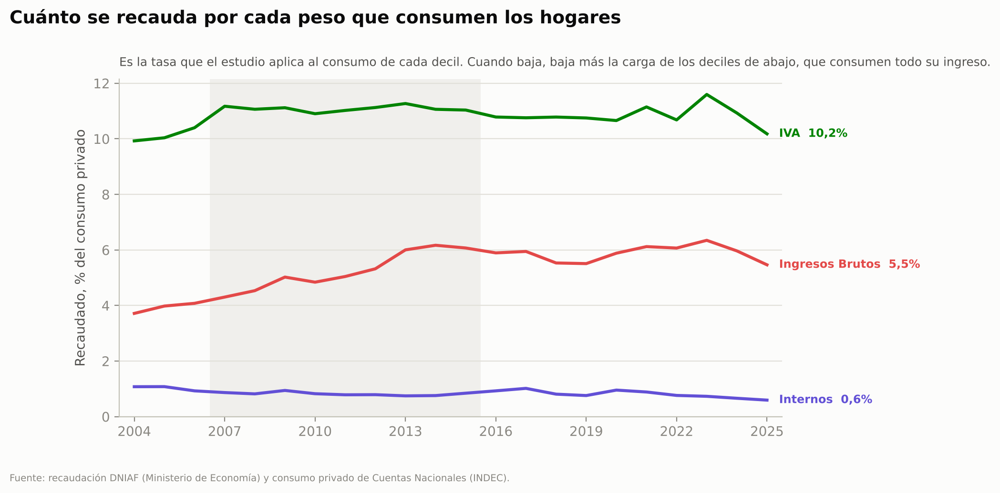

**Figura A.1.** Recaudación de IVA, Internos e Ingresos Brutos por cada peso de consumo de los
hogares, 2004-2025.

Es la tasa que el estudio aplica al consumo de cada grupo (sección 2): lo que se recaudó con cada
impuesto, según la Dirección Nacional de Investigaciones y Análisis Fiscal, dividido por el consumo
privado de las Cuentas Nacionales del INDEC.

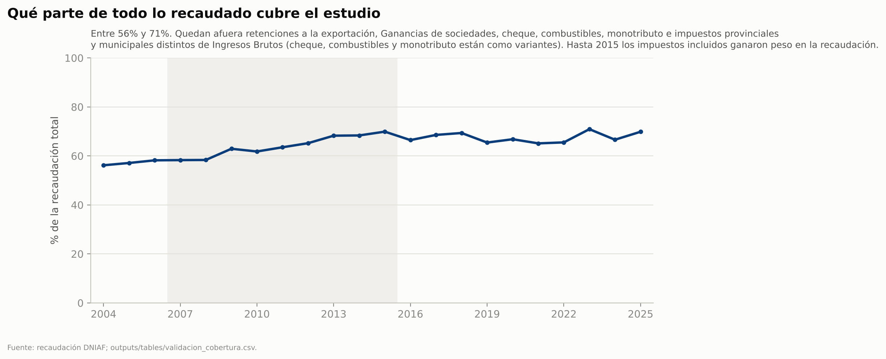

**Figura A.2.** Qué parte de todo lo recaudado cubren los impuestos del estudio, 2004-2025.

### Hitos de política tributaria

Cambios de ley que coinciden en el tiempo con movimientos de los resultados. Son coincidencias, no
causas demostradas.

| Año | Hecho | Dónde se ve |
|---|---|---|
| 2008 | Fin de las AFJP: los aportes pasan al Estado | Aportes de los deciles medios (figura 4) |
| 2013 | Decreto 1242/2013: piso de Ganancias para asalariados | Ganancias del decil 10 (figuras 4 y 11) |
| 2016 | Ley 27.260: baja de alícuotas de Bienes Personales y blanqueo | El 1% (figuras 11 y 13) |
| 2019-2020 | Ley 27.541: suben las alícuotas de Bienes Personales | El 1% (figuras 11 y 13) |
| 2021 | Ley 27.617: suben los mínimos de Ganancias | Ganancias del decil 10 (figura 4) |
| 10/2023-06/2024 | Régimen cedular: casi todos los asalariados dejan de pagar Ganancias | Ganancias del decil 10 (figura 4) |
| 2024 | Ley 27.743: vuelve Ganancias a los asalariados y bajan las alícuotas de Bienes Personales | Ganancias y Bienes Personales (figura 11) |

### Cada año, grupo por grupo

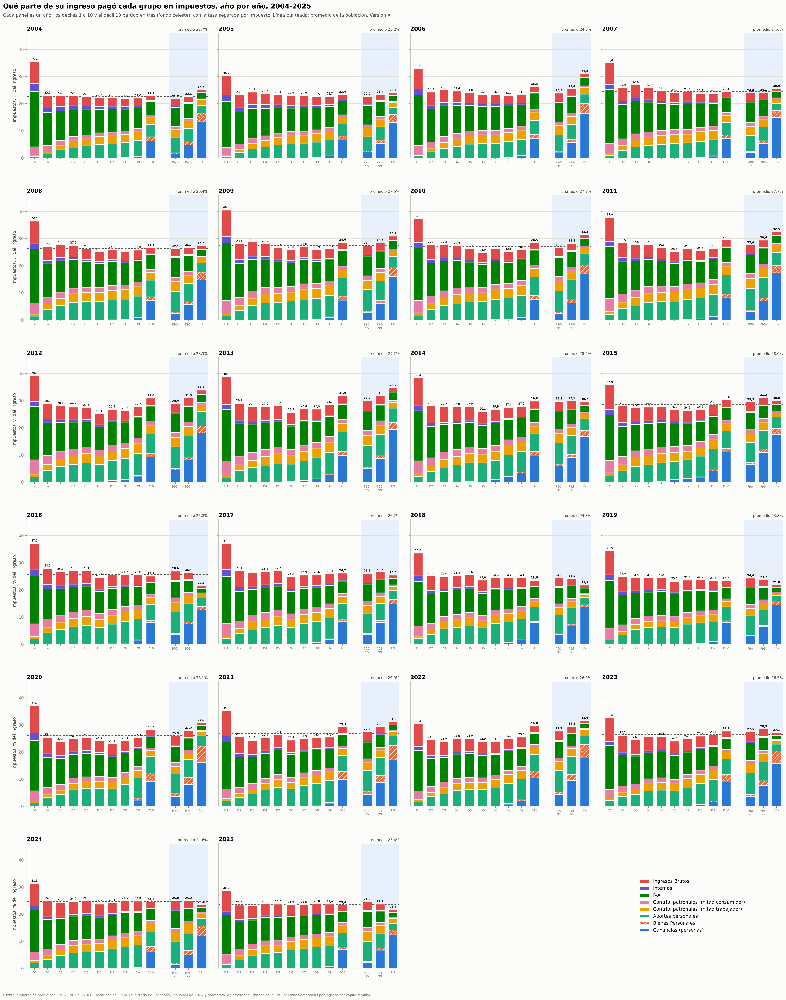

**Figura A.3.** Qué parte de su ingreso pagó cada grupo en impuestos, año por año, 2004-2025.

La figura A.3 repite la figura 8 para cada año de 2004 a 2025: la tasa de cada decil y del decil 10
partido en tres, separada por impuesto, con la versión A.

### Control del 1% más rico

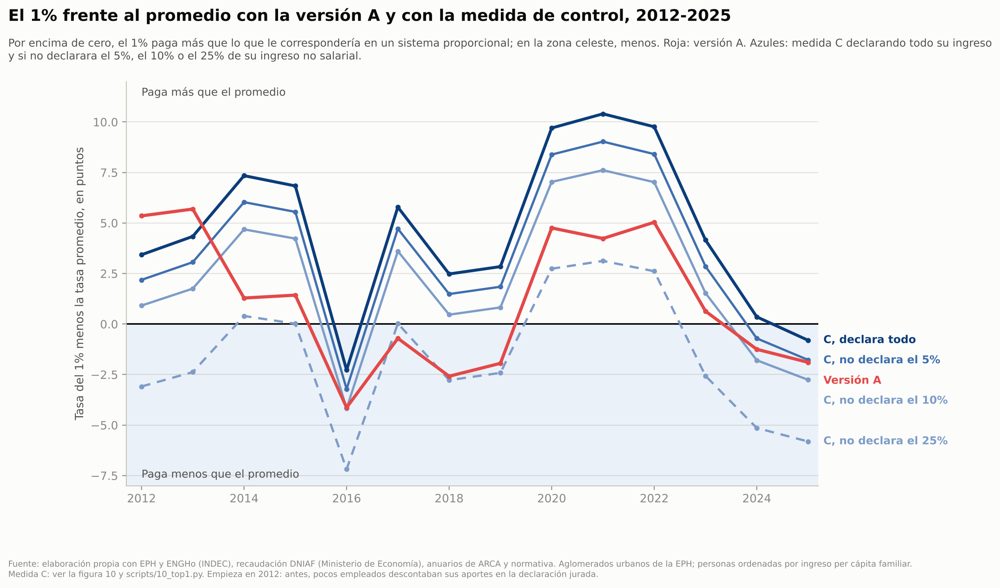

**Figura A.4.** El 1% más rico frente al promedio con la versión A y con la medida de control, según
cuánto ingreso no declara, 2012-2025.

Cada línea muestra cuántos puntos paga el 1% por encima o por debajo del promedio de la población.
Por encima de cero paga más que lo que le correspondería en un sistema proporcional; en la zona
celeste, por debajo de cero, paga menos. La línea roja es la versión A. Las azules son la medida de
control de la sección 4: declarando todo su ingreso, y si no declarara el 5%, el 10% o el 25% de su
ingreso no salarial. Esos porcentajes equivalen a no declarar alrededor del 4%, el 9% y el 22% de su
ingreso total. Empieza en 2012 porque antes pocos empleados descontaban sus aportes en la
declaración jurada. Las fuentes son las de la figura 10.

Las dos medidas coinciden en 2014-2015 y 2020-2022: el 1% paga más que el promedio en todos los
escenarios, en los años en que Ganancias y Bienes Personales pesaron más. También coinciden en 2016
y 2025, cuando paga menos aun declarando todo. En 2024 coinciden si el 1% no declara el 5% de su
ingreso no salarial. En 2018 y 2019 coinciden sólo si no declara una cuarta parte, y en 2017, ni así.
