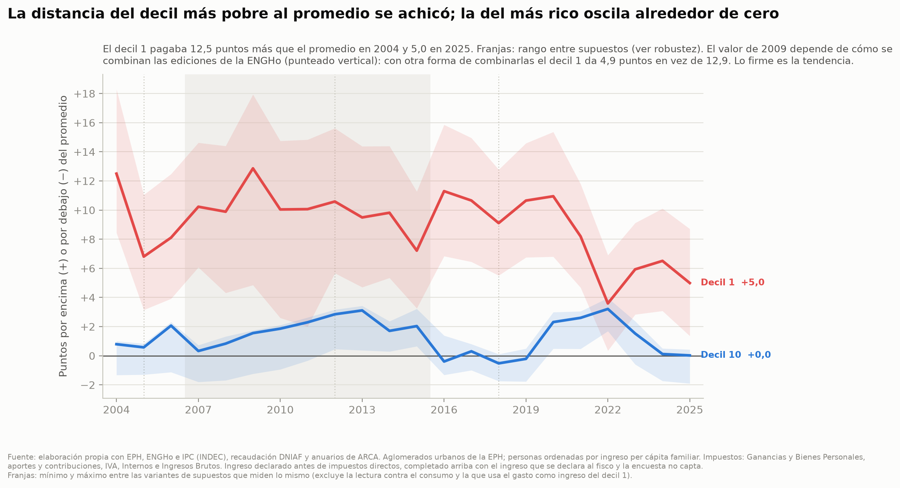
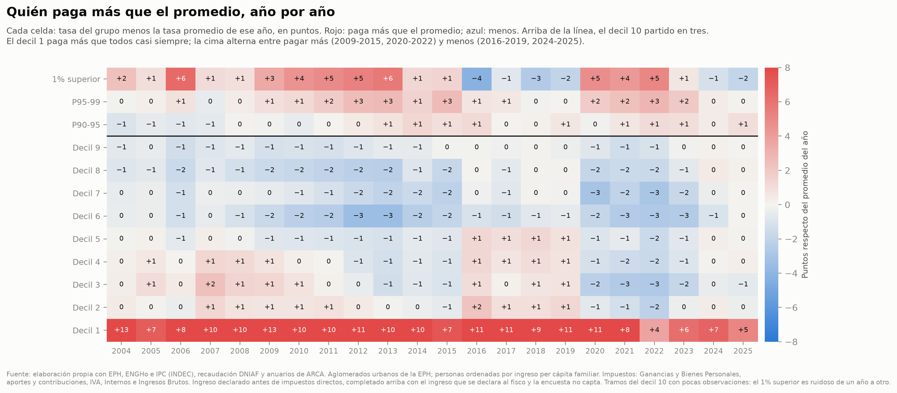
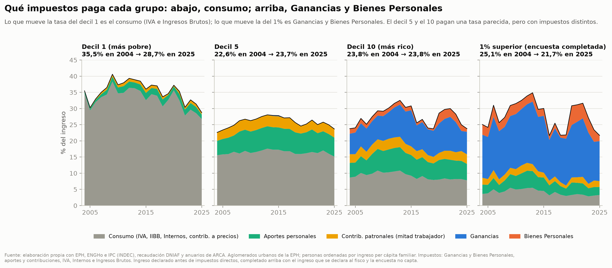
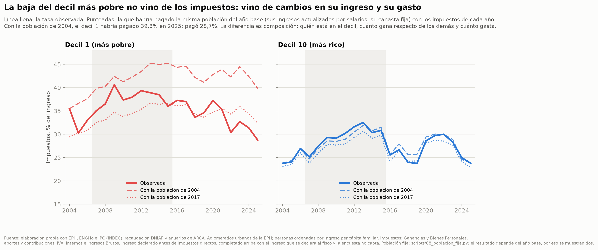
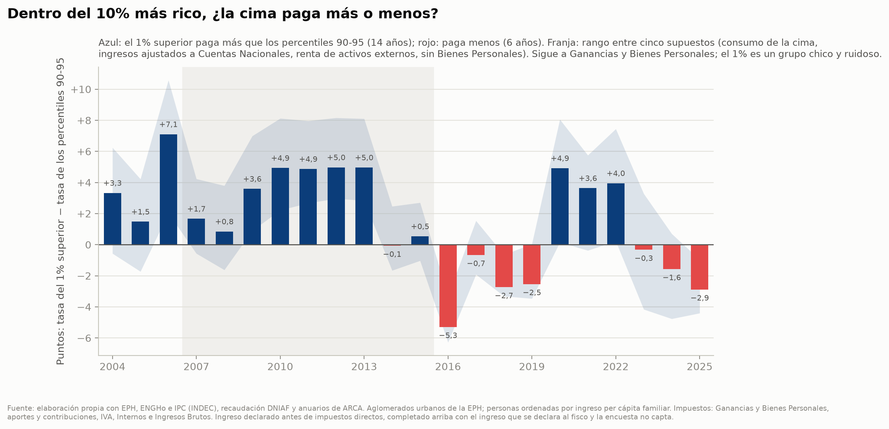
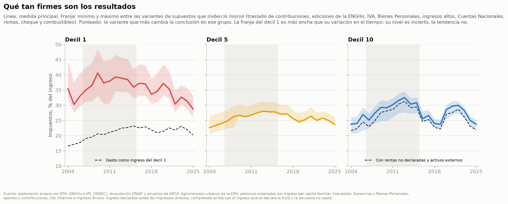
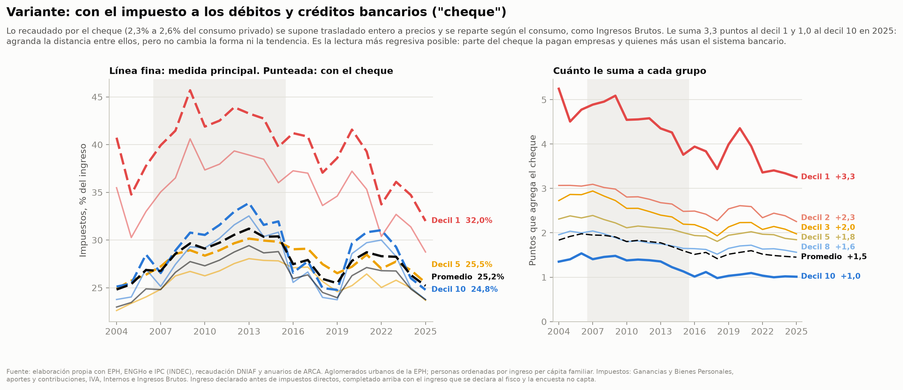

# Quién paga impuestos en Argentina, 2004-2025

**Informe de resultados.** Qué parte de su ingreso pagó en impuestos cada grupo de la población,
año por año, y cómo fue cambiando. Los gráficos se generan con `scripts/12_informe_graficos.py`
y están en `outputs/figures/informe/`. El método completo está en `docs/metodologia.md`.

## Resumen

- **El 10% más pobre paga la mayor proporción de su ingreso, todos los años.** Pasa en los 22 años
  y en todas las variantes de supuestos que miden lo mismo. En 2025 pagó 28,7% de su ingreso,
  contra 23,8% en promedio.
- **Esa distancia se achicó.** El decil 1 pagaba 12,5 puntos más que el promedio en 2004 y 5,0
  en 2025. La baja vino de cambios en el ingreso y el gasto de ese grupo, no de los impuestos: con
  la población de 2004, los impuestos de 2025 le habrían cobrado 39,8%.
- **Del decil 2 al 10 la carga es pareja.** En 2025, entre 23,0% y 23,8%. El sistema es casi
  proporcional: no cobra más, en proporción, a quien gana más.
- **Dentro del 10% más rico, la cima a veces paga más y a veces menos.** El 1% superior pagó más
  que los percentiles 90-95 en 14 de 22 años (hasta 5 puntos más en 2010-2013) y menos en 2016-2019,
  2024 y 2025 (hasta 5,3 puntos menos en 2016). Lo que lo mueve es Ganancias y Bienes Personales.
- **La carga promedio subió de 23,0% (2004) a 29,4% (2013) y volvió a 23,8% (2025).**

## 1. Qué se mide

**Tasa efectiva** = impuestos que paga un grupo ÷ su ingreso.

- **Grupos:** personas de los aglomerados urbanos de la EPH (65% de la población en 2025),
  ordenadas por ingreso per cápita familiar y agrupadas en deciles. El decil 10 además se parte en
  percentiles 90-95, 95-99 y el 1% superior.
- **Ingreso:** el que se declara en la EPH, antes de impuestos directos. Arriba se completa con el
  ingreso que se declara a ARCA y la encuesta no capta, junto con la Ganancias que paga.
- **Impuestos:** Ganancias y Bienes Personales, aportes personales, contribuciones patronales, IVA,
  Internos e Ingresos Brutos. Son entre 56% y 71% de todo lo recaudado (anexo, gráfico A3).
  Quedan afuera retenciones a la exportación, Ganancias de sociedades, cheque, combustibles,
  monotributo e impuestos provinciales y municipales distintos de Ingresos Brutos.
- **Anclado a lo recaudado:** los impuestos al consumo se reparten según lo que efectivamente se
  cobró por cada peso de consumo (anexo, gráfico A2), no según la alícuota legal.
- **Un año por vez, con el mismo método:** las reglas de Ganancias, aportes y contribuciones de
  cada año; la encuesta de gastos (ENGHo) de 2004/05, 2012/13 y 2017/18, interpolada entre
  ediciones.

## 2. Cuánto se paga y cómo cambió

La carga promedio sube de 23,0% en 2004 a 29,4% en 2013, baja a 24,0% en 2019, sube a 27,1% en
2021 y vuelve a 23,8% en 2025. El decil 1 está arriba de todos los grupos en los 22 años. Los
deciles 2 a 9 (franja gris) pagan casi lo mismo entre sí: en 2025 los separa menos de un punto.
El decil 10 va pegado al promedio, salvo en 2009-2015 y 2020-2023, cuando pagó entre 1,5 y 3,2
puntos más.

El período 2007-2015 (sombreado) es el de la intervención del INDEC: la EPH y los precios de esos
años son menos confiables. En 2007, 2015 y 2016 faltan trimestres de la EPH (círculos huecos).

## 3. Quién paga más, y si eso cambió

Para ver si cambió la forma y no sólo el nivel, cada grupo se mide contra el promedio de su año.
El decil 1 pagaba 12,5 puntos más que el promedio en 2004, alrededor de 10 entre 2007 y 2020, y
entre 3,6 y 6,5 desde 2022 (5,0 en 2025). La caída de 2004 a 2025 aparece en las 18 variantes de
supuestos. El decil 10 oscila entre 3,2 puntos arriba (2022) y medio punto abajo (2018) del promedio.

**Cuidado con 2009.** El pico del decil 1 (12,9 puntos, 40,6% de su ingreso) depende de cómo se
combinan las ediciones de la ENGHo: con la de 2004/05 hasta 2011 en vez de interpolarla, da 4,9
puntos. Lo firme es la tendencia, no el valor de un año.

El mapa muestra los 22 años y los 12 grupos. Rojo es pagar más que el promedio de ese año; azul,
menos. El decil 1 es rojo todos los años. Los deciles 6 a 8 son los que más seguido pagan menos que
el promedio (hasta 3 puntos en 2012-2013 y 2020-2023). La cima del decil 10 alterna.

## 4. Por qué cambió

**Cada grupo paga impuestos distintos.** Al decil 1 casi todo le llega por el consumo: IVA,
Ingresos Brutos, Internos y la parte de las contribuciones patronales que pasa a precios
(26,8 de sus 28,7 puntos en 2025). Al 1% superior le llega sobre todo por Ganancias y Bienes
Personales (14,1 puntos en 2025; 22,8 en 2022). El decil 5 y el 10 pagan una tasa parecida con
impuestos distintos: el 10 paga menos consumo (7,8 puntos contra 15,1) y más Ganancias y Bienes
Personales (7,9 contra 0).

Por eso la carga de abajo sigue a los impuestos al consumo, y la de arriba a Ganancias y Bienes
Personales. El IVA cobrado por cada peso de consumo bajó de 11,6% en 2023 a 10,2% en 2025 y el de
Ingresos Brutos, de 6,3% a 5,5% (anexo, A2): de ahí viene buena parte de la baja del decil 1 en
esos años.

**Impuestos o población.** Los deciles no son las mismas personas cada año: cambia quién trabaja
registrado, cuánto gana cada uno respecto de los demás y cuánto gasta. Para separar ese efecto se
toma la población de un año base, se actualizan sus ingresos por salarios, se deja fija su canasta
y se le aplican los impuestos de cada año.

- Con la población de 2004, el decil 1 habría pasado de 35,5% a 45,2% en 2013 y 39,8% en 2025.
  Pagó 28,7%. Los impuestos no se volvieron más livianos para los pobres: cambió quién es pobre,
  cuánto gana y cuánto consume en relación con su ingreso.
- Con la población de 2017 la conclusión es la misma (32,4% en 2025).
- En el decil 10 las tres líneas casi coinciden: su tasa la explican los impuestos de cada año.

## 5. Adentro del 10% más rico

El decil 10 mezcla a asalariados de clase media alta con los ricos. Partido en tres, se ve que el
1% superior paga entre 5 puntos más (2010-2013) y 5,3 puntos menos (2016) que los percentiles
90-95. Paga más cuando Ganancias y Bienes Personales pesan más (2009-2013, 2020-2022) y menos cuando
pesan menos (2016-2019, 2024-2025). En 2025 los tres tramos pagan 24,6%, 23,7% y 21,7%.

Para llegar acá la encuesta se completa con las declaraciones juradas de Ganancias: a las personas
de arriba se les suma el ingreso que declaran a ARCA y la encuesta no ve (con sus rentas exentas) y
la Ganancias que pagan. Con eso, la Ganancias del 1% de la encuesta coincide con la del 1% de las
declaraciones (2024: 12,0% contra 11,7% de su ingreso).

**Dos medidas del 1%.** La de este gráfico es el 1% de la encuesta, completado. La figura 7 del
repo estima el 1% sólo con declaraciones juradas, por declarante, y le suma la mitad de las
utilidades de las empresas y del impuesto de sociedades: da 26,6% en 2025. No son el mismo grupo ni
la misma cuenta, y no conviene compararlas en un mismo eje.

## 6. Qué tan firmes son los resultados

Cada resultado se recalcula con otros supuestos: cuánto de las contribuciones patronales paga el
trabajador o el consumidor, cómo se combinan las ENGHo, IVA al nivel legal, sin Bienes Personales,
ingresos altos sin corregir, ingresos ajustados a Cuentas Nacionales, rentas del capital
multiplicadas por 7, renta de activos externos, con cheque y combustibles.

- **Firme:** el decil 1 paga más que los deciles 2 a 9 en todas las variantes y todos los años
  (396 de 396 combinaciones). Su distancia al promedio es menor en 2025 que en 2004 en las 18
  variantes. Los deciles 2 a 9 pagan casi lo mismo entre sí.
- **Incierto:** el nivel del decil 1. Su franja (entre 26% y 33% en 2025) es más ancha que su
  variación en el tiempo.
- **Una lectura que lo da vuelta:** si en el decil 1 se usa el gasto en vez del ingreso declarado
  (los hogares pobres gastan más de lo que declaran ganar), paga entre 3 y 7 puntos menos que el
  promedio. Mide otra cosa, pero muestra cuánto depende el resultado de abajo de la medida del ingreso.
- **El decil 10 baja** cuando se suma el ingreso de capital que nadie declara (rentas multiplicadas
  por 7 y renta de activos externos): 21,8% en 2025, debajo de todos los demás deciles.

### Variante: con el impuesto al cheque

La medida principal no incluye el impuesto a los débitos y créditos bancarios. La variante lo suma:
lo recaudado (entre 2,3% y 2,6% del consumo privado) se supone trasladado entero a los precios y se
reparte según el consumo de cada decil, como Ingresos Brutos.

| Puntos que agrega | Prom. | D1 | D2 | D3 | D5 | D8 | D10 |
|---|---|---|---|---|---|---|---|
| 2004 | +1,8 | +5,2 | +3,1 | +2,7 | +2,3 | +2,0 | +1,4 |
| 2012 | +1,8 | +4,6 | +2,8 | +2,5 | +2,1 | +1,8 | +1,4 |
| 2018 | +1,4 | +3,4 | +2,3 | +1,9 | +1,8 | +1,5 | +1,0 |
| 2025 | +1,5 | +3,3 | +2,3 | +2,0 | +1,8 | +1,6 | +1,0 |

Es regresivo: al decil 1 le suma tres veces más que al decil 10, porque consume todo su ingreso y
el 10 ahorra. Agranda la distancia entre ellos en unos 2 puntos, pero no cambia la forma ni la
tendencia. Con el cheque, 2018 queda cerca de Argendata, que lo incluye: decil 1, 37,1% (ellos
35,8%); decil 10, 25,0% (ellos 24,9%). Es la lectura más regresiva posible: parte del cheque la
pagan empresas y quienes más usan el sistema bancario, que están más arriba.

## 7. Comparación y limitaciones

**Contra Argendata (Pessino, Rasteletti, Artana y Lustig, BID 2023), ~2018:**

| Decil | 1 | 2 | 3 | 5 | 9 | 10 |
|---|---|---|---|---|---|---|
| Argendata | 35,8 | 30,8 | 27,8 | 25,6 | 24,2 | 24,9 |
| Este estudio, 2018 | 33,6 | 25,3 | 25,0 | 25,7 | 24,5 | 24,0 |
| Este estudio, 2018, con cheque | 37,1 | 27,6 | 27,0 | 27,5 | 25,9 | 25,0 |

La forma coincide: el decil 1 paga mucho más y del 3 al 10 la carga es pareja. Las diferencias de
nivel vienen de los impuestos incluidos (ellos suman cheque, otros impuestos en cascada y derechos
de importación, que pesan más abajo) y de la definición de ingreso (ellos incluyen el alquiler
imputado de la vivienda propia). Lo que agrega este estudio es la serie de 22 años y el interior
del decil 10.

**Limitaciones:**

- Sólo aglomerados urbanos de la EPH; el resto del país es en promedio más pobre.
- 2007-2015: datos del INDEC intervenido.
- 2025 usa las declaraciones juradas de 2024 actualizadas (las de 2025 todavía no se publicaron).
- El 1% superior de la encuesta tiene pocas observaciones: sus saltos de un año (2006, 2016) son en
  parte ruido.
- No se tiene en cuenta que en los comercios informales se paga menos IVA, lo que haría menos
  pesada la carga de abajo.
- No se reparten Ganancias de sociedades ni retenciones a la exportación entre los deciles (ver
  "Pendientes").

### Pendientes

**Ganancias de sociedades (2,4% del PIB en 2025; entre 2,4% y 3,1% en la serie).** No se suma a la
medida principal por tres razones:

1. **No se sabe bien quién lo paga.** Lo paga la empresa, pero el costo puede recaer en los dueños
   (menos ganancia), en los trabajadores (menos salario) o en los consumidores (más precio). La
   literatura usa escenarios (100% a los dueños del capital, o 50% capital y 50% trabajo) y el
   resultado de la cima depende de cuál se elija.
2. **Sumarlo bien exige sumar también las utilidades al ingreso de los dueños.** Si se suma sólo el
   impuesto, la tasa de la cima se infla (es el mismo error que se corrigió con la Ganancias de
   personas: impuesto sin el ingreso que lo genera). Con las utilidades, esa parte paga cerca del
   30% y el efecto es mucho menor: en el 1% de las declaraciones juradas (figura 7) sumar la mitad
   del impuesto y de las utilidades casi no cambia su tasa (30,2% sin sociedades, 30,1% con).
3. **No hay datos de quién es dueño de qué.** Ni la EPH ni las declaraciones juradas publicadas dicen
   cuántas acciones o participaciones tiene cada persona.

**Cómo se agregaría.** Como variantes, con una sola perilla: quién paga cada peso del impuesto. A
quien lo paga se le suman a la vez el impuesto y el ingreso que tendría sin el impuesto, como en la
corrección de la Ganancias de personas. Cuatro escenarios:

| Escenario | Capital | Trabajo | Consumidores |
|---|---|---|---|
| Todo al capital | 100% | | |
| Mitad capital, mitad trabajo | 50% | 50% | |
| Todo al trabajo | | 100% | |
| Todo a precios | | | 100% |

- **Parte del capital (los dueños).** Impuesto: su parte de la recaudación, menos la que corresponde
  a dueños del exterior (aproximada con la inversión extranjera directa de la Posición de inversión
  internacional del INDEC). Ingreso: las utilidades antes del impuesto (impuesto ÷ alícuota), que
  son ingreso de los dueños aunque la empresa no las reparta. La alícuota va año por año en
  `params/`: 35% hasta 2017, 30% en 2018-2020, escala de 25/30/35% desde 2021 (Ley 27.630). A quién:
  primero con las proporciones del empalme con las declaraciones juradas (como la Ganancias que la
  encuesta no capta); mejor, con las rentas de negocios por tramo de los anuarios de ARCA, si vienen
  separadas; las ganancias de negocios de la EPH pueden dar la forma en los deciles medios.
- **Parte del trabajo (salarios más bajos).** Se trata como un impuesto al salario: tasa = su parte
  de la recaudación ÷ la masa salarial privada registrada del país; a cada decil, esa tasa × su masa
  salarial privada registrada, como impuesto y también como ingreso (es salario que habría cobrado).
  No alcanza a informales, empleados públicos ni jubilados.
- **Parte de los consumidores (precios más altos).** Como la mitad de las contribuciones patronales
  que pasa a precios: recaudación por peso de consumo privado × el consumo de cada decil.

**Qué se espera.** El nivel sube unos 3 puntos en cualquier escenario (2,4% a 3,1% del PIB).

- Todo al capital: sube la cima; el 1% de la encuesta (21,7% en 2025) se acerca al 30%, porque esa
  parte paga más que su promedio, y su parte del ingreso crece mucho (las utilidades son del orden
  de 8% del PIB). Los deciles 1 a 8 casi no cambian.
- Todo al trabajo: recae en los deciles con empleo privado registrado (4 a 10) y sube varios puntos
  a los del medio; el decil 1 casi no cambia. El perfil queda con una joroba en el medio.
- Todo a precios: regresivo, como el IVA.
- Mitad y mitad: entre los dos primeros.

**Dónde se toca el código.** `params/` (alícuota por año); `src/incidencia/incidencia.py` (un campo
de `Variante` con el reparto entre capital, trabajo y precios; un impuesto `sociedades`; el cálculo
de cada parte); `scripts/09_ingresos_altos.py` (el reparto de la parte del capital si se usan las
rentas de negocios); `scripts/05_incidencia.py` y `scripts/11_tramos_decil10.py` (las cuatro
variantes); el informe (una subsección como la del cheque). No hace falta volver a correr la
microsimulación de la EPH.

**Otros impuestos que quedan afuera:**

- **Combustibles (0,6% del PIB en 2025)** está como variante: se reparte según el consumo total de
  cada decil. Le llega a los hogares por dos vías: directa (la nafta del auto propio, que crece con
  el ingreso) e indirecta (el gasoil del transporte de carga y de pasajeros, de la producción
  agropecuaria y de la industria, que encarece casi todo lo que se compra). Repartirlo según el
  consumo total representa bien la vía indirecta y exagera algo lo regresivo de la directa. Le suma
  1,1 puntos al decil 1 y 0,3 al decil 10 en 2025 (3,7 y 0,9 en 2004, cuando el impuesto pesaba el
  doble). Para separar las dos vías haría falta el gasto en combustible de la ENGHo y una matriz
  insumo-producto.
- **Impuestos provinciales distintos de Ingresos Brutos** (inmobiliario, automotor, sellos; 1,0% a
  1,4% del PIB): habría que conseguir la recaudación separada por impuesto y repartir el inmobiliario
  según la propiedad de la vivienda, el automotor según la tenencia de autos y sellos a precios.
  Sumaría entre 1 y 2 puntos, bastante parejo.
- **Tasas municipales:** no hay una serie nacional de recaudación.
- **Retenciones a la exportación:** no está claro si las pagan los productores o los consumidores
  internos, con precios de alimentos más bajos.
- **Monotributo (0,04% a 0,15% del PIB):** suma menos de medio punto en el decil 1 y una décima en el
  resto.

## Anexo

**A1. Progresividad.** El índice de Kakwani compara cómo se reparten los impuestos con cómo se
reparte el ingreso. Va entre −0,021 (2016) y +0,031 (2022): prácticamente cero, con cambios de
signo. El sistema no redistribuye ingreso: cobra a cada grupo más o menos lo que le toca según su
parte del ingreso. Tabla: `outputs/tables/progresividad_anual.csv`.

**A2. Recaudado por peso de consumo.** Es la tasa que el estudio aplica al consumo de cada grupo.
El IVA pasó de 9,9% del consumo privado en 2004 a 11,6% en 2023 y 10,2% en 2025; Ingresos Brutos,
de 3,7% a 6,2% en 2014 y 5,5% en 2025.

**A3. Cobertura.** Qué parte de todo lo recaudado entra en el estudio: entre 56% (2004) y 71%.

### Hitos de política tributaria

Coincidencias en el tiempo, no causas demostradas:

| Año | Hecho | Dónde se ve |
|---|---|---|
| 2008 | Fin de las AFJP: los aportes pasan al Estado | Aportes en G4 |
| 2013 | Dto. 1242/2013: piso de Ganancias para asalariados | Ganancias del decil 10 |
| 2016 | Ley 27.260: baja de alícuotas de Bienes Personales y blanqueo | Bienes Personales y la cima (G6) |
| 2019-2020 | Ley 27.541: suben las alícuotas de Bienes Personales | Bienes Personales y la cima (G6) |
| 2021 | Ley 27.617: suben los mínimos de Ganancias | Ganancias del decil 10 |
| 10/2023-06/2024 | Régimen cedular: casi todos los asalariados dejan de pagar Ganancias | Ganancias del decil 10 |
| 2024 | Ley 27.743: vuelve Ganancias a asalariados y bajan las alícuotas de Bienes Personales | Ganancias y Bienes Personales |
