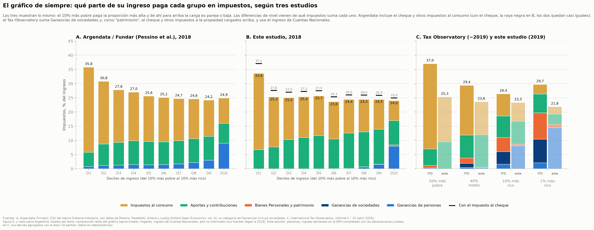
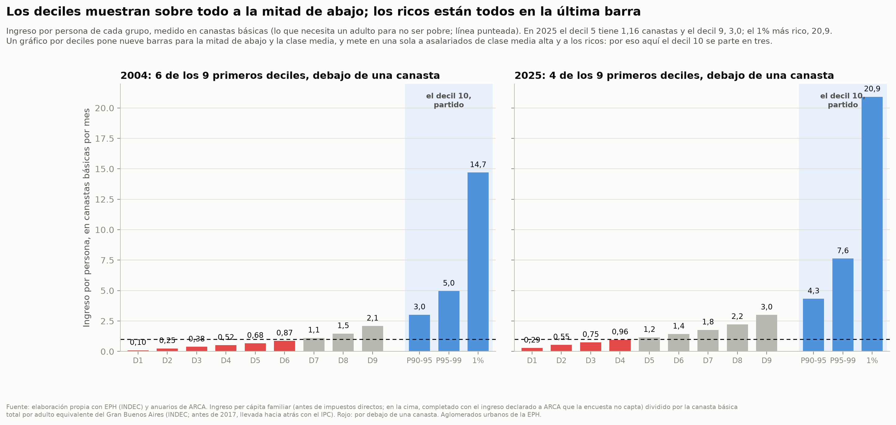
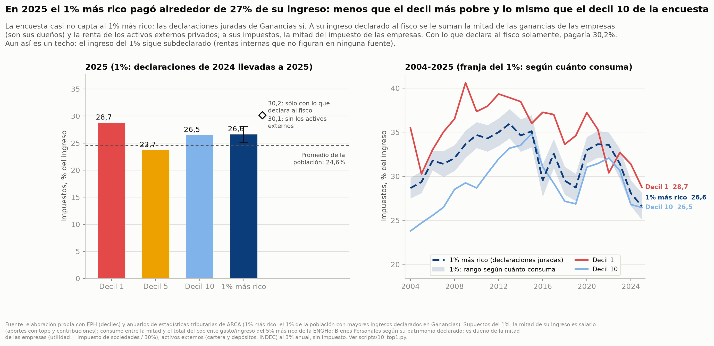
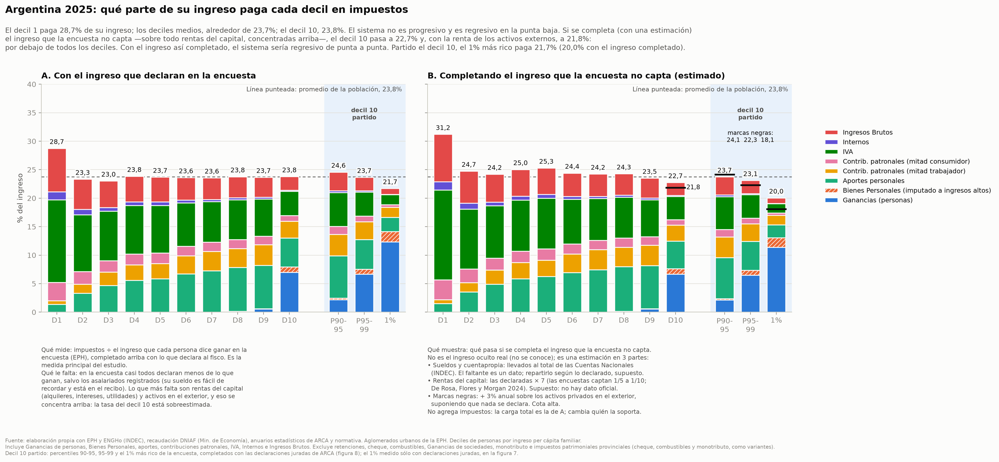
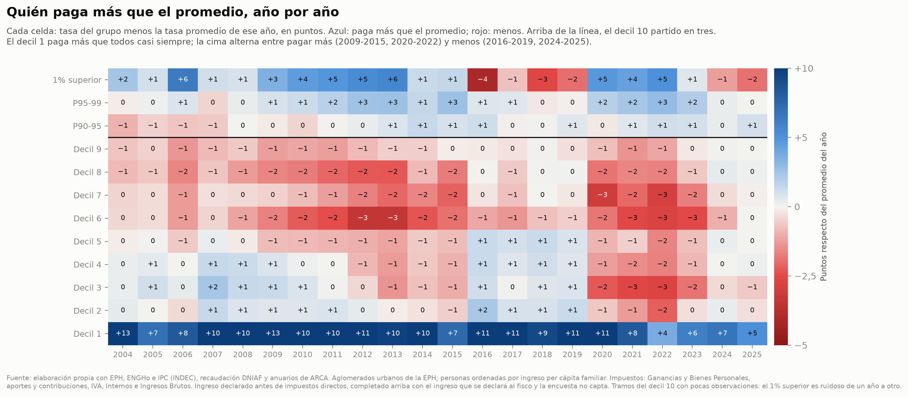
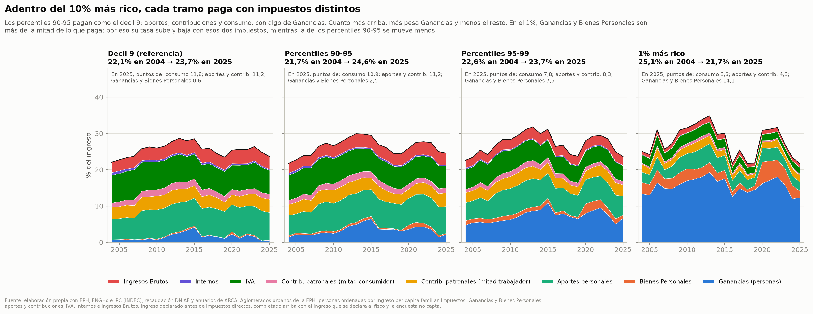
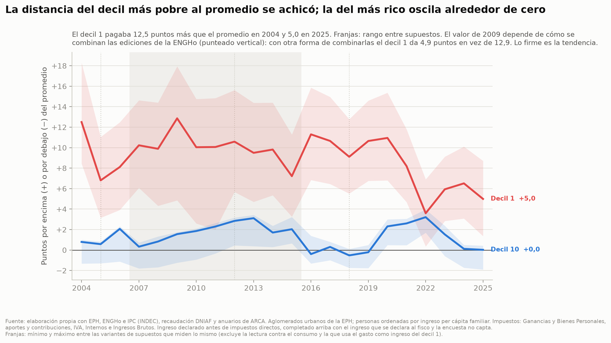

# Quién paga impuestos en Argentina, 2004-2025

**Informe de resultados.** Qué parte de su ingreso pagó en impuestos cada grupo de la población,
año por año, y cómo fue cambiando. Está escrito para que lo pueda leer cualquiera; los párrafos
marcados **Detalle técnico** son para quien quiera saber exactamente cómo se calculó. Los gráficos
se generan con `scripts/12_informe_graficos.py` y están en `outputs/figures/informe/`. El método
completo está en `docs/metodologia.md`.

## Cómo leer este informe

- **Tasa efectiva:** de cada 100 pesos que ingresa un grupo, cuántos se van en impuestos. No es la
  alícuota de la ley (el 21% del IVA, por ejemplo): es lo que efectivamente termina pagando, sumando
  todos los impuestos y dividiendo por todo su ingreso.
- **Decil:** se ordena a toda la población de menor a mayor ingreso por persona y se la corta en
  diez grupos del mismo tamaño. El decil 1 es el 10% de menores ingresos; el decil 10, el 10% de
  mayores ingresos.
- **Percentil:** lo mismo, cortando en cien grupos. "Percentiles 90-95" es el 5% que está justo
  arriba del decil 9; "el 1% más rico" es el percentil 100.
- **Canasta básica total:** lo que el INDEC calcula que necesita un adulto por mes para no ser pobre.
  Medir el ingreso en canastas permite comparar años sin que la inflación lo distorsione.
- **Proporcional, progresivo, regresivo:** un sistema es *proporcional* si todos pagan la misma
  tasa; *progresivo*, si la tasa sube con el ingreso; *regresivo*, si baja.
- **Puntos:** la diferencia entre dos porcentajes. Pasar de 24% a 28% es subir 4 puntos.

## Resumen

- **El gráfico de siempre muestra un sistema regresivo abajo y plano arriba.** El 10% más pobre
  paga la proporción más alta de su ingreso (28,7% en 2025) y del decil 2 al 10 la carga es pareja
  (entre 23,0% y 23,8%). Lo encuentran también Argendata y el International Tax Observatory.
- **Pero en Argentina los deciles esconden a los ricos.** En 2025 cuatro deciles están por debajo de
  la línea de pobreza de un adulto, y el decil 10 junta a quien tiene 4 canastas por persona con
  quien tiene 21. Hay que partirlo.
- **Partido, la cima paga menos.** En 2025 los percentiles 90-95 pagan 24,6%, los 95-99, 23,7%, y el
  1% más rico, 21,7%: menos que cualquier decil.
- **El sistema es casi proporcional, y el 1% es lo que más se mueve.** Comparado con un sistema
  donde todos pagan la misma tasa, nadie se aleja más de unas décimas, salvo el 1%: pagó más de lo
  proporcional en 2009-2013 y 2020-2022 y menos en 2016-2019 y 2024-2025, al ritmo de Ganancias y
  Bienes Personales.
- **Comparado con un sistema progresivo, falta arriba lo que sobra abajo.** Con la misma
  recaudación, el 1% pagaría entre 2,4 y 9,1 puntos más de la recaudación total, todos los años, y
  los deciles 1 a 7 pagarían menos.
- **Adentro del decil 10 cambia cómo se paga.** Los percentiles 90-95 pagan como un asalariado
  (aportes, contribuciones, consumo); el 1%, sobre todo con Ganancias y Bienes Personales.
- **Los impuestos agrandan la distancia entre ricos y pobres.** El 10% más rico ingresaba 46 veces
  lo del 10% más pobre en 2004 y 20 veces en 2025; después de impuestos, siempre un poco más (22
  veces en 2025).

## 1. El gráfico de siempre

**En una frase:** tres estudios distintos, con datos y métodos distintos, dibujan el mismo perfil:
el 10% más pobre paga la proporción más alta y de ahí para arriba la carga es pareja.

Así se suele mostrar quién paga impuestos: una barra por decil, con la parte de su ingreso que se va
en impuestos. El gráfico pone lado a lado los dos estudios más citados y este:

- **A. Argendata (Fundar)**, con datos de Pessino, Rasteletti, Artana y Lustig, para 2018: el decil 1
  paga 35,8% y el decil 10, 24,9%.
- **B. Este estudio**, mismo año: el decil 1 paga 33,6% y el decil 10, 24,0%.
- **C. International Tax Observatory (ITO)**, informe de abril de 2026: no usa deciles sino cuatro
  grupos. El 50% más pobre paga 37%, el 40% del medio 29%, el 10% más rico 25% y el 1% más rico
  alrededor de 30%. Al lado, este estudio con los mismos cuatro grupos en 2019: 25,3%, 23,6%, 23,3% y
  21,8%.

**Por qué los niveles no son iguales.** Cada estudio suma impuestos distintos y mide el ingreso de
otra forma:

| | Argendata | ITO | Este estudio |
|---|---|---|---|
| Año | 2018 | no lo dice (sus fuentes llegan a 2019) | 2004 a 2025, cada año |
| Unidad | personas | hogares | personas |
| Ingreso | encuesta | Cuentas Nacionales (más alto que la encuesta) | encuesta, completada arriba con las declaraciones juradas |
| Impuesto al cheque | sí (como impuesto "en cascada") | no lo detalla | como variante (raya negra en B) |
| Ganancias de sociedades | sí | sí | no (ver "Pendientes") |
| Impuestos al patrimonio | no | sí | Bienes Personales |

Con el cheque, este estudio queda casi igual a Argendata en las dos puntas (2018: decil 1, 37,1%
contra 35,8%; decil 10, 25,0% contra 24,9%). En el IVA las dos estimaciones coinciden casi decil por
decil (decil 1: 16,7 contra 16,5 puntos; decil 5: 8,8 contra 8,8). Las diferencias que quedan
vienen de "otros impuestos indirectos" que Argendata suma (probablemente derechos de importación y
combustibles, entre otros) y de que reparte Ganancias de sociedades entre todos los deciles.

Contra el ITO, la diferencia grande está en las puntas. Abajo, el ITO le carga al 50% más pobre unos
30 puntos de impuestos al consumo, contra unos 18 de este estudio; no pudimos verificar de dónde
sale esa diferencia. Arriba, el 1% del ITO llega a 30% porque suma Ganancias de sociedades (unos 8
puntos) y bastante patrimonio (unos 9); este estudio no reparte el impuesto de sociedades.

**El mismo gráfico, 22 años.** Este estudio repite la cuenta todos los años desde 2004. La carga
promedio sube de 23,0% en 2004 a 29,4% en 2013, baja a 24,0% en 2019, sube a 27,1% en 2021 y vuelve a
23,8% en 2025. El decil 1 está arriba de todos los grupos en los 22 años. Los deciles 2 a 9 (franja
gris) pagan casi lo mismo entre sí. El 1% más rico (punteado) es el que más se mueve: entre 21,6% y
34,9% según el año. El período 2007-2015 (sombreado) es el de la intervención del INDEC: sus datos son
menos confiables.

**Detalle técnico: qué mide este estudio.**

- **Población:** personas de los aglomerados urbanos de la Encuesta Permanente de Hogares (EPH), 65%
  de la población en 2025, ordenadas por ingreso per cápita familiar (el ingreso del hogar dividido
  por sus miembros).
- **Ingreso:** el que se declara en la EPH, antes de impuestos directos. Arriba se completa con el
  ingreso que se declara a ARCA y la encuesta no capta (sección 3).
- **Impuestos:** Ganancias y Bienes Personales, aportes personales, contribuciones patronales
  (mitad las paga el trabajador con menos salario y mitad el consumidor con precios más altos), IVA,
  Internos e Ingresos Brutos. Son entre 56% y 71% de todo lo recaudado (anexo, A3).
- **Anclado a lo recaudado:** los impuestos al consumo se reparten según lo que efectivamente se
  cobró por cada peso consumido (anexo, A2), no según la alícuota legal. Así se descuenta la evasión.
- **Cada año con sus reglas:** las escalas de Ganancias, aportes y contribuciones de cada año, y la
  encuesta de gastos (ENGHo) de 2004/05, 2012/13 y 2017/18, interpolada entre ediciones.

## 2. Por qué ese gráfico engaña en Argentina

**En una frase:** los deciles reparten a la población en partes iguales, pero en Argentina la
mitad de esas partes son pobres o casi, y todos los ricos quedan apretados en la última barra.

El gráfico mide el ingreso de cada grupo en canastas básicas: cuántas veces le alcanza para cubrir
lo que necesita un adulto para no ser pobre.

- En 2025, los deciles 1 a 4 están **por debajo de una canasta** por persona (de 0,29 a 0,96). En
  2004 eran seis deciles.
- El decil 5 tiene 1,16 canastas y el decil 9, 3,0. Es clase media, no ricos.
- El decil 10 junta realidades muy distintas: los percentiles 90-95 tienen 4,3 canastas; los 95-99,
  7,6; el 1% más rico, **20,9**.

Por eso, cuando un gráfico por deciles muestra que "el decil 10 paga 24%", está promediando a un
asalariado de clase media alta con quien tiene cinco veces su ingreso. Nueve de las diez barras
hablan de la mitad de abajo y de la clase media; lo que pasa con los ricos queda escondido en una
sola. La solución de este estudio es partir el decil 10 en tres (sección 3).

**Por qué el decil 1 paga tanto.** Cada grupo paga impuestos distintos:

| Puntos de su ingreso | Ganancias | Bienes Pers. | Aportes | Contrib. (trabajador) | Contrib. (precios) | IVA | Internos | Ingresos Brutos | **Total** |
|---|---|---|---|---|---|---|---|---|---|
| Decil 1, 2004 | 0,0 | 0,0 | 0,5 | 0,3 | 3,3 | 20,4 | 3,1 | 7,9 | **35,5** |
| Decil 1, 2025 | 0,0 | 0,0 | 1,4 | 0,6 | 3,2 | 14,5 | 1,4 | 7,6 | **28,7** |
| Decil 5, 2025 | 0,0 | 0,0 | 5,9 | 2,7 | 1,8 | 8,3 | 0,6 | 4,3 | **23,7** |
| Decil 10, 2025 | 7,0 | 1,0 | 5,1 | 2,9 | 1,0 | 4,2 | 0,2 | 2,4 | **23,8** |
| 1% más rico, 2025 | 12,4 | 1,8 | 2,5 | 1,8 | 0,4 | 1,8 | 0,1 | 1,0 | **21,7** |

- **Decil 1: consumo.** IVA, Ingresos Brutos, Internos y la parte de las contribuciones que pasa a
  precios son 26,8 de sus 28,7 puntos en 2025. Quien gasta todo lo que gana (o más, con ayuda de
  familiares, ahorros o deudas) paga el IVA sobre todo su ingreso; quien ahorra, sólo sobre una
  parte. En 2004 el decil 1 gastaba 2,2 veces lo que declaraba ganar; en 2025, 1,4 veces. Por eso su
  tasa bajó, sobre todo por el IVA (de 20,4 a 14,5 puntos).
- **Decil 5: consumo y salario.** Paga casi lo mismo por consumo que por aportes y contribuciones de
  su salario registrado.
- **Decil 10 y el 1%: Ganancias.** El decil 10 paga 7,8 puntos por consumo, 8,0 por aportes y
  contribuciones y 8,0 por Ganancias y Bienes Personales: la misma tasa que el decil 5, con impuestos
  distintos. En el 1%, Ganancias y Bienes Personales son 14,1 de sus 21,7 puntos.

**Detalle técnico.** El consumo de cada decil sale de la ENGHo, la encuesta de gastos del INDEC. La
tasa del decil 1 depende de que su gasto supere a su ingreso declarado: parte es ingreso que no se
declara en la encuesta. Si en vez del ingreso se usa el gasto, el decil 1 paga menos que el promedio
(sección 7). Por eso el nivel del decil 1 es el resultado menos firme; su tendencia sí es firme.

## 3. Partir el decil 10

**En una frase:** se parte el 10% más rico en tres tramos (percentiles 90-95, 95-99 y el 1%), y se
completa lo que la encuesta no ve con las declaraciones juradas de Ganancias.

**Cómo se calcula.** La EPH es una encuesta: la gente declara cuánto gana, y los de más ingresos
declaran menos de lo que ganan o directamente no responden. Para no subestimar la cima se hacen dos
cosas:

1. **Se parte el decil 10 con la misma encuesta.** Se ordena a sus personas por ingreso per cápita
   familiar, igual que a todos, y se corta en los percentiles 95 y 99.
2. **Se completa la cima con lo que se declara al fisco.** ARCA publica cuánto ingreso y cuánto
   Ganancias declaran los contribuyentes, por tramo. Se busca el punto donde la encuesta y las
   declaraciones se separan: de ahí para arriba, a las personas de la encuesta se les suma el ingreso
   que declaran al fisco y la encuesta no ve (incluidas sus rentas exentas) y la Ganancias que pagan
   por él. Bienes Personales se reparte del mismo modo, según quién tiene patrimonio declarado.

**Cómo sabemos que funciona.** Con esa corrección, la Ganancias que paga el 1% de la encuesta como
parte de su ingreso coincide con la del 1% de las declaraciones juradas: 12,0% contra 11,7% en 2024.

**Detalle técnico.** Se suman a la vez el ingreso faltante y el impuesto faltante, a escala de la
población del país. Sumar sólo el impuesto inflaría la tasa (fue un error del proyecto, corregido:
ver `docs/metodologia.md`, sección 5). La parte de Ganancias que no corresponde a esas personas se
reparte entre los que presentan declaración, a escala de consumo. 2025 usa las declaraciones de 2024
actualizadas.

**El gráfico de siempre, con el decil 10 partido.** Cuatro años: 2004, el comienzo; 2013, el de carga
promedio más alta; 2019, el punto bajo antes de la pandemia; 2025, el último. A la derecha de cada
año, los tres tramos.

- En 2004 y 2013 la carga **sube** dentro del decil 10: el 1% paga más que los percentiles 90-95
  (25,1% contra 21,7% en 2004; 34,9% contra 29,9% en 2013).
- En 2019 y 2025 **baja**: el 1% paga 21,8% y 21,7%, menos que los percentiles 90-95 (24,4% y 24,6%)
  y menos que cualquier decil.
- Lo que cambia es el tamaño del azul y el naranja: Ganancias y Bienes Personales.

**Dos medidas del 1% más rico.** La de este informe es el 1% de la encuesta, completado. Otra forma
de medirlo es tomar sólo las declaraciones juradas, por contribuyente, y sumar la mitad de las
utilidades de las empresas y del impuesto de sociedades: da 26,6% en 2025 (gráfico de arriba). No es el mismo grupo ni la misma cuenta: esa medida queda por
encima del promedio, sobre todo porque suma el impuesto de sociedades, que este informe todavía no
reparte (ver "Pendientes").

**Y aun así está subestimado.** Hay ingreso que no se declara ni en la encuesta ni al fisco: rentas
del capital, activos en el exterior. Si se lo suma (salarios llevados a Cuentas Nacionales, rentas
multiplicadas por 7, renta de los activos externos), el decil 10 baja de 23,8% a 21,8% en 2025 y queda
debajo de todos los deciles (panel B del gráfico de arriba; el panel A es la medida principal).

## 4. ¿Proporcional o progresivo?

**En una frase:** el sistema argentino reparte casi igual que uno donde todos pagan la misma tasa;
lejos de uno progresivo. El que más se aleja de lo proporcional es el 1%, y su dirección cambia con
las leyes de Ganancias y Bienes Personales.

**Cómo se lee.** Se toma todo lo que se recaudó en un año y se pregunta cómo se repartiría entre los
grupos si el sistema fuera de dos tipos de referencia, recaudando lo mismo:

- **Proporcional:** todos pagan la tasa promedio. Cada grupo pagaría una parte de los impuestos igual
  a su parte del ingreso: si tiene el 10% del ingreso, paga el 10% de los impuestos.
- **Progresivo:** la tasa sube con el ingreso. Con la referencia elegida, en 2025 el decil 1 pagaría
  12,7% y el 1% más rico 37,0%.

Cada celda es la diferencia, en puntos de la recaudación total, entre lo que el grupo paga y lo que
pagaría en la referencia. Azul: paga más; rojo: paga menos.

**Frente al proporcional (arriba): desvíos de décimas.**

- El decil 1 paga más que su parte del ingreso los 22 años (entre 0,2 y 0,6 puntos).
- Los deciles 6 a 9 pagan menos casi siempre, sobre todo en 2009-2015 y 2020-2023.
- El 1% es el único que se aleja más de un punto, y en las dos direcciones (franjas de arriba):
  - **2009-2013, la cima paga más** (entre +1,0 y +1,5 puntos): sube su Ganancias, de 16% a 19% de
    su ingreso, en años en que el piso del impuesto quedó atrás de los salarios.
  - **2016-2019, la cima paga menos** (hasta −1,9 en 2016): bajan su Ganancias (a 12,6% en 2016) y
    su Bienes Personales (de 2,3% a entre 0,8% y 1,6%), con baja de alícuotas y blanqueo (Ley 27.260).
  - **2020-2022, paga más otra vez** (hasta +2,1): suben las alícuotas de Bienes Personales (Ley
    27.541) y su Bienes Personales pasa a 6,0% de su ingreso en 2020.
  - **2024-2025, paga menos** (−0,6 y −0,9): baja su Ganancias (12,0% en 2024) y su Bienes Personales
    (1,8% en 2025), con la Ley 27.743.

Son coincidencias en el tiempo con cambios de ley, no causas probadas; la tabla completa de hitos
está al final.

**Frente al progresivo (abajo): desvíos de varios puntos y siempre en la misma dirección.** Los
deciles 1 a 7 pagan más de lo que les tocaría todos los años (hasta 1,8 puntos). El 1% paga entre 2,4
y 9,1 puntos menos, también todos los años. Lo que falta arriba es lo que sobra abajo y en el medio.

**Un número por año.** El índice de Kakwani resume lo mismo: compara cómo se reparten los
impuestos con cómo se reparte el ingreso. Si es positivo, el sistema es progresivo; si es negativo,
regresivo; si es cero, proporcional. En Argentina va entre −0,021 (2016) y +0,031 (2022):
prácticamente cero, con los mismos cambios de signo que el 1% de la matriz. Tabla:
`outputs/tables/progresividad_anual.csv`.

**Detalle técnico.** Referencia progresiva: tasa del grupo = tasa promedio × (ingreso por persona del
grupo ÷ promedio)^0,25, reescalada para recaudar lo mismo. El exponente es una elección: con 0,25 el
decil 1 paga cerca de la mitad del promedio y el 1% cerca del doble. Kakwani: índice de concentración
de los impuestos menos Gini del ingreso, con 12 grupos (aproximado). Tabla de la matriz:
`outputs/tables/deltas_proporcional_progresivo.csv`.

**Otra forma de verlo: contra la tasa promedio.** Cada celda es la tasa del grupo menos la tasa
promedio del año, en puntos (mismos colores). El decil 1 paga entre 4 y 13 puntos más que el
promedio todos los años; los deciles 6 a 8 son los que más seguido pagan menos; la cima alterna.

## 5. Adentro del decil 10 también cambia

**En una frase:** dentro del 10% más rico la tasa baja hacia la cima, y el 1% es el que más se aleja
de lo que pagaría en un sistema progresivo.

En 2025, a la izquierda: los percentiles 90-95 pagan 24,6%, los 95-99, 23,7%, y el 1%, 21,7% (con el
ingreso no declarado, los rombos, 20,1%). A la derecha, los mismos dos repartos de referencia de la
sección 4, para ese año:

- **Proporcional:** los percentiles 90-95 pagan 0,5 puntos de la recaudación más de lo que les
  tocaría, los 95-99 lo justo y el 1% 0,9 menos.
- **Progresivo:** los percentiles 90-95 casi lo justo (−0,2); los 95-99, 3,4 puntos menos; el 1%, 7,0
  menos.

El mismo gráfico para cada año está en `outputs/figures/por_anio/`.

**Cómo paga cada tramo.** No sólo cambia cuánto pagan: cambia con qué.

- **Percentiles 90-95:** pagan como el decil 9. En 2025, 10,9 puntos de consumo, 11,2 de aportes y
  contribuciones y sólo 2,5 de Ganancias y Bienes Personales. Son, sobre todo, asalariados
  registrados de buenos sueldos.
- **Percentiles 95-99:** mitad y mitad. 7,8 de consumo, 8,3 de aportes y contribuciones, 7,5 de
  Ganancias y Bienes Personales.
- **El 1% más rico:** 14,1 de sus 21,7 puntos son Ganancias y Bienes Personales. Los aportes tienen
  tope y el consumo es una parte chica de su ingreso.

Por eso la tasa del 1% sube y baja con las leyes de Ganancias y Bienes Personales (de 21,6% a 34,9%
según el año), mientras que la de los percentiles 90-95 se mueve menos.

## 6. Conclusión: ricos y pobres

**En una frase:** la distancia de ingresos entre ricos y pobres se achicó desde 2004, pero el
sistema tributario no la reduce: la agranda un poco.

A la izquierda: en 2004 el 10% más rico ingresaba por persona 46 veces lo del 10% más pobre; en 2015,
20 veces; en 2025, 20. Después de pagar impuestos la distancia es mayor los 22 años (22 veces en
2025), porque el decil 1 paga una proporción más alta de su ingreso que el decil 10. A la derecha,
el ingreso de cada decil y del 1% en canastas básicas, año por año. Es ingreso declarado: arriba
está subdeclarado, así que la distancia real es mayor.

Juntando todo:

1. El gráfico de siempre (sección 1) muestra un sistema regresivo abajo y plano arriba, y eso lo
   confirman otros estudios.
2. Pero en Argentina ese gráfico habla sobre todo de la mitad de abajo (sección 2).
3. Partiendo el decil 10, la cima paga menos que el resto (sección 3).
4. El sistema es casi proporcional; el que más se aleja es el 1%, y hacia arriba o hacia abajo según
   las leyes de Ganancias y Bienes Personales de cada momento (sección 4).
5. Dentro del 10% más rico, los de arriba pagan otros impuestos y una tasa más baja (sección 5).

Esto mide sólo los impuestos. No incluye el gasto público (jubilaciones, AUH, salud, educación), que
sí redistribuye ingreso.

## 7. Qué tan firme es

**En una frase:** que el decil 1 paga más y que del 2 al 10 la carga es pareja aguanta cualquier
supuesto; el nivel exacto del decil 1 y del decil 10 depende de cómo se mida.

Cada resultado se recalculó con otros supuestos: a quién se le carga la contribución patronal, el IVA
legal en vez del recaudado, sin corregir los ingresos altos, sin Bienes Personales (franja celeste);
con el impuesto al cheque (triángulos); con el ingreso que nadie declara (rombos).

- El decil 1 paga más que los deciles 2 a 9 en todas las variantes y todos los años (396 de 396
  combinaciones).
- Su nivel es lo más incierto: la franja va de 26% a 33% en 2025.
- Si en el decil 1 se usa el gasto en vez del ingreso declarado, paga entre 3 y 7 puntos menos que el
  promedio. Mide otra cosa, pero muestra cuánto depende el resultado de abajo de cómo se mide el
  ingreso.
- Con el ingreso que nadie declara, el decil 10 queda debajo de todos los deciles en 10 de los 22
  años (entre ellos 2004, 2016-2019, 2024 y 2025).

**El impuesto al cheque.** La medida principal no lo incluye; la variante lo suma suponiendo que se
traslada entero a precios y repartiéndolo según el consumo, como Ingresos Brutos (lo recaudado es
entre 2,3% y 2,6% del consumo privado).

| Puntos que agrega | Prom. | D1 | D2 | D3 | D5 | D8 | D10 |
|---|---|---|---|---|---|---|---|
| 2004 | +1,8 | +5,2 | +3,1 | +2,7 | +2,3 | +2,0 | +1,4 |
| 2012 | +1,8 | +4,6 | +2,8 | +2,5 | +2,1 | +1,8 | +1,4 |
| 2018 | +1,4 | +3,4 | +2,3 | +1,9 | +1,8 | +1,5 | +1,0 |
| 2025 | +1,5 | +3,3 | +2,3 | +2,0 | +1,8 | +1,6 | +1,0 |

Es regresivo: al decil 1 le suma tres veces más que al decil 10, porque consume todo su ingreso y el
10 ahorra. Agranda la distancia entre ellos en unos 2 puntos, pero no cambia la forma ni la
tendencia. Es la lectura más regresiva posible: parte del cheque la pagan empresas y quienes más
usan el sistema bancario, que están más arriba.

**La tendencia del decil 1.** Pagaba 12,5 puntos más que el promedio en 2004 y 5,0 en 2025; la
caída aparece con todos los supuestos (franjas). **Cuidado con 2009:** el pico del decil 1 (12,9
puntos) depende de cómo se combinan las ediciones de la ENGHo; combinándolas de otra forma da 4,9.
Lo firme es la tendencia, no el valor de un año.

## 8. Limitaciones y pendientes

**Limitaciones:**

- Sólo aglomerados urbanos de la EPH; el resto del país es en promedio más pobre.
- 2007-2015: datos del INDEC intervenido.
- 2025 usa las declaraciones juradas de 2024 actualizadas (las de 2025 todavía no se publicaron).
- El 1% superior de la encuesta tiene pocas observaciones: sus saltos de un año (2006, 2016) son en
  parte ruido.
- No se tiene en cuenta que en los comercios informales se paga menos IVA, lo que haría menos
  pesada la carga de abajo.
- No se reparten Ganancias de sociedades ni retenciones a la exportación entre los deciles.

### Pendientes

**Ganancias de sociedades (2,4% del PIB en 2025; entre 2,4% y 3,1% en la serie).** No se suma a la
medida principal por tres razones:

1. **No se sabe bien quién lo paga.** Lo paga la empresa, pero el costo puede recaer en los dueños
   (menos ganancia), en los trabajadores (menos salario) o en los consumidores (más precio). La
   literatura usa escenarios (100% a los dueños del capital, o 50% capital y 50% trabajo) y el
   resultado de la cima depende de cuál se elija.
2. **Sumarlo bien exige sumar también las utilidades al ingreso de los dueños.** Si se suma sólo el
   impuesto, la tasa de la cima se infla (es el mismo error que se corrigió con la Ganancias de
   personas: impuesto sin el ingreso que lo genera). Con las utilidades, esa parte paga cerca del
   30% y el efecto es mucho menor: en el 1% de las declaraciones juradas (figura 7) sumar la mitad
   del impuesto y de las utilidades casi no cambia su tasa (30,2% sin sociedades, 30,1% con).
3. **No hay datos de quién es dueño de qué.** Ni la EPH ni las declaraciones juradas publicadas dicen
   cuántas acciones o participaciones tiene cada persona.

**Cómo se agregaría.** Como variantes, con una sola perilla: quién paga cada peso del impuesto. A
quien lo paga se le suman a la vez el impuesto y el ingreso que tendría sin el impuesto, como en la
corrección de la Ganancias de personas. Cuatro escenarios:

| Escenario | Capital | Trabajo | Consumidores |
|---|---|---|---|
| Todo al capital | 100% | | |
| Mitad capital, mitad trabajo | 50% | 50% | |
| Todo al trabajo | | 100% | |
| Todo a precios | | | 100% |

- **Parte del capital (los dueños).** Impuesto: su parte de la recaudación, menos la que corresponde
  a dueños del exterior (aproximada con la inversión extranjera directa de la Posición de inversión
  internacional del INDEC). Ingreso: las utilidades antes del impuesto (impuesto ÷ alícuota), que
  son ingreso de los dueños aunque la empresa no las reparta. La alícuota va año por año en
  `params/`: 35% hasta 2017, 30% en 2018-2020, escala de 25/30/35% desde 2021 (Ley 27.630). A quién:
  primero con las proporciones del empalme con las declaraciones juradas (como la Ganancias que la
  encuesta no capta); mejor, con las rentas de negocios por tramo de los anuarios de ARCA, si vienen
  separadas; las ganancias de negocios de la EPH pueden dar la forma en los deciles medios.
- **Parte del trabajo (salarios más bajos).** Se trata como un impuesto al salario: tasa = su parte
  de la recaudación ÷ la masa salarial privada registrada del país; a cada decil, esa tasa × su masa
  salarial privada registrada, como impuesto y también como ingreso (es salario que habría cobrado).
  No alcanza a informales, empleados públicos ni jubilados.
- **Parte de los consumidores (precios más altos).** Como la mitad de las contribuciones patronales
  que pasa a precios: recaudación por peso de consumo privado × el consumo de cada decil.

**Qué se espera.** El nivel sube unos 3 puntos en cualquier escenario (2,4% a 3,1% del PIB).

- Todo al capital: sube la cima; el 1% de la encuesta (21,7% en 2025) se acerca al 30%, porque esa
  parte paga más que su promedio, y su parte del ingreso crece mucho (las utilidades son del orden
  de 8% del PIB). Los deciles 1 a 8 casi no cambian.
- Todo al trabajo: recae en los deciles con empleo privado registrado (4 a 10) y sube varios puntos
  a los del medio; el decil 1 casi no cambia. El perfil queda con una joroba en el medio.
- Todo a precios: regresivo, como el IVA.
- Mitad y mitad: entre los dos primeros.

**Dónde se toca el código.** `params/` (alícuota por año); `src/incidencia/incidencia.py` (un campo
de `Variante` con el reparto entre capital, trabajo y precios; un impuesto `sociedades`; el cálculo
de cada parte); `scripts/09_ingresos_altos.py` (el reparto de la parte del capital si se usan las
rentas de negocios); `scripts/05_incidencia.py` y `scripts/11_tramos_decil10.py` (las cuatro
variantes); el informe (un apartado como el del cheque, en la sección 7). No hace falta volver a correr la
microsimulación de la EPH.

**Otros impuestos que quedan afuera:**

- **Combustibles (0,6% del PIB en 2025)** está como variante: se reparte según el consumo total de
  cada decil. Le llega a los hogares por dos vías: directa (la nafta del auto propio, que crece con
  el ingreso) e indirecta (el gasoil del transporte de carga y de pasajeros, de la producción
  agropecuaria y de la industria, que encarece casi todo lo que se compra). Repartirlo según el
  consumo total representa bien la vía indirecta y exagera algo lo regresivo de la directa. Le suma
  1,1 puntos al decil 1 y 0,3 al decil 10 en 2025 (3,7 y 0,9 en 2004, cuando el impuesto pesaba el
  doble). Para separar las dos vías haría falta el gasto en combustible de la ENGHo y una matriz
  insumo-producto.
- **Impuestos provinciales distintos de Ingresos Brutos** (inmobiliario, automotor, sellos; 1,0% a
  1,4% del PIB): habría que conseguir la recaudación separada por impuesto y repartir el inmobiliario
  según la propiedad de la vivienda, el automotor según la tenencia de autos y sellos a precios.
  Sumaría entre 1 y 2 puntos, bastante parejo.
- **Tasas municipales:** no hay una serie nacional de recaudación.
- **Retenciones a la exportación:** no está claro si las pagan los productores o los consumidores
  internos, con precios de alimentos más bajos.
- **Monotributo (0,04% a 0,15% del PIB):** suma menos de medio punto en el decil 1 y una décima en el
  resto.

## Anexo

**A2. Recaudado por peso de consumo.** Es la tasa que el estudio aplica al consumo de cada grupo.
El IVA pasó de 9,9% del consumo privado en 2004 a 11,6% en 2023 y 10,2% en 2025; Ingresos Brutos,
de 3,7% a 6,2% en 2014 y 5,5% en 2025. Cuando baja, baja más la carga de los deciles de abajo, que
consumen todo su ingreso.

**A3. Cobertura.** Qué parte de todo lo recaudado entra en el estudio: entre 56% (2004) y 71%.

**Datos de otros estudios.** Los de la sección 1 están en `data/externos/`, con sus fuentes.

### Hitos de política tributaria

Coincidencias en el tiempo, no causas demostradas:

| Año | Hecho | Dónde se ve |
|---|---|---|
| 2008 | Fin de las AFJP: los aportes pasan al Estado | Aportes del decil 5 (sección 2) |
| 2013 | Dto. 1242/2013: piso de Ganancias para asalariados | Ganancias del decil 10 |
| 2016 | Ley 27.260: baja de alícuotas de Bienes Personales y blanqueo | El 1% en la matriz (sección 4) |
| 2019-2020 | Ley 27.541: suben las alícuotas de Bienes Personales | El 1% en la matriz (sección 4) |
| 2021 | Ley 27.617: suben los mínimos de Ganancias | Ganancias del decil 10 |
| 10/2023-06/2024 | Régimen cedular: casi todos los asalariados dejan de pagar Ganancias | Ganancias del decil 10 |
| 2024 | Ley 27.743: vuelve Ganancias a asalariados y bajan las alícuotas de Bienes Personales | Ganancias y Bienes Personales |
