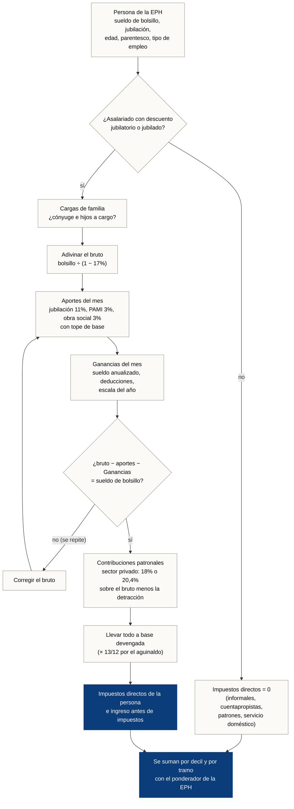

# El simulador de impuestos directos sobre la EPH

**En una frase:** para cada persona de la encuesta que trabaja en blanco o está jubilada, se
reconstruye cuánto gana antes de descuentos y se le calculan, con la ley de ese mes, los aportes,
las contribuciones patronales y la Ganancias que le corresponden.

Es la pieza central del proyecto: de acá salen los impuestos directos de cada decil y los ingresos
antes de impuestos con los que se calculan todas las tasas. Código: `src/incidencia/directos.py`
(reglas) y `scripts/04_microsimulacion_eph.py` (lo corre sobre los 86 trimestres disponibles, 2003T3-2025T4). Parámetros:
`params/`. Contexto: [metodología](metodologia.md), sección 3; [fuentes](fuentes.md);
[diagramas](diagramas.md).

## 1. Qué problema resuelve

La EPH pregunta cuánto **cobra** cada persona: el sueldo "de bolsillo", ya descontados los aportes
y la Ganancias que retiene el empleador. No pregunta cuánto paga de impuestos. Para saberlo hay que
hacer la cuenta al revés:

1. Reconstruir el **sueldo bruto** a partir del de bolsillo.
2. Con el bruto, aplicar las **reglas legales** de cada mes: alícuotas de aportes, topes, escalas y
   deducciones de Ganancias, alícuotas de contribuciones patronales.

Como la ley cambió muchas veces entre 2004 y 2025, cada mes se calcula con sus propias reglas.

## 2. El paso a paso

**1. A quién alcanza.** Se simulan los impuestos de:

- **Asalariados registrados:** ocupados (`ESTADO = 1`) en relación de dependencia (`CAT_OCUP = 3`)
  a los que les descuentan jubilación (`PP07H = 1`), salvo el servicio doméstico (`PP04B1 = 1`), que
  tiene un régimen especial no modelado.
- **Jubilados y pensionados:** quienes cobran una jubilación (`V2_M > 0`), que paga Ganancias si
  supera el mínimo.

El resto (asalariados no registrados, cuentapropistas, patrones) tiene impuestos directos cero. No
es que no paguen nada: monotributistas y autónomos pagan, pero la EPH no dice quién está inscripto
y cómo (ver "Limitaciones").

**2. Cargas de familia.** Para Ganancias importa si la persona tiene cónyuge e hijos a cargo. Con
el parentesco de la EPH (`CH03`): el cónyuge cuenta si gana menos que la ganancia no imponible; los
hijos (`CH03 = 3`) cuentan si son menores de la edad límite del año y tampoco superan ese ingreso.
Las cargas se le asignan al jefe o al cónyuge, el que gane más. Es una aproximación: la EPH no
identifica hijos de otros miembros del hogar.

**3. Del sueldo de bolsillo al bruto.** El bruto es lo que hace falta para que, después de restar
aportes y Ganancias, quede el sueldo de bolsillo declarado. Pero los aportes y la Ganancias dependen
del bruto. Se resuelve probando:

- Primer intento: bolsillo ÷ (1 − 17%), los aportes sin Ganancias.
- Con ese bruto se calculan aportes y Ganancias, y se recalcula qué bruto daría ese bolsillo.
- Se promedia el intento anterior con el nuevo y se repite 60 veces. Converge siempre, porque los
  descuentos crecen más despacio que el sueldo.

Si la persona además cobra jubilación, la Ganancias se calcula sobre la suma y se reparte entre
sueldo y jubilación en proporción a cada uno.

**4. Aportes personales.** 11% de jubilación (7% en el sector privado hasta 12/2007, cuando la
mayoría aportaba a las AFJP), 3% para el PAMI (INSSJP) y 3% de obra social, con un tope: por encima
de cierto sueldo ya no se aporta más (`params/lmi.csv`). La obra social se usa para reconstruir el
bruto, pero **no se cuenta como impuesto**: no la recauda el Estado. Los aportes a las AFJP hasta
11/2008 sí se cuentan (hay una variante, `sin_afjp`, que los saca).

**5. Ganancias.** Es un impuesto anual, pero se retiene mes a mes. Para cada mes:

- El sueldo del mes se lleva a un año completo con la evolución de los salarios de ese año (RIPTE),
  contando 13 pagos por el aguinaldo.
- Se restan las deducciones del año: ganancia no imponible, deducción especial, cónyuge e hijos.
- Al resto se le aplica la escala del año (de 5% a 35%) y el resultado se vuelve a pasar a un mes.

Además se aplican las reglas especiales de cada época (tabla de la sección 4).

**6. Contribuciones patronales.** Las paga el empleador sobre el bruto, sólo en el sector privado
(en el público no se simulan). La alícuota depende del tamaño de la empresa: la mayor si el
establecimiento tiene más de 40 personas (aproximación: la norma usa la facturación, que la EPH no
trae). Desde 2018 se resta antes una detracción fija por trabajador. El proyecto supone que la mitad
la paga el trabajador (como un sueldo más bajo) y la mitad el consumidor (precios más altos); esa
mitad se trata como un impuesto al consumo (ver [metodología](metodologia.md), sección 3).

**7. Aguinaldo.** La EPH a veces pregunta en meses en que se cobró aguinaldo y otras no. Para no
mezclar, todo se lleva a **base devengada**: cada mes incluye 1/12 del aguinaldo, en el ingreso
(`src/incidencia/eph.py`) y en los impuestos (× 13/12).

**8. Resultado.** Por persona: bruto, aportes, Ganancias, contribuciones y el **ingreso antes de
impuestos directos** (bolsillo + aportes + obra social + Ganancias + la mitad de las contribuciones
que recae en el trabajador). Se promedian los tres meses del trimestre y se suman por decil y por
tramo con el ponderador de la EPH.

## 3. Ejemplos con el código real

Personas de ejemplo en el segundo trimestre de 2025, calculadas con las mismas funciones que usa
el proyecto. Montos en pesos por mes.

| | A. Asalariado privado, soltero | B. Asalariado privado, cónyuge sin ingresos y 2 hijos | C. Jubilado | D. Asalariado no registrado |
|---|---|---|---|---|
| Ingreso de bolsillo declarado en la EPH | 1.000.000 | 4.000.000 | 3.000.000 | 1.000.000 |
| — con 1/12 de aguinaldo (base de la cuenta) | 1.083.333 | 4.333.333 | 3.250.000 | 1.083.333 |
| Bruto reconstruido | 1.305.221 | 5.351.274 | — | — |
| Aporte jubilatorio (11%) | 143.574 | 385.674 (con tope) | — | 0 |
| PAMI (3%) | 39.157 | 105.184 | — | 0 |
| Obra social (3%, no es impuesto) | 39.157 | 105.184 | — | 0 |
| Ganancias | 0 | 421.899 | 114.225 | 0 |
| Contribuciones patronales | 233.574 | 961.864 | — | 0 |
| — la mitad que paga el trabajador | 116.787 | 480.932 | — | 0 |
| **Impuestos directos** | **299.518** | **1.393.689** | **114.225** | **0** |
| Ingreso antes de impuestos directos | 1.422.008 | 5.832.205 | 3.364.225 | 1.083.333 |
| **Impuestos directos ÷ ingreso** | **21,1%** | **23,9%** | **3,4%** | **0%** |

Cómo leerlo:

- **A** no llega al mínimo de Ganancias: paga sólo aportes y su mitad de las contribuciones.
- **B** gana cuatro veces más. Su aporte jubilatorio no crece en la misma proporción porque tiene
  tope; sí paga Ganancias, a pesar de las deducciones por su familia.
- **C**, jubilado, no paga aportes ni contribuciones; paga Ganancias porque su haber supera la
  deducción especial de jubilados.
- **D** cobra lo mismo que A pero en negro: el simulador no le asigna impuestos directos. Sí paga
  impuestos al consumo, que se calculan aparte para todos.

Todas las filas, salvo la primera, incluyen la doceava parte del aguinaldo. El ingreso antes de
impuestos es el bolsillo con aguinaldo más aportes, obra social, Ganancias y la mitad de las
contribuciones: para A, 1.083.333 + 143.574 + 39.157 + 39.157 + 0 + 116.787 = 1.422.008.

## 4. Reglas de cada período

Todas están en `params/`, con la norma y si se verificó contra el texto (detalle en
[trazabilidad](trazabilidad_datos.md), sección B).

| Período | Regla | Dónde |
|---|---|---|
| Todo el período | Escalas, ganancia no imponible, deducción especial y cargas de familia de cada año (PDF de la DNIAF) | `params/ganancias.yaml` |
| 2003-2008 | Reducción de deducciones según el ingreso ("tablita de Machinea") | `reduccion_deducciones` |
| hasta 12/2007 | Aporte jubilatorio de 7% en el sector privado (AFJP; se supone para todos los privados) | `seguridad_social.yaml` |
| hasta 11/2008 | Los aportes a las AFJP se cuentan como impuesto (variante `sin_afjp`) | `afjp_existen_hasta` |
| 09/2013-12/2015 | Dto. 1242/2013: exentos los que ganaban hasta $15.000 en ene-ago 2013; deducciones mayores en tramos intermedios | `dto_1242` |
| 2017-2025 | Jubilados: deducción de 6 haberes mínimos (2017-2020) y 8 (desde 2021) | `jubilados_veces_haber_minimo` |
| 2018 en adelante | Contribuciones con detracción por trabajador; alícuotas 20,4% / 18% desde 2019 (Ley 27.541) | `contribuciones_patronales` |
| 2021-09/2023 | Ley 27.617: exentos hasta cierto sueldo bruto, con un tramo de transición (interpolado) | `umbrales_ley_27617` |
| 10/2023-06/2024 | Régimen cedular: casi todos los asalariados dejan de pagar; desde 2024, tabla reescalada por el salario mínimo | `cedular` |
| 2025 | Tabla anual del período fiscal 2025; tope de aportes por movilidad, controlado contra resoluciones de la ANSES | `ganancias.yaml`, `lmi.csv` |

## 5. Qué tan bien reproduce lo recaudado

Se compara lo simulado, llevado de la encuesta a todo el país, con lo que efectivamente se cobró
(`outputs/tables/validacion_directos.csv`; [validación](validacion.md), sección 1):

| Impuesto | Simulado ÷ recaudado, 2009-2025 | Lectura |
|---|---|---|
| Aportes personales | 1,09 a 1,42 | Algo de más; una explicación posible es que la simulación supone que todos los registrados aportan sobre todo su sueldo declarado (no verificado). Hasta 2008 da 2,5 a 3,1 porque la recaudación no incluía lo que iba a las AFJP |
| Contribuciones patronales | 0,65 a 0,94 | De menos: sólo se simulan las de empleadores privados (no las del sector público) |
| Ganancias de personas | 0,13 a 0,40 | Muy de menos: la encuesta no capta a los de más ingresos ni las rentas, y sólo se simulan asalariados y jubilados |

Por eso la Ganancias que falta (entre 60% y 87% de lo recaudado) se agrega aparte, con las
declaraciones juradas de ARCA ([metodología](metodologia.md), sección 5). Lo simulado describe bien
a los asalariados de la mitad de arriba; la cima se completa después.

## 6. Limitaciones

- **Informales e independientes con impuestos directos cero en la medida principal.** El
  monotributo está como variante (sección 8); los aportes de autónomos del régimen general, no.
- **Asalariados que aportan por su cuenta.** Se declaran asalariados pero el empleador no les descuenta
  la jubilación y la pagan ellos (pregunta PP07I): típicamente, monotributistas que facturan a un
  solo empleador. Pasaron de 2,2% de los ocupados en 2016 a 4,4% en 2025, mientras los asalariados
  registrados bajaron de 51,6% a 47,4%. El simulador los trata como no registrados (cero), también
  en la variante con monotributo, que sólo cubre a cuentapropistas y patrones. Como esa variante se
  ajusta a lo recaudado, incluirlos no cambiaría el total: sólo lo repartiría entre más personas.
- **Empleo público:** se simulan aportes y Ganancias, pero no contribuciones patronales.
- **Tamaño de empresa por cantidad de empleados**, no por facturación como dice la norma.
- **Cargas de familia aproximadas** con el parentesco de la EPH.
- **Algunas alícuotas no verificadas** contra el texto de la norma (INSSJP, obra social,
  contribuciones 2003-2019 y 2025): figuran como `no_verificado` en `params/`.
- **Régimen cedular de 2024 y tramo de transición de la Ley 27.617 aproximados** (reescalado e
  interpolación), no transcritos de las tablas oficiales.

## 8. Monotributo (variante `con_monotributo`)

**En una frase:** a cada cuentapropista o patrón que paga monotributo se le cobra la cuota de su
categoría, según lo que factura, y el total se ajusta a lo que efectivamente se recaudó.

1. **Categoría.** La facturación anual se estima como ingreso mensual de la EPH × 12 (margen 1:
   se factura del orden de lo que se declara ganar; ver abajo). Con las tablas de cada período
   (`params/monotributo.yaml`: Ley 25.865 para 2004-2009 y las tablas de ARCA desde 2010) se busca
   la categoría. Industria y comercio usan la escala de venta de bienes; el resto, la de servicios
   (rama de actividad de la EPH, `vende_bienes` en `eph.py`). Quien supera la última categoría
   queda fuera del régimen.
2. **Cuota.** Impuesto integrado más aporte jubilatorio. La obra social no se cuenta, como en los
   asalariados.
3. **Quién paga.** Desde el cuarto trimestre de 2023 la EPH pregunta si la persona aportó como
   monotributista (PP05I): pagan los que dicen que sí. Antes se usa la proporción de cada decil en
   2023T4-2025T4, de 10% en el decil 1 a 58% en el decil 10.
4. **Nivel.** El impuesto integrado simulado se escala para que coincida con lo recaudado (DNIAF,
   régimen simplificado) por habitante; la jubilación, con el mismo factor. Lo pagado se suma al
   ingreso antes de impuestos (se supone que la ganancia que declara el independiente es neta de
   la cuota).

**El margen.** ARCA recauda el monotributo en dos líneas: el impuesto integrado y los recursos de
seguridad social (jubilación y obra social). El cociente entre las dos fue 0,59 en 2019 y 0,37 en
2024. La simulación lo reproduce con un margen de ~0,7 (2019) y ~1,4 (2024); con márgenes bajos
(facturación mucho mayor que el ingreso declarado) los independientes caerían en categorías altas y
el impuesto pesaría mucho más que la jubilación. Los monotributistas declaran facturaciones bajas.

**Calibración.** Lo simulado hubo que multiplicarlo por entre 0,8 (2004) y 2,9 (2013) para llegar a
lo recaudado, y en 2025 por 1,1. La jubilación que resulta es entre 11% y 65% de la línea
"autónomos" de la DNIAF, que incluye además la obra social y los aportes de autónomos del régimen
general: la variante es una cota baja.

**Resultado.** El monotributo es entre 0,1 y 1,0 puntos del ingreso de cada decil (2025: 0,15 en el
decil 1 y 0,42 en el 10, porque desde 2023T4 se sabe quién paga y pagan más arriba). Como también se
suma al ingreso, la tasa total sube menos: entre 0,1 y 0,7 puntos por decil y entre 0,15 y 0,5 en
promedio. No cambia la forma de la curva ni ninguna conclusión del informe.

## 9. Mapa del código

| Qué | Dónde |
|---|---|
| Lectura de la EPH, aguinaldo devengado, deciles y tramos, adultos equivalentes | `src/incidencia/eph.py` |
| Parámetros por mes (topes, contribuciones, RIPTE, haber mínimo, SMVM) | `Parametros` en `src/incidencia/directos.py` |
| Aportes del mes | `aportes_mes` |
| Ganancias del mes, con todas las reglas especiales | `ganancias_mes` |
| Cónyuge e hijos a cargo | `cargas_familia` |
| Bruto desde neto, contribuciones, base devengada | `simular` |
| Suma por decil y tramo | `resumir_por_decil` |
| Cuota del monotributo por categoría | `monotributo_mes` |
| Corrida de todos los trimestres; salida `data/processed/eph_trimestral_*.csv` | `scripts/04_microsimulacion_eph.py` |
| Personas de mayor ingreso para el empalme con las declaraciones juradas | `cola_alta` en el mismo script |
